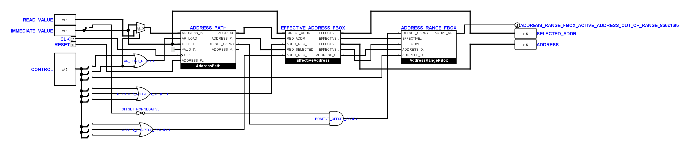

# AddressUnit: erneute Prüfung

**Nachtrag vom 4. November 2026:** Die unten dokumentierte Gültigkeitslücke
ist inzwischen korrigiert. Die AddressUnit ist auf Benutzerwunsch nach
Registerladen, Adressbildung und Zugriffsprüfung neu angeordnet. Aktuelle
Schaltung, Regressionen und Abnahme stehen in
[`tiny_cpu_address_validity.md`](tiny_cpu_address_validity.md).
Die folgenden Befunde beschreiben den historischen Stand vom 1. November.

Die Benutzerzeichnung vom 1. November 2026 bleibt erhalten. Alle 28 Bauteile
und Pins stehen unverändert; nur neun Steuerbit-Zuordnungen und die kurzen
Datenleitungen vor dem Adressregister-Multiplexer wurden korrigiert.
Der eingehende Stand liegt unter
`artifacts/address-review-20261101-201501/logisim/`.

## Fehler und Korrektur

Die Eingangsprüfung scheiterte bei `STORE_ADDRESS(20)`: Die CPU gab als
Speicheradresse `0` statt `20` aus. Die lokalen Abgriffe am 45-Bit-Steuerbus
wählten falsche Bits. Ihre richtige Belegung ist, von oben nach unten:

| Bit, ab null gezählt | Signal |
| --- | --- |
| 22 | `LD_REG_CONST` |
| 23 | `LD_REG_ADR` |
| 11 | `INVERT` |
| 9 | `ADDR_REG_ARGUMENT` |
| 25 | `STORE_ADR_REG` |
| 20 | `LOAD_ADR_REG` |
| 10 | `ADDR_REG_OFFS_ARGUMENT` |
| 26 | `STORE_REG_OFF` |
| 21 | `LOAD_REG_OFF` |

Außerdem waren die Datenleitungen des Multiplexers vertauscht. Eingang 0
erhält jetzt `IMMEDIATE_VALUE`, Eingang 1 `READ_VALUE`. `LD_REG_ADR` wählt
damit beim Laden aus dem Speicher den gelesenen Wert; beim Laden einer
Konstante wird der unmittelbare Operand übernommen.



Der gemeinsame Steuerbus und der lokale Vorzeichen-Abgriff bleiben erhalten.
Es wurden keine Bauteile, Konstanten oder Tunnel hinzugefügt. Die kurzen
Höhenwechsel unmittelbar am Multiplexer berücksichtigen dessen feste Pins.

## Nachweise

- Neun Adressregisterfälle bestanden: Konstante, Halten, Null und erneutes
  Laden, indirektes Lesen und Schreiben, positive und negative Offsets sowie
  Laden des Adressregisters aus dem Speicher.
- Fünf gezielte Fehleränderungen wurden wie erwartet erkannt: Reset dauerhaft
  aktiv, Laden gesperrt, Daten festgesetzt, Registerauswahl gesperrt und
  fälschlich gesetzter Übertrag bei negativem Offset.
- 63 elektrische Kernfälle, sieben Systemfälle und CPU-Trace bestanden.
- Alle 75 nativen Logisim-Anschlüsse stimmen in Position und Breite mit dem
  Offline-Modell überein. Kontaktprüfung und statische Verdrahtungsprüfung
  bestanden.
- Zwei neue positionsunabhängige Regressionen prüfen die drei Adressanforderungen
  und den Datenmultiplexer. Beide bestehen und erkennen den gesicherten
  fehlerhaften Eingang.
- Ein bitweiser Vergleich sämtlicher funktionaler Anschlüsse von `AddressUnit`
  ergibt dieselben Netze wie im zuletzt elektrisch geprüften Stand.
- Die übrigen 28 Kern-Teilkreise und alle anderen 23 `.circ`-Dateien sind
  gegenüber dem eingehenden Stand bytegleich, einschließlich der zuletzt
  vom Benutzer geänderten `AccumulatorUnit` und der geschützten Decoder.

Der Strukturprüfer unterstützt nun auch die neun lokalen Steuerbus-Abgriffe.
Er verlangt weiterhin die richtigen Bits, die vollständige Busbreite und die
physische Verbindung jedes Abgriffs zum Steuerbus.

## Verbleibende Prüfbefunde

### Offene Funktionslücke: Adressregister-Gültigkeit

**Nachtrag vom 1. November 2026; nachgewiesen, noch nicht korrigiert.**
`AddressPath` speichert neben dem Adresswert das Gültigkeitsbit `AR_VALID`
und gibt es als `ADDRESS_VALID` aus. In `AddressUnit` bleibt dieser Ausgang
offen; der Eingang `AddressPath.VALID_IN` ist fest mit `1` verbunden.
Die Gültigkeit des Registers schützt deshalb aktuell keine indirekten
Speicherzugriffe. Der Ausgang ist fachlich nicht überflüssig.

Das folgende Programm verwendet das beim Start noch ungültige Adressregister:

```text
LOAD_CONST(7)
STORE_ADDRESS_REGISTER()
HALT()
```

Der elektrische Vergleich mit dem Referenzmodell meldet an Flanke 2 vor
der aktiven Flanke (`pre`) den ersten Unterschied:

| Signal | Soll | Ist |
| --- | --- | --- |
| `MEM_WRITE` | 0 | 1 |

Das Referenzmodell verweigert den Zugriff und setzt `INV`, weil das
Adressregister ungültig ist. Die Schaltung aktiviert dagegen die
Schreibfreigabe. Der erste Unterschied belegt die fehlende Zugriffssperre;
er ist keine vollständige Messung aller nachfolgenden Fehlerflags oder
Speicherzustände. Programm, Trace und Fehlermeldung liegen unter
`artifacts/address-valid-review-20261101/`.

Das Sollverhalten folgt aus
[`TinyCPU._address`](../src/tiny_cpu_vm.py) und dem
[Gültigkeitsprinzip](tiny_cpu.md#guiding-principle-errors-are-not-modular-arithmetic):
Bei Register- und Register-plus-Offset-Adressierung muss `ADDRESS_VALID`
ausgewertet werden. Ein ungültiges Adressregister muss `INV` auslösen;
insbesondere dürfen dann weder RAM noch Peripherie beschrieben werden.
Direkte Adressierung darf nicht vom Gültigkeitszustand des unbenutzten
Adressregisters abhängen. Eine Bereichsverletzung (`ADDR`) und eine fehlende
Registergültigkeit (`INV`) sind getrennte Fehlerursachen.

Zur noch offenen Korrektur gehört außerdem die Bildung von `VALID_IN` beim
Laden des Adressregisters: Eine Konstante ist nur innerhalb des zulässigen
Adressbereichs gültig. Beim Laden aus dem Speicher müssen sowohl die
Gültigkeit des gelesenen Werts als auch dessen Adressbereich berücksichtigt
werden. Eine feste Eins bildet diese Bedingungen nicht ab. Dieser Ladepfad
wurde im obigen Gegenbeispiel nicht gesondert elektrisch geprüft.

Vor einer Abnahme sind Regressionen für ein uninitialisiertes Register,
indirektes Lesen, Schreiben und Rechnen jeweils mit und ohne Offset,
ungültige Speicherwerte beim Registerladen sowie Bereichsgrenzen nötig.
Gültige Adresse null und direkte Zugriffe bei ungültigem Register müssen
weiterhin funktionieren. Die Korrektur muss die Benutzerzeichnung und die
bestehenden Schnittstellen gemäß den Projektregeln erhalten.

Die zuvor bestandenen neun Adressregisterfälle, 63 Kernfälle und sieben
Systemfälle decken diesen Gegenfall nicht ab. Auch der Vergleich mit dem
bisherigen Netz bestätigt nur die Wiederherstellung dieses Netzes, nicht
die Vollständigkeit seiner Gültigkeitslogik. Eine vollständige funktionale
Freigabe von `AddressUnit` ist daher ausdrücklich offen.

### Bestehende Struktur- und Rasterbefunde

Die vollständige Python-Suite läuft mit 237 Tests und meldet sieben
Fehlschläge sowie einen Fehler. Drei Befunde betreffen das alte absolute
Leitungsraster in `FetchUnit`, `AccumulatorUnit` und der aktuellen
`AddressUnit`-Benutzerzeichnung. Der bekannte Decoder-Mutationstest erwartet
entfernte Konstanten.

Vier weitere Befunde vergleichen den alten Struktur-Fingerabdruck. Dein
Vorzeichen-Splitter entnimmt jetzt nur Bit 15; die frühere Darstellung hatte
zusätzlich einen unbenutzten Ausgang für Bits 0 bis 14. Dadurch ändert sich
der Bauteilgraph, obwohl alle funktionalen Anschlüsse bitgleich verbunden sind.
Wird ausschließlich dieser unbenutzte Ausgang in einer Analyse-Kopie wieder
ergänzt, stimmt der bisherige Fingerabdruck erneut. Die Produktionszeichnung
und der erwartete Fingerabdruck wurden dafür nicht verändert.

Die bestandenen elektrischen Prüfungen ersetzen keine vollständige visuelle
Abnahme aller Schaltungen. Der separat dokumentierte frühere MUL-Grenzfall
war nicht Gegenstand dieser Adresskorrektur.

Sicherung, native Vorher-/Nachher-Ansichten, Rohprotokolle und der ausführbare
Vergleich `proof.py` liegen unter `artifacts/address-review-20261101-201501/`.
