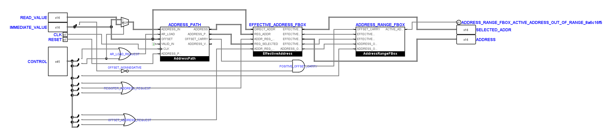
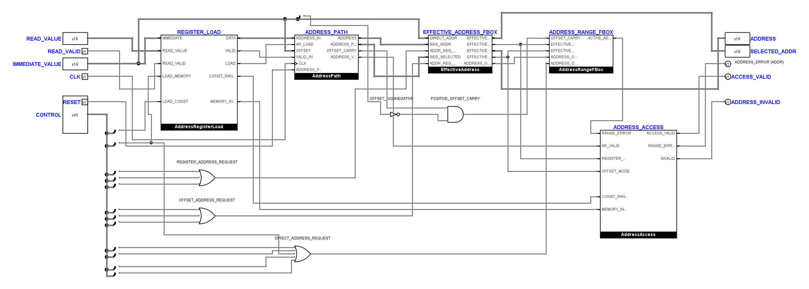
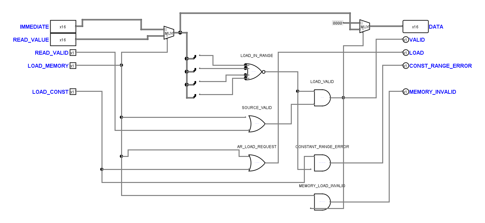
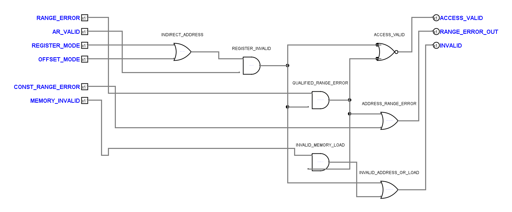

# Adressregister-Gültigkeit und lesbare AddressUnit

Arbeitspaket vom 4. November 2026, auf dem eingehenden Commit
`20c14a2` aufbauend. Die Sicherung und elektrischen Rohdaten liegen unter
`artifacts/address-validity-20261104/`. Die VM und die ISA wurden nicht geändert.

**Späterer Prüfstand vom selben Tag:** Die unten als offen festgehaltenen
STORE-/Decoder-Mutationsadapter sind inzwischen repariert und elektrisch
abgenommen. Die [Eingabeplanung](tiny_cpu_input_plan.md) dokumentiert diese
Nachprüfung; die vier übrigen Rasterbefunde bestehen weiterhin.

## Elektrischer Ausgangsbefund

Die neue fokussierte Regression enthält 38 Programme. Vor der Korrektur bestanden
15; bei 23 wurde der erste abweichende benannte Anschluss festgehalten.
`before/proof.json` enthält alle Unterschiede, die jeweiligen Unterverzeichnisse
Programmabbild, Solltrace, Messpunkte, Java-Befehl und unveränderte Rohdaten.

Mit gültigem RAM an Adresse null liest ein uninitialisiertes Adressregister
fälschlich `9 VALID`. Der indirekte Store aktiviert an Flanke 4 (`pre`)
`MEM_WRITE=1` statt 0. Laden aus ungültigem RAM setzt `AR_VALID` fälschlich auf 1;
die Werte `4096` und `0xffff` werden ungeprüft ins Register übernommen.
Eine negative effektive Adresse `0xffff` meldet außerdem
`EffectiveAddress.ADDRESS_OUT_OF_RANGE=0`: Der Vergleich mit `0x0fff` war
vorzeichenbehaftet. Die passive Messung steht in `probes-range.tsv` und den
zugehörigen Rohdaten.

Diese benannten Fehler gingen den jeweiligen Schaltungsänderungen voraus.
Weitere dabei gemessene Prioritätslücken waren `DIV0` bei ungültigem Operand
und fehlendes `INV` bei einem ungültigen `PRINT_ADDRESS`.

## Funktion und Darstellung

Die AddressUnit folgt jetzt einer Verarbeitungskette aus Registerladen,
Adressregister, effektiver Adressauswahl und Bereichsprüfung. Darunter stehen
die drei nach Aufgabe getrennten Steueranforderungen und die Zugriffsprüfung.
Eingänge beginnen links oben, Ausgänge rechts oben; die Blattpins sind in
Gruppen von höchstens vier Objekten mit zusätzlichem Zwischenraum angeordnet.
Die Zeichnung enthält sichtbare Leitungen und lokale Steuerbit-Abgriffe.





Der lange bestehende Fehlerpinname bleibt als Schnittstellenname erhalten;
auf dem Blatt steht dafür die kurze Beschriftung `ADDRESS_ERROR (ADDR)`.
Die letzten Layoutschritte wurden durch einen unveränderten funktionalen
Topologie-Fingerabdruck abgesichert. Die AddressUnit besteht nun auch das
gruppierte Leitungsraster und die Prüfung auf explizite Abzweige. Diese
Prüfungen ersetzen die zusätzlich ausgeführte native Sichtprüfung nicht.

Die zwei neuen Teilkreise haben getrennte Aufgaben:

- `AddressRegisterLoad` wählt unmittelbaren oder gelesenen Wert, prüft dessen
  Bereich `0..4095` und beim Speicherladen zusätzlich `READ_VALID`. Bei einem
  ungültigen Ladeversuch speichert `AddressPath` `0 INVALID`.
- `AddressAccess` wertet die Registergültigkeit ausschließlich bei indirekten
  Zugriffen aus. Ungültiges Register setzt `INV`; die Bereichsverletzung eines
  gültigen Registers setzt `ADDR`. Bei ungültigem Register wird ein aus dessen
  Zahlenwert abgeleiteter Bereichsfehler unterdrückt. Eine ungültige Konstante
  setzt `ADDR`, ein ungültiger gelesener Registerwert `INV`.





`MemoryUnit` qualifiziert Wert und Gültigkeit nach der internen/externen
Leseauswahl und sperrt sowohl die exportierte Schreibanforderung als auch die
endgültige RAM-Freigabe. Das schützt auch den Peripheriepfad und die Auswahl
des externen `RAM_WRITE_ENABLE`. Rohe RAM-Ausgänge bleiben beobachtbar.
`FaultUnit` führt die zusätzlichen Fehlerursachen zusammen; ungültige
Divisionsoperanden haben Vorrang vor `DIV0`, und ungültiges `PRINT_ADDRESS`
setzt `INV`. Der Bereichsvergleich in `EffectiveAddress` ist jetzt unsigned.

Die bestehende Kernschnittstelle, Opcode-Belegung und Flankenverträge bleiben
erhalten. Bereits vorhandene Symbolkontakte der Funktionsboxen behalten ihre
Position; ergänzt sind nur die benötigten internen Gültigkeitspfade.
`TinyCPUMain` enthält weiterhin genau acht Funktionsboxen.
Die geschützten Decoderzeichnungen bleiben bytegleich.

## Nachtrag: einheitlicher Symbolstil

`AddressRegisterLoad` und `AddressAccess` verwenden auf Benutzerwunsch jetzt
denselben Symbolstil wie die bisherigen Logisim-Funktionsboxen: schwarze
Namensleiste, weißer fetter Titel, Dialog-Schrift und nach Bitbreite gezeichnete
Anschlussmarkierungen. Lange Signalnamen werden wie bei den bisherigen Boxen
im Symbol abgekürzt; ihre vollständigen Pinnamen bleiben erhalten.

Nur die beiden Symbolzeichnungen wurden geändert. Anschlusspositionen,
Pinbindungen, Größen, Pingruppen, Bauteile und Leitungen bleiben unverändert.
Der Vergleich der funktionalen Topologie, die Struktur- und Systemvertragsprüfung
sowie drei elektrische Kontrollläufe (gültige Adresse null, ungültiger
Speicherladewert und gesperrter indirekter Store) bestehen. Sicherung und
Rohdaten liegen unter `artifacts/address-symbol-style-20261104/`; die aktuelle
Ansicht oben zeigt bereits den angeglichenen Stil.

## Abnahme

Die neue verpflichtende Regression wird so ausgeführt:

```text
python scripts/test-logisim-address-validity.py --output artifacts/address-validity-20261104/final-validity-export
```

Sie prüft indirektes Lesen, Schreiben und alle sieben binären Operationen
jeweils ohne und mit Offset bei uninitialisiertem Register, direkte Zugriffe
bei ungültigem Register, gültige Adresse null, ungültiges RAM beim Registerladen,
Wiederherstellung nach `CLEAR_ERROR`, `0`, `4095`, `4096`, `-1`, positive und
negative Offsetgrenzen sowie direkte Bereichsverletzungen einschließlich
`PRINT_ADDRESS`. Ungültige Maschinenoperanden werden ausdrücklich als rohe
Instruktionen erzeugt: Der Assembler darf sie weiterhin ablehnen. Die
Registergrenzen werden zusätzlich mit mathematisch festgelegten Erwartungen
geprüft, unabhängig vom VM-Ergebnis.

Drei getrennte Schaltungskopien umgehen Zugriffssperre, Ladegültigkeit oder
INV-Weitergabe. Jede muss am festgelegten ersten Unterschied scheitern.
Der Kerntrace beobachtet nun neben `MEM_WRITE` auch den öffentlichen
`EXTERNAL_WRITE_ENABLE`; beide müssen vor jeder Instruktionsflanke zum
erwarteten Schreibereignis passen.

## Nachweise und verbleibende Grenzen

| Prüfung | Ergebnis und Rohdaten unter `artifacts/address-validity-20261104/` |
| --- | --- |
| Zweifacher Minimalkern, Countdown, 63 Kernfixtures | Bestanden; `final-matrix.log`, `final/core-trace*`, `final/matrix/`. Jede Kernfixture vergleicht auch `EXTERNAL_WRITE_ENABLE`. |
| Sieben Systemfixtures | Bestanden; `final/matrix/system/` und zusätzlich `system-final/system/`. |
| Adressgültigkeit | 38 Programme bestanden, drei genau benannte Mutationen abgelehnt; `final/validity/proof.json`. |
| Bisherige Registerregression | Neun Programme bestanden, fünf Mutationen abgelehnt; `register-final/proof.json`. Bei künstlichem Offset-Carry ist nun bereits das ungültige Nullergebnis der erste Unterschied; ADDR und INV werden zusätzlich geprüft. |
| EffectiveAddress | Alle sechs Fälle bestanden, einschließlich unsigned-Bereichsfehler für `0xffff`; `effective.log`. |
| Negativkontrollen | Rechenwert trotz Normalhalt, unterdrücktes PRINT sowie zwei Immediate-Fehler abgelehnt; `core-mutation.log`, `print.log`, `immediate.log`. |
| Operator-Panel | Elektrischer STEP-Test bestanden; `operator-final.log`. Kein manueller GUI-Kurztest. |
| Statische Schaltungsprüfung und Systemverträge | Bestanden; `static-final.log`, `proof.json`. |
| AddressUnit und beide neuen Teilkreise | Gruppiertes Raster, explizite Abzweige, Topologievergleich und native Sichtprüfung bestanden; `proof.json` und die Bilder oben. |
| Vollständige Windows-Unit-Suite | 241 Tests, vier Rasterbefunde und ein Fehler im bestehenden Decoder-Mutationstest; `offline-accepted.txt`. |

Die vier verbleibenden Rasterbefunde betreffen `FetchUnit`, `AccumulatorUnit`,
`MemoryUnit` und `FaultUnit`. Ihre Prüfkategorien waren bereits am Eingang rot;
die geänderten Anschlussrouten in MemoryUnit/FaultUnit sind damit weiterhin
keine vollständige Rasterabnahme dieser Blätter. Die AddressUnit gehört nicht
mehr zu diesen offenen Rasterbefunden. Der frühere Topologie-Fingerabdruck
wurde nach unabhängig bestandener elektrischer Prüfung fortgeschrieben.

Der vorhandene Decoder-Mutationsadapter erwartet inzwischen entfernte
Konstanten beziehungsweise die alten Eingangsnummern 12 und 14 von
`ACC_LOAD_REQUEST`. Deshalb brechen auch `test-logisim-store.py` und der
Mutationsabschnitt von `test-logisim-decode.py` beim Aufbau ihrer Fehlerkopie
ab (`store.log`, `decode.log`). Die Zeichnung wurde dafür nicht zurückgebaut
und diese Prüfungen wurden weder übersprungen noch als bestanden markiert.
Die alte Suite meldete vor diesem Paket neun Fehlschläge und einen Fehler.
Das komplette Offline- und elektrische Sammelgate bleibt wegen dieser
ausdrücklich benannten Restbefunde offen.

Der erste Systemversuch scheiterte an einem nicht beschreibbaren Standard-
Temp-Verzeichnis. Ein weiterer Versuch meldete trotz zehn bestandener Vektoren
einen Prozess-Timeout; die Rohdaten wurden behalten. Der getrennte erneute
Lauf und der abschließende vollständige Lauf bestanden alle sieben Fixtures
mit unveränderten Timeout- und Vergleichsregeln.

Verwendet wurden Python 3.14.5, OpenJDK 27 (`27+35-2325`) und die gepinnte
Logisim-evolution-JAR 4.1.0 unter `.venv/Include/`. Java war explizit als
`C:/Program Files/jdk-27/bin/java.exe` gewählt. Für die lokale Sandbox lagen
`TEMP` und `TMP` in `artifacts/address-validity-20261104/tmp`; eine lokale
`LocalPreferencesFactory` hielt Java-Einstellungen ausschließlich im Speicher.
`JAVA_TOOL_OPTIONS` enthielt dazu
`-Djava.util.prefs.PreferencesFactory=LocalPreferencesFactory` und
`-Xbootclasspath/a:C:/Users/marku/myCloud/TinyCPU/artifacts/address-validity-20261104/prefs`.
Die einzelnen elektrischen Befehle und Exit-Diagnosen stehen zusätzlich in
den jeweiligen `command.json`-/Rohdateien.

Der abschließende kombinierte Kern-/Systemlauf lautete:

```text
python src/tiny_cpu_logisim.py --system tinycpu-peripherals-16-12-v1 --jar .venv/Include/logisim-evolution-4.1.0-all.jar --trace-output artifacts/address-validity-20261104/final/core-trace.tsv --matrix-output artifacts/address-validity-20261104/final/matrix
```

`proof.py` prüft lesend den finalen Schaltungsdigest, die bestehenden
Symbolkontakte und öffentlichen Kernpins, die 24 unveränderten Kernteilkreise,
den geschützten Decoder, Raster, Abzweige und elektrischen Abnahmeprotokolle.
Die letzten rein geometrischen Anpassungen behalten denselben funktionalen
Topologie-Fingerabdruck wie die elektrisch geprüfte Schaltung.

Dieses Paket ist keine Releaseabnahme aus frischem Checkout und schließt
weder die gültige externe Eingabe aus AP 22.1 noch arithmetische Grenzen aus
AP 22.2 ab. Als nächster Funktionsschritt bleibt die Eingabeschnittstelle
abzugrenzen; die veralteten Mutationsadapter und übrigen Layoutbefunde sind
zuvor beziehungsweise getrennt als offene Prüfaufgaben zu bearbeiten.
