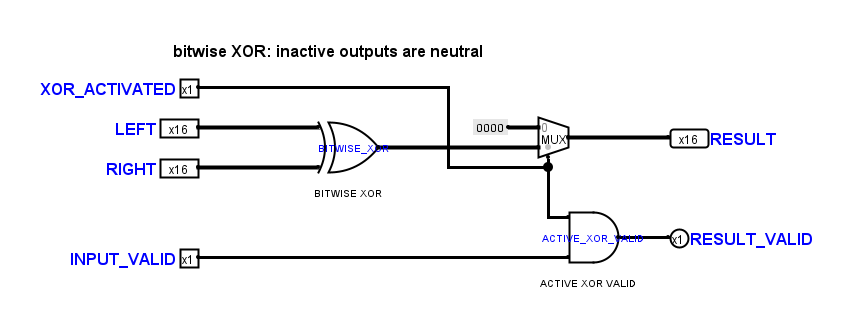
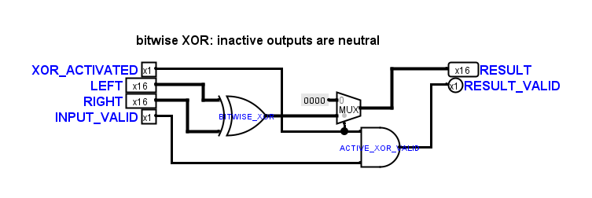
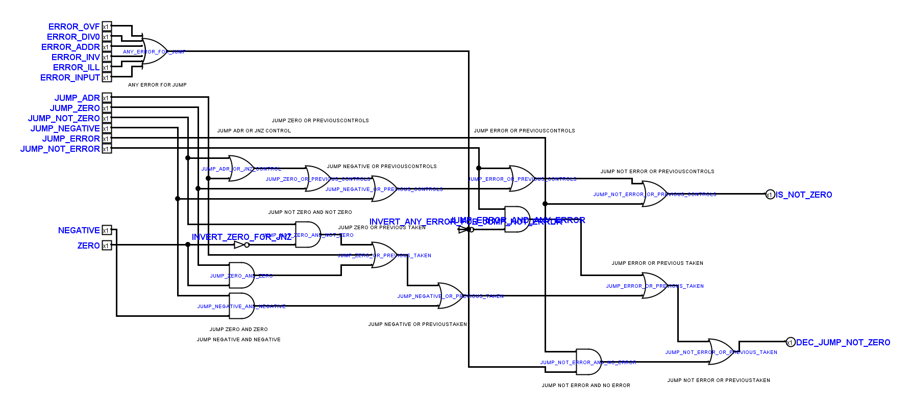
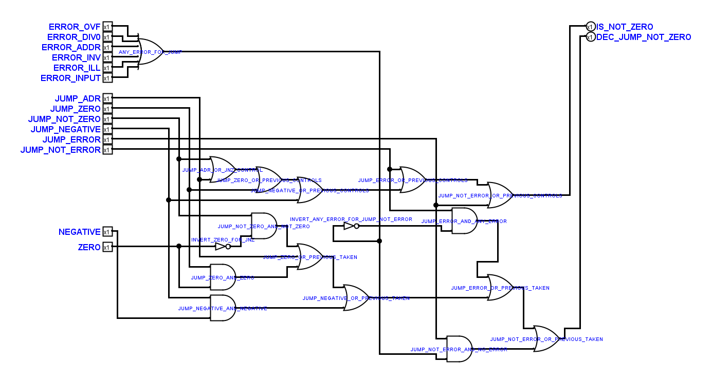
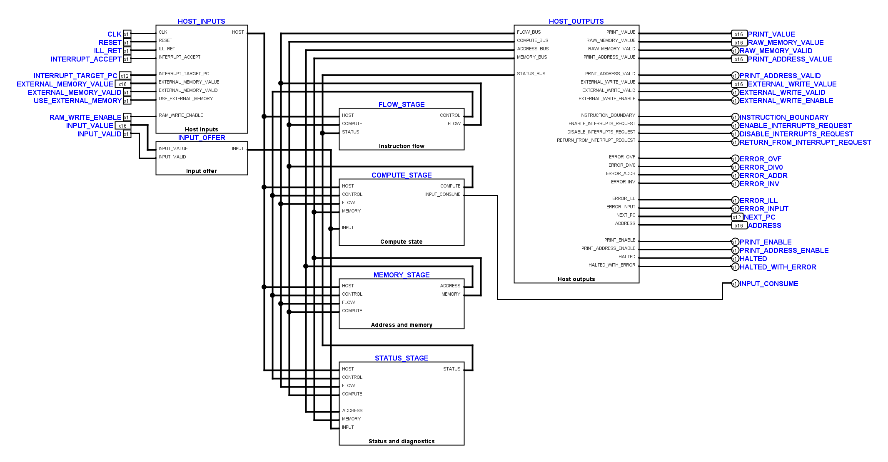
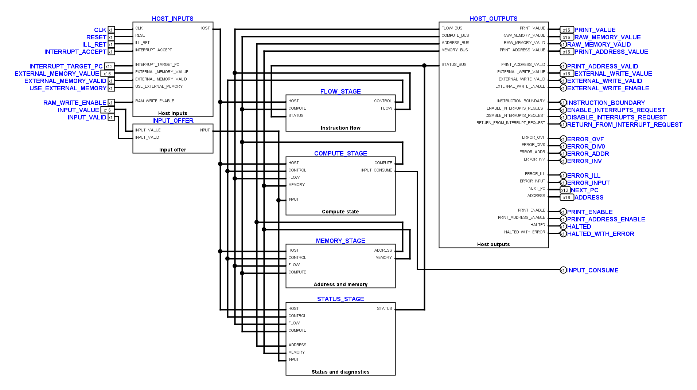

# Fortsetzung nach der handbereinigten OR-Schaltung

Die vom Benutzer bis einschließlich `OrArithmeticCircuit` bereinigten
19 Kernblätter bilden die Referenz dieses Durchgangs. Ihre zuletzt
gespeicherten Fassungen bleiben bytegleich erhalten. Auch die während der
Bearbeitung hinzugekommenen Textkorrekturen in MUL/DIV und die neue Anordnung
von `CPUAccumulatorInputUnitLink` wurden übernommen.

Alle 34 nachfolgenden Kernblätter wurden geprüft. 15 davon wurden lokal
bereinigt beziehungsweise im gemeinsamen Stand weitergeführt; die übrigen
19 Blätter besitzen bereits kompakte Anschlusskorridore oder wurden nach
Vergleich unverändert belassen. Andere Projekte und Diagnosekopien wurden
in diesem Durchgang nicht umgezeichnet.

## Änderungen

- `XorArithmeticCircuit` übernimmt die kompakte Pin- und Gatteranordnung der
  handbereinigten OR-Schaltung. Die zusätzliche native Tiefe des XOR-Symbols
  ist berücksichtigt; Leitungen enden an den tatsächlichen Anschlüssen.
- `JumpBox` hat gruppierte Ausgänge rechts oben, kürzere Zwischenräume und
  entzerrte Beschriftungen. Der Fehler-Inverter wird von links angefahren.
  Zwei zusätzliche Kreuzungen halten diese lokale Zuführung und die
  Gatterkorridore frei; die gesamte Zeichnung benötigt dennoch weniger Leitung.
- `AddressUnit`, `MemoryUnit`, `FaultUnit`, `FaultInputUnit`,
  `AddressRegisterLoad` und `AddressAccess` wurden verdichtet. Redundante
  Textkopien bereits sichtbarer Gatterbeschriftungen entfallen. Die nativen
  Gatterbeschriftungen bleiben lesbar und sind auf 10 Punkt vereinheitlicht.
- In `ExecutionUnit`, `BranchUnit`, `CPUAddressUnitLink`,
  `CPUCoreDiagnosticsLink` und `CPUComputeStage` wurden lokale Leitungswege
  beziehungsweise Abstände bereinigt.
- `TinyCPUInputMain` folgt der bereinigten Hauptübersicht: acht gerade
  Busstämme links, 20-Pixel-Abstände und eine größere Lücke nach vier Spuren.
  Rückführungen laufen vom Ausgang rechts nach oben und anschließend links
  zum zugehörigen Bus. Die Signalbelegung bleibt unverändert.
- Die neue Benutzeranordnung von `CPUAccumulatorInputUnitLink` bleibt erhalten.
  Nur der INPUT_VALID-Abgriff wurde um eine Rasterzeile versetzt, damit neben
  INPUT_VALUE und RESET jeweils eine Zeile frei bleibt.

## Native Vorher-/Nachher-Ansichten

XOR vorher:

XOR nachher:

Sprunglogik vorher:

Sprunglogik nachher:

INPUT-Übersicht vorher:

INPUT-Übersicht nachher:

## Prüfung

Der gemeinsame Endstand benötigt über die 34 geprüften Blätter 193.850 statt
205.410 Leitungspixel, rund 5,6 Prozent weniger. Die Zahl der Kreuzungen sinkt
von 603 auf 591. In der INPUT-Übersicht allein sinkt sie von 98 auf 87.
Der native Abstands-Audit findet keine unbeteiligten Leitungen innerhalb der
20-Pixel-Freiräume an Funktionsboxen. Feste enge Bauteilanschlüsse werden
weiterhin nur lokal aufgefächert.

Alle 80 nativen Anschlussnetzvergleiche bestätigen dieselben elektrischen
Netze, Bitbreiten, relativen Symbolanschlüsse und Bauteilparameter. Der
Vergleich verwendet stabile Bauteilkennungen und ist auch gegenüber einer
umsortierten XML-Reihenfolge nach einem Logisim-Speichern unabhängig.
Beide geschützten Decoderzeichnungen sind unverändert.

Zusätzlich bestehen 274 Unit-Tests, 2.240 native Vorher-/Nachher-Schritte
über 34 Kernblätter und die XOR-Diagnose sowie die INPUT-Prüfung mit zehn
VM-Vergleichen, Reset-Wahrheitstabelle und drei abgewiesenen Negativkontrollen.
Die vollständige CPU-Befehlsmatrix mit 63 Fällen sowie die Offline- und
statischen Leitungsprüfungen bestehen ebenfalls.
Die genauen Geometriereferenzen sind nach Netzvergleich und Sichtkontrolle
nachgeführt; elektrische Prüfungen und echte Leitungslücken bleiben verbindlich.

Sicherung und Nachweise liegen unter
`artifacts/author-style-followup-20261108/`, insbesondere `scope.json`,
`preserved-author-drawings.json`, `native-proof.json`, `metrics.json`,
`reference-updates.json`, `unit.txt`, `native.txt`, `core.txt`, `input.txt`
und `check-root/`. Der gesicherte Prüfstand enthält die zusammengeführten
Benutzeränderungen und keine ältere Autosave-Datei.
