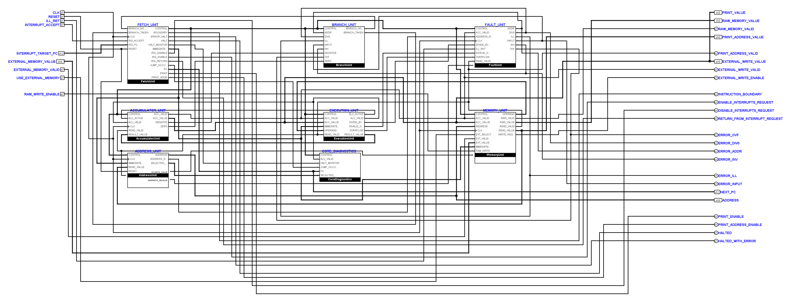
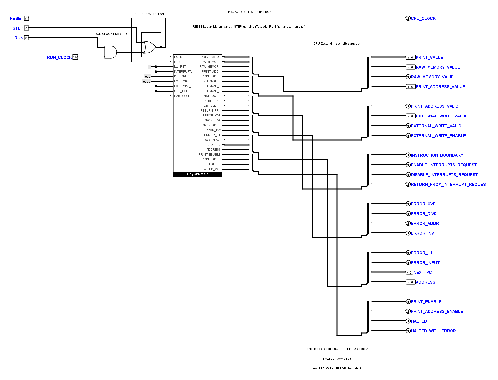
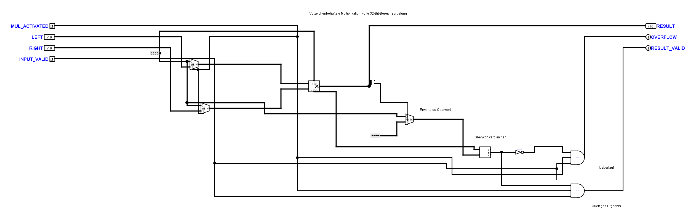
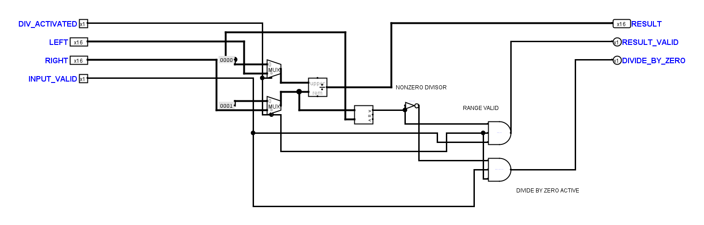

# Projektweite Schaltungskorrektur und Zeichenüberarbeitung

**Nachtrag vom 7. November:** Der Benutzer hat das Ergebnis der zeichnerischen
Überarbeitung zurückgewiesen. Die damalige Feststellung einer abgeschlossenen
zeichnerischen Abnahme ist damit überholt. Die
[Wiederherstellung der früheren Layouts](tiny_cpu_layout_restoration_20261107.md)
erhält die hier beschriebenen elektrischen Korrekturen.

Stand: 6. November 2026. Auftrag: elektrische Fehler korrigieren und zusätzlich
sämtliche Schaltbilder nach dem [Benutzerstil](tiny_cpu_schematic_style.md)
überarbeiten. Die elektrische und zeichnerische Abnahme ist abgeschlossen.

## Umfang und Zeichnung

24 `.circ`-Dateien enthalten 58 Teilkreisdefinitionen. 56 Definitionen sind
überarbeitet: Kernübersicht, acht Funktionsboxen, deren Blattbausteine,
Peripherie, Operator, Diagnose- und Smoke-Blätter. Die beiden handgezeichneten
`FetchDecodeControls` sind gegenüber dem gesicherten Eingang bytegleich.
Die eingehende lokale AddressUnit-Änderung war Teil der Arbeitsgrundlage.

Eingänge beginnen links oben, Ausgänge rechts oben. Höchstens vier Pins bilden
eine Gruppe, danach folgt ein zusätzlicher freier Pinplatz. Leitungen bleiben
sichtbar und rechtwinklig; lange Spuren stehen in Vierergruppen mit 20/40 Pixel
Abstand. Die Kernübersicht verwendet dafür einen um 70 Pixel versetzten
x-Ursprung, um die festen Symbolanschlüsse freizuhalten. Die geschützten Decoder
sind von der Rasterprüfung ausgenommen. Die Übersicht behält ihre dokumentierte
Ausnahme von einer durchgehenden Leserichtung.

Mehrbitanzeigen verwenden Hexadezimaldarstellung. Gatterbeschreibungen stehen
als lesbare Texte neben der Logik und nicht über Leitungen. Symbolbindungen
wurden mit den verschobenen Blattpins nachgeführt. Öffentliche Pinnamen,
Richtungen und Breiten sind unverändert; die acht Aufgabenboxen bleiben die
alleinige Logikstruktur der Hauptübersicht. Es gibt weiterhin keine Tunnel.

Das Operator-Panel fasst seine 24 Beobachtungen in sechs physische Busse
zusammen. Jedes Signal belegt zusammenhängende Bits, in der folgenden Reihenfolge
jeweils vom niederwertigsten Bit an:

| Bus | Breite | Signale in Bitreihenfolge |
| --- | ---: | --- |
| 1 | 49 | PRINT_VALUE[16], RAW_MEMORY_VALUE[16], RAW_MEMORY_VALID, PRINT_ADDRESS_VALUE[16] |
| 2 | 19 | PRINT_ADDRESS_VALID, EXTERNAL_WRITE_VALUE[16], EXTERNAL_WRITE_VALID, EXTERNAL_WRITE_ENABLE |
| 3 | 4 | INSTRUCTION_BOUNDARY, ENABLE_INTERRUPTS_REQUEST, DISABLE_INTERRUPTS_REQUEST, RETURN_FROM_INTERRUPT_REQUEST |
| 4 | 4 | ERROR_OVF, ERROR_DIV0, ERROR_ADDR, ERROR_INV |
| 5 | 30 | ERROR_ILL, ERROR_INPUT, NEXT_PC[12], ADDRESS[16] |
| 6 | 4 | PRINT_ENABLE, PRINT_ADDRESS_ENABLE, HALTED, HALTED_WITH_ERROR |

Die Konstantenzahl sinkt gegenüber dem tatsächlichen Eingang dieses Pakets
von 63 auf 59. Im Operator werden fünf skalare Ruhepegel aus einer expliziten
Nullquelle versorgt; mit den beiden breiten Nullwerten bleiben drei Quellen.
MUL benötigt zusätzlich ein 16-Bit-FFFF für die Vorzeichenerweiterung; DIV
verwendet die vorhandene Null auch für den Nullteilertest. Andere lokale
Konstanten bleiben erhalten, wo das Zusammenlegen lange Rückführungen erzeugte.

## Nachgewiesene elektrische Fehler und Korrekturen

| Bereich | Nachgewiesener Fehler | Korrektur |
| --- | --- | --- |
| FaultUnit | ERROR_INPUT war vor Flanke 1 undefiniert; eine 10-Pixel-Lücke trennte den INPUT-Ausgang von seiner Leitung. | Ausgang angeschlossen; passive INPUT-Baseline erneut geprüft. |
| Diagnose-FetchDecode | INTERRUPT_TARGET_PC berührte einen PC-Splitterkontakt und trieb damit das PC-Netz mit; native Simulation lieferte E. | Sichtbare Umführung trennt Interruptziel und laufenden PC. |
| Operator | Sieben Konstanten ohne Wertattribut verwendeten Logisims Standardwert 1; bereits Flanke 1 pre meldete MEM_WRITE=1 statt 0. | Alle unbenutzten Eingänge explizit auf 0, gleiche skalare Ruhepegel zusammengelegt; echter CPU-Lauf durch STEP ergänzt. |
| MUL, beide Fassungen | 16384 × 2 ergab 0x8000 VALID, OVF=0. Die bloße Vorzeichenprüfung erkannte weitere Bereichsüberschreitungen nicht. | Vorzeichenbehaftetes vollständiges Produkt; oberes Wort muss der Vorzeichenerweiterung des unteren entsprechen. Sonst OVF und im Operationspfad 0 INVALID. |
| DIV, beide Fassungen | 7 ÷ −2 scheiterte am vorzeichenbehafteten Vergleich mit einer impliziten 1. Die Diagnosefassung verwendete zusätzlich den falschen Vergleichsausgang und meldete im deaktivierten Zustand gültige Ergebnisse. | Tatsächliche Nullprüfung; Freigabe und Eingangsgültigkeit qualifizieren Ergebnis und Nullteilerfehler. Dieselbe korrigierte Blattlogik in Kern und Diagnose. |

Auf ausdrückliche Benutzerentscheidung bleibt der bestehende v1-Sonderfall
`−32768 ÷ −1 = −32768 VALID`, ohne OVF. DIV schneidet gegen null ab und behält
die unteren 16 Ergebnisbits. VM, Opcodes und Maschinenformat wurden nicht
geändert. Die übrigen Reparaturen stellen das bestehende Referenzverhalten her.

## Nachweise und Reproduktion

Die Einzelprüfungen trennen Layout, elektrische Funktion und Darstellung:

- Positionsunabhängige native Kontakt-/Bitnetzvergleiche sichern die
  Umzeichnungen. Vor der anschließenden gezielten MUL-/DIV-Logikkorrektur
  bestanden außerdem 64 elektrische Vorher-/Nachher-Stimuli je Definition:
  58 Definitionen, insgesamt 3712 Vergleiche. Das ist ausdrücklich kein
  Nachweis unveränderten Verhaltens für die danach korrigierte Arithmetik.
- Die neue Arithmetikprüfung legt Erwartungen mathematisch fest, prüft zunächst
  die VM und vergleicht dann vollständige elektrische Kerntraces. 83 Fälle
  umfassen ADD/SUB-Grenzen, MUL und DIV in allen vier Operandenarten,
  ungültige Operanden, Nullteiler, Vorzeichen und CLEAR_ERROR. Je 36 weitere
  Vektoren prüfen beide MUL- und beide DIV-Blattfassungen direkt.
- Fehlerkopien umgehen die MUL-Bereichsprüfung beziehungsweise stellen den
  fehlerhaften signierten DIV-Nulltest wieder her. Sie müssen am ersten
  abweichenden ACC-Wert scheitern. Die historische MUL-Schaltung wird ebenfalls
  abgelehnt. Ein absichtlich falscher Vektor prüft den nativen Testadapter.
- Der Operator-Test vergleicht LOAD/PRINT/HALT und die vollständige Zählschleife
  durch tatsächliche STEP-Flanken gegen die VM. Eine Fehlerkopie mit aktiven
  Ruhepegeln muss bereits an Flanke 1 pre an MEM_WRITE scheitern.
- Die bestehenden Kern-, ISA-, Speicher-, Decoder-, Adress-, Peripherie- und
  Mutationsprüfungen bleiben erhalten. Statische Prüfungen folgen realen
  Anschlüssen statt alten absoluten Zeichenkoordinaten. Die vollständigen
  Peripherie-Topologien ersetzen frühere unvollständige Leitungslisten.

Die native Darstellung aller 58 Definitionen wurde mit Logisims eigenem
Zeichenpfad exportiert und auf acht Übersichtsseiten sowie in Detailansichten
kontrolliert. Das ist eine Sichtprüfung der echten Schaltung, kein interaktiv
bedienter GUI-Probelauf. Der bisher offene manuelle Bedienversuch bleibt separat.

Reproduzierbare Pflichtprüfung (Java und gepinntes Logisim-JAR erforderlich):

```bash
PYTHONPATH=src python -m unittest discover -s tests
PYTHONPATH=src python src/tiny_cpu_verify.py
bash scripts/test-logisim.sh
```

Für einen erneuten nativen Bildexport:

```bash
java -Djava.awt.headless=true -cp "$LOGISIM_JAR" scripts/LogisimCircuitLayout.java artifacts/layout-review hardware/logisim/TinyCPU.circ hardware/logisim/TinyCPU_Operator.circ hardware/logisim/TinyCPU_Peripherals.circ
```

Die vollständigen lokalen Rohdaten stehen unter
`artifacts/circuit-repair-20261106/`: Eingangssicherung `before/`,
`layout-proof.jsonl`, `equivalence-final.txt`, `source-final-proof.json`,
`native-accepted/`, `native-visual-final/`, `native-sanity-final.txt`,
`equivalence-visual-final.txt`, `final-visual-proof.json`, `arithmetic-accepted/proof.json`,
`acceptance-final/results.json`, `unit-final-254.txt` und `verify-final.txt`.
Diese Artefakte sind lokal und werden nicht als Release ausgeliefert.

## Abnahmestand und nächster Schritt

Alle lokalen Abschlussprüfungen sind bestanden:

| Prüfung | Ergebnis |
| --- | --- |
| Unit-Suite | 254 Tests bestanden |
| Offline-Verifikation | 24 Dateien, 58 Definitionen; öffentliche Verträge und Tunnelverbot bestanden |
| Bestehende ISA-Kernmatrix | 63 vollständige VM-Vergleiche, Kernprogramm und Minimalfälle bestanden |
| Zusätzliche Arithmetik | 83 vollständige Kernfälle; 36 MUL- und 36 DIV-Vektoren je integrierter/diagnostischer Fassung bestanden |
| Fehlerkopien | Rechenwert-, Decoder-, STORE-, Adress-, MUL-, DIV- und Operator-Mutationen abgelehnt |
| Peripherie | 7 Systemfälle bestanden |
| Operator | Takt-/STEP-Prüfung, LOAD/PRINT/HALT und Zählschleife bestanden |
| Passive INPUT-Baseline | Vollständiger Kernvergleich und interne Lade-/Fehlerpfade bestanden |
| Native Zustandsprüfung | Alle 58 Definitionen, 3712 Stimuli ohne E/U oder Oszillation; kein Vergleich mit einer unabhängigen Referenz in diesem letzten Selbstvergleich |
| Zeichnung | Alle 56 ungeschützten Definitionen gesichtet; beide geschützten Decoder bytegleich |

Der letzte rein zeichnerische Nachtrag verschiebt Diagnoseanzeigen hinter den
Leitungsrücklauf und einen DIV-Text aus einer Leitung. Unveränderte
Kontaktgraphen und ein weiterer nativer Vorher-/Nachher-Vergleich sichern ihn.
CRLF-Zeilen des geschützten eingehenden Decoders bleiben dabei bytegleich;
die Diff-Whitespace-Prüfung berücksichtigt diese Windows-Zeilenenden.

Aktuelle, nativ aus Logisim exportierte Ansichten:









Die externe gültige Eingabe ist weiterhin ein eigenes, noch offenes
Funktionspaket. Nach der wiederhergestellten passiven Baseline folgt Schritt 2
des [Eingabeplans](tiny_cpu_input_plan.md); dieses Korrekturpaket führt keine
neuen Eingabevarianten oder öffentlichen Kernpins ein.
