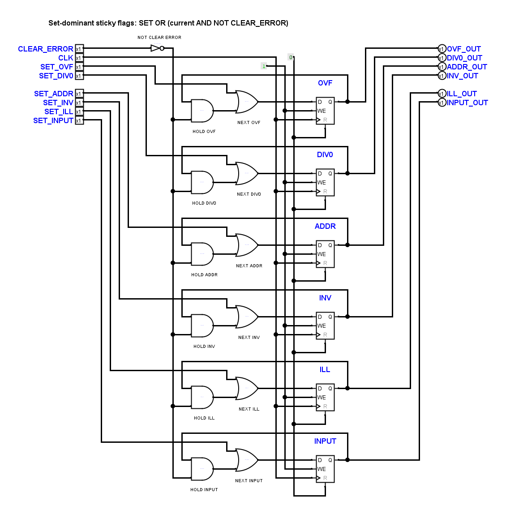
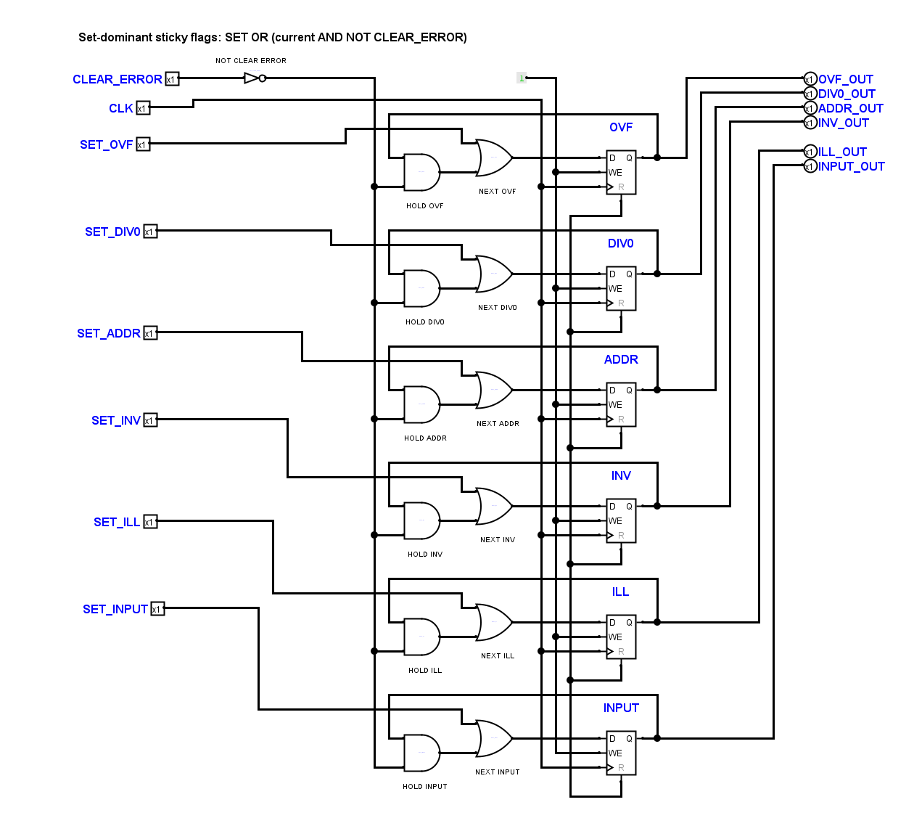

# ErrorFlags: Gatterabstand, Beschriftungen und Rückführungsrichtung

Die beiden Benutzerkorrekturen vom 8. November 2026 sind in `ErrorFlags`
innerhalb von `TinyCPU.circ` und in der eigenständigen Diagnosefassung
umgesetzt. Nur diese beiden Teilkreisblöcke wurden geändert; alle übrigen
Schaltungsblöcke einschließlich der geschützten Decoder bleiben bytegleich.

Alle sechs Q-Rückführungen jeder Fassung laufen gegen den Uhrzeigersinn:
vom Q-Ausgang nach rechts, nach oben, oberhalb der Zelle nach links und zum
oberen AND-Eingang zurück. Die Leitungen überzeichnen weder Registertitel
noch HOLD-/NEXT-Beschriftungen. SET-Signale haben einen getrennten Korridor
zum OR-Eingang. Die ursprüngliche elektrische Zuordnung der Gattereingänge
wurde nicht vertauscht.

Die linke gemeinsame Leitung steht 40 Pixel von der AND-Kante entfernt;
die senkrechte Q-Rückführung steht 20 Pixel davor. Auch an OR-Gliedern und
Registern bleiben für unbeteiligte Leitungen mindestens 20 Pixel frei.
Die Speicherzeilen stehen nun 160 Pixel auseinander, damit Rückführung,
Registeranschlüsse und Beschriftungen gleichzeitig Platz haben. Die
elektrischen Bauteile, Konstanten und öffentlichen Schnittstellen bleiben erhalten.

## Native Ansichten

Kernfassung:

Diagnosefassung:

## Nachweise

Der vorherige Abstandsaudit war auf Funktionsboxen beschränkt. Die neue
Gegenprüfung erfasst in diesen beiden Blättern ausdrücklich die nativen
Grenzen aller 36 AND-/OR-Glieder und Register sowie 40 sichtbare Beschriftungen.
Sie bestätigt mindestens 20 Pixel Abstand, keine überzeichneten Beschriftungen
und zwölf tatsächlich gegen den Uhrzeigersinn geführte Rückleitungen.
Gerade eigene Anschlussstücke bis zum Pin werden dabei gesondert behandelt.

Alle 80 nativen Anschlussnetz- und Symbolvergleiche stimmen überein.
Logisims gezielter Vorher-/Nachher-Vergleich beider `ErrorFlags`-Fassungen
besteht mit 128 vollständig definierten, gleichen Simulationsschritten.
Fünf gezielte bestehende Layout-, Topologie- und Integrationsprüfungen sowie
die vollständige Offline-Verifikation bestehen. Die exakten Geometrien in
der Layoutreferenz wurden erst nach der nativen Sicht- und Anschlusskontrolle
nachgeführt.

Ausgangssicherung, native Ansichten und Einzelprotokolle liegen unter
`artifacts/errorflags-clearance-20261108/`, insbesondere `native-proof.json`,
`clearance-and-caption-proof.json`, `routing-proof.json`, `equivalence.txt`,
`targeted-tests.txt`, `offline.txt` und `final-proof.json`.
