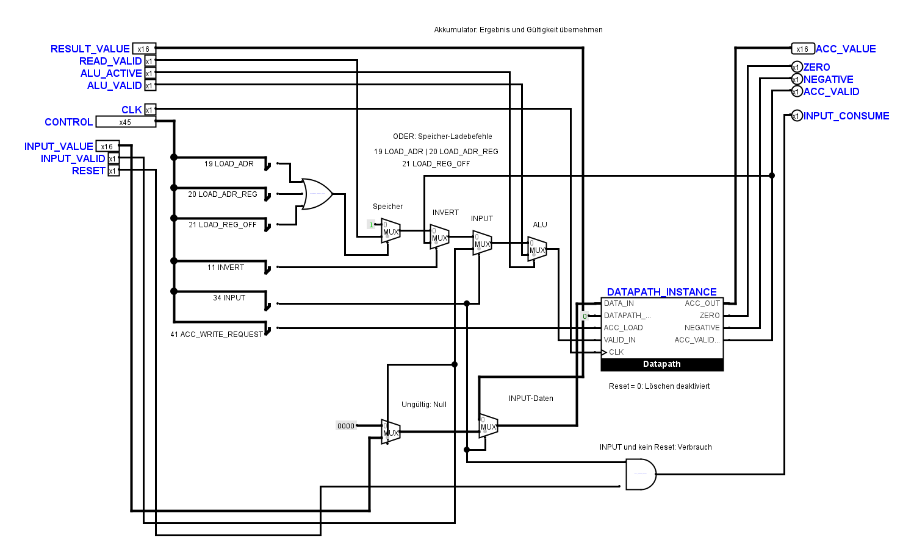
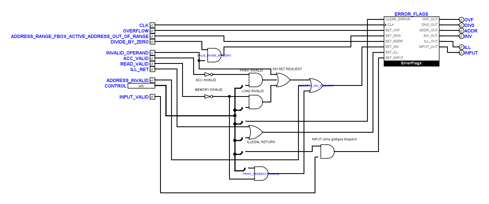

# AP 22.1: Zusätzliche INPUT-Grenze

**Stand: 7. November 2026.** Schritt 2 des
[Eingabeplans](tiny_cpu_input_plan.md) ist abgeschlossen. Ausgangscommit:
`b3c8500a4c7c870d57d947473e4ba5241bf78519`, anschließend die hier beschriebenen
Arbeitskopieänderungen. Die vollständige dynamische Eingabeabnahme bleibt ein
eigenes Folgepaket; die INPUT-Checkbox in AP 22.1 bleibt deshalb offen.

## Implementierte Grenze

`hardware/logisim/TinyCPU.circ` enthält zusätzlich:

- `TinyCPUInputMain`: dieselben acht Aufgaben und bisherigen öffentlichen Pins
  wie die Baseline, ergänzt um `INPUT_VALUE[16]`, `INPUT_VALID` und
  `INPUT_CONSUME`.
- `AccumulatorInputUnit`: verwendet den bestehenden `Datapath`. Bei INPUT
  wird der angebotene Wert mit seiner Gültigkeit ausgewählt. Ein ungültiges
  Angebot lädt unabhängig vom Datenmuster `0 INVALID`. Der Verbrauchsausgang
  ist `CONTROL.34 AND NOT RESET`; jede steigende Flanke mit diesem Pegel
  bedeutet einen Leseversuch, auch bei ungültigem Angebot.
- `FaultInputUnit`: verwendet die bestehenden `ErrorFlags`. Die INPUT-Ursache
  entsteht nur aus `CONTROL.34 AND NOT INPUT_VALID`. Die Sticky-Speicherung
  und alle anderen Fehlerwege bleiben erhalten.

Die sechs übrigen Funktionsboxen werden gemeinsam verwendet. Alle 58 bisherigen
Teilkreisdefinitionen, einschließlich beider geschützter Decoder, bleiben
bytegleich zum Ausgangscommit. Es gibt weiterhin 24 Schaltungsdateien, nun mit
61 Definitionen. In den Varianten entfällt eine skalare Nullquelle und kommt
eine benötigte 16-Bit-Nullquelle hinzu; insgesamt werden drei Konstanten aus der
Akkumulatorbox in die zusätzliche Variante übernommen. Es gibt keine Tunnel.

Die Blattpins und die vorhandenen Symbolanschlüsse bleiben erhalten. Die neuen
Eingabepins bilden eigene Gruppen. Am Akkumulatorsymbol liegen die drei neuen
Eingänge oben, damit die bestehende Adressbox darunter frei bleibt. Diese lokale
Symbolergänzung verändert keinen bisherigen Anschluss. Native Darstellungen
wurden geprüft; Kontaktprüfung und Bitbreitenvergleich finden an der neuen
Grenze keine offenen Leitungsenden, überlappenden Leitungen oder ungeteilten
T-Kontakte. Dies ist keine interaktive GUI-Bedienabnahme.





Die [native Übersicht](images/input-boundary-20261107/main.png) zeigt weiterhin
acht Funktionsboxen. Die exakten lokal ergänzten Geometrien sind ebenso wie die
übernommenen Zeichnungen im Layoutmanifest hinterlegt. Änderungen an ihnen
heben die jeweilige Rasterausnahme wieder auf.

## Prüfung und behobene Fehler

Die passive INPUT-Baseline bestand vor dem Umbau erneut. Der neue Treiber
`scripts/test-logisim-input-boundary.py` verbindet ausschließlich in
Artefaktkopien die beiden öffentlichen Eingänge mit festen Angeboten. Der
unveränderte Java-Kernexporter erhält keine VM-Sollzustände. Der Vergleich prüft
den gesamten bisherigen Kernzustand und RAM sowie den Verbrauch vor jeder
Instruktionsflanke. Alle exportierten Verbrauchswerte müssen definiert sein.
Das ist eine statische Grenzabnahme, kein dynamischer Stimulusadapter.

| Prüfung | Nachweisumfang |
| --- | --- |
| Gültige INPUT-Werte | 0, -1, -32768 und 32767; ACC und PRINT gültig, kein INPUT-Fehler |
| Ungültiges Angebot | Nach ACC=7: Datenmuster `0xffff` wird zu `0 INVALID`, INPUT-Flag gesetzt |
| PRINT und CLEAR_ERROR | Ungültige Ausgabe setzt INV; Löschen der Flags validiert den ACC nicht |
| Zwei aufeinanderfolgende INPUTs | Zwei Transaktionen bei durchgehend aktivem Verbrauchspegel |
| Speicherweg | Eingabe -1 speichern, anderen Wert laden, gespeicherten Wert samt Gültigkeit wieder lesen |
| Übersprungener INPUT | Kein Verbrauch, ACC=7 bleibt für PRINT erhalten |
| Bestehender Fehler und gültiger INPUT | INV bleibt nach erfolgreicher Eingabe sticky bis CLEAR_ERROR |
| Reset-/Verbrauchstabelle | Sieben Kombinationen; Reset sperrt Verbrauch auch bei aktiv bleibendem INPUT-Decode und beiden Taktpegeln |
| Elektrische Negativkontrollen | Falscher Datenwert, erzwungene Ladegültigkeit und unterdrückter Verbrauch werden an ihrer ersten abweichenden Beobachtung abgelehnt |

Der erste elektrische Versuch deckte einen Kurzschluss des neuen
Verbrauchsexports mit einem bestehenden Halt-Netz auf. Ausschließlich die neue
Route wurde getrennt; die bestandene Wiederholung und eine zusätzliche
Strukturkontrolle gegen gleich breite konkurrierende Treiber schützen diesen
Fehler. Anfängliche Fehlversuche bleiben im Artefaktverzeichnis erhalten.

Die Ausgangsarbeitskopie hatte außerdem drei Prüfprobleme nach dem letzten
GUI-Speichern. Acht Layoutreferenzen waren veraltet; ihr nativer
positionsunabhängiger Kontaktvergleich mit `b3313dd` bestätigt unveränderte
elektrische Netze. Nur diese Referenzen wurden nachgeführt. Der Analyseadapter
leitet die entfernte versteckte NOR-Beschriftung `ACCESS_VALID` jetzt aus der
tatsächlichen Verbindung zum gleichnamigen öffentlichen Ausgang ab. Schließlich
akzeptiert die Prüfung der Schreibfreigabe beide Vertauschungen der zwei
kommutativen UND-Eingänge, verlangt aber weiterhin beide richtigen Quellen.
Keine dieser Anpassungen schreibt eine Bestandszeichnung zurück.

## Reproduktion und Artefakte

Umgebung: Windows, Python 3.14.5, OpenJDK 27+35-2325 und die vorhandene gepinnte
Logisim-evolution-JAR 4.1.0. Ein Download war nicht nötig. PowerShell aus dem
Repositoryverzeichnis:

```powershell
New-Item -ItemType Directory -Force artifacts/ap22-input-boundary-20261107/tmp | Out-Null
$env:PYTHONPATH='src'
$env:JAVA='C:/Program Files/jdk-27/bin/java.exe'
$env:LOGISIM_JAR=(Resolve-Path .venv/Include/logisim-evolution-4.1.0-all.jar).Path
$env:TEMP=(Resolve-Path artifacts/ap22-input-boundary-20261107/tmp).Path
$env:TMP=$env:TEMP
$env:JAVA_TOOL_OPTIONS='-Djava.util.prefs.PreferencesFactory=LocalPreferencesFactory -Xbootclasspath/a:C:/Users/marku/myCloud/TinyCPU/artifacts/address-validity-20261104/prefs'
python src/tiny_cpu_verify.py
python scripts/check-logisim-circuit.py
python -m unittest discover -s tests -v
python scripts/test-logisim-input-boundary.py --output artifacts/ap22-input-boundary-20261107/acceptance/input-boundary
```

Die Preferences-Hilfsklassen stammen aus der bestehenden lokalen Abnahme und
umgehen ausschließlich das in dieser Umgebung nicht beschreibbare
Windows-Preferences-Verzeichnis. Normal installierte Simulatorumgebungen
benötigen diese lokale Hilfseinstellung nicht.

Nachweise unter `artifacts/ap22-input-boundary-20261107/`:

- `verify-final.txt`, `structure-final.txt`, `unit-final.txt`: Offline-Gates und
  264 bestandene Unit-Tests. Die elektrischen Gates werden zusätzlich ausgeführt.
- `acceptance/results.json` und die zugehörigen Logs: 16 elektrische Prüfpakete
  einschließlich der vollständigen 63-Fall-Kernmatrix, Peripherie, Operator,
  Baseline und neuer Eingabegrenze. Alle abschließenden Exitcodes sind 0.
- `acceptance/input-boundary/proof.json`: zehn vollständige statische
  Kern-/VM-Vergleiche, sieben Reset-Vektoren und drei abgelehnte elektrische
  Fehlerkopien. Programme, feste Angebote, Erwartungen, Befehle und unveränderte
  elektrische Rohdaten stehen neben jedem Fall.
- `incoming-layout-proof.json`, `previous-native/`, `final-native/`: native
  Kontaktvergleiche und Ansichten. `final-proof.json` bündelt Quellhashes,
  Bytegleichheit der Bestandsdefinitionen und abschließende Prüfergebnisse.

Je ein STORE- und Arithmetikprüflauf wurde wegen paralleler rein darstellerischer
Änderungen durch seine Bytegleichheitskontrolle abgebrochen. Nach dem Einfrieren
der Schaltungsdateien wurden beide Pakete vollständig bestanden wiederholt.
Die Abbrüche stehen in `acceptance/results-before-resume.json` beziehungsweise
`acceptance/arithmetic-first.txt`; die endgültigen Ergebnisse in
`acceptance/results.json`.
Ein Linux-Lauf und eine interaktive GUI-Abnahme wurden hier nicht durchgeführt.

## Nächster Schritt

Schritt 3 ergänzt flankenbezogene wechselnde Angebote, Host-Bereichsprüfung,
leere und ausdrücklich ungültige Quellen sowie ein eigenes Verbrauchsprotokoll.
Dabei folgen insbesondere fehlgeschlagenes und anschließend erfolgreiches INPUT,
wechselnde Werte bei Nicht-INPUT-Befehlen und der vollständige Reset-Ablauf.
Schritt 4 bindet diese dynamische Matrix verpflichtend in das elektrische Gate
ein und führt die bestehenden Kernfixtures auch über die neue Eingabegrenze
aus. Erst danach wird AP 22.1 vollständig geschlossen.
