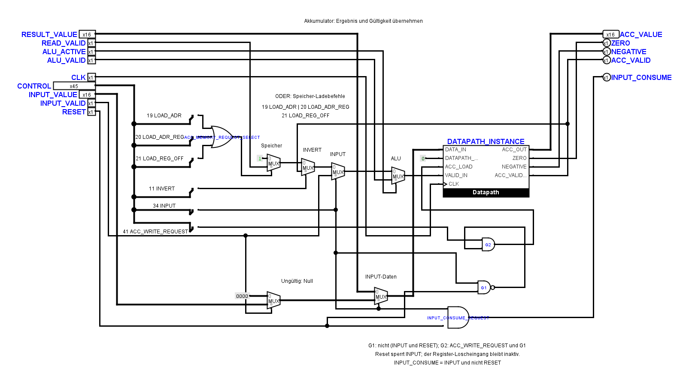
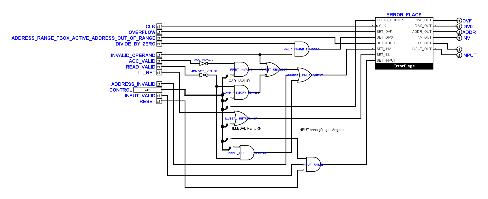

# INPUT-Resetkorrektur und Layout-Testreferenzen

Stand: 10. November 2026. Ausgangspunkt ist Commit
`02b058ce5bafaabe166e9ccbaa12bb830664d661` mit den zusätzlichen lokalen
INPUT-Treiberänderungen. Die eingegangenen Zeichnungen und Quellhashes wurden
unter `artifacts/input-reset-repair-20261110/before/` beziehungsweise
`incoming-hashes.json` gesichert.

**Abschluss:** Beide INPUT-Resetfehler und die sieben Layout-Testfehler sind
behoben. 294 Unit-Tests und alle 17 elektrischen Prüfpakete bestehen auf dem
endgültigen Schaltungsstand. Schritte 3 und 4 des Eingabeplans und damit
AP 22.1 sind abgeschlossen.

## Elektrisch belegte Ursachen und lokale Korrektur

Die passive Messung des zunächst gescheiterten Reset-Falls bestätigt:
`RESET=1` erreicht die Akkumulatorbox, `INPUT_CONSUME=0` sperrt korrekt,
aber `Datapath.ACC_LOAD=1`, `VALID_IN=1` und `DATA_IN=23` laden dennoch den
Akkumulator. Der Register-Löscheingang liegt vertragsgemäß auf 0. Eine
zusätzliche elektrische Kontrolle mit ungültigem Angebot belegt unabhängig
`ERROR_INPUT=1` während Reset. Beide Befunde sind vor der Reparatur erhalten:
`reset-passive.tsv` und `before-invalid/diagnostic.json`.

Nur drei Definitionen in `TinyCPU.circ` ändern sich:

| Blatt | Korrektur |
| --- | --- |
| `AccumulatorInputUnit` | Zwei lokale Gatter: `G1 = NOT (CONTROL.34 AND RESET)` und `G2 = CONTROL.41 AND G1`. Nur G2 treibt `Datapath.ACC_LOAD`. |
| `FaultInputUnit` | Zusätzlicher Reset-Eingang. `INPUT_FAILED = CONTROL.34 AND NOT INPUT_VALID AND NOT RESET`. |
| `CPUFaultInputUnitLink` | Greift RESET aus Bit 1 des bereits vorhandenen HOST-Busses ab und verbindet den neuen Blattanschluss. |

Takt, Datenwahl, Gültigkeitswahl und Register-Löscheingänge bleiben erhalten.
Die CPU behält ihre bisherige Resetsemantik: Der Befehlsablauf startet neu;
vorhandener Akkumulator, Adressregister, RAM und Sticky-Flags werden dadurch
nicht allgemein gelöscht. Die neue Sperre betrifft INPUT. Andere Befehle und
die öffentliche Baseline-Schnittstelle werden nicht geändert.

Es kommen keine Konstanten, Tunnel oder eigenen Symbolformen hinzu. Neue
Gatter tragen kurze sichtbare Kennungen mit eigener Erklärung unter der
Schaltung; Schriftgrößen bleiben mindestens 10 Punkt. Die zusätzlichen
Leitungen haben freie Korridore. Native Ansichten wurden kontrolliert; lange
Parallelführungen und ODER-Anschlussrichtungen bestehen die bisherigen Regeln.





50 andere Kerndefinitionen und alle 23 übrigen `.circ`-Dateien bleiben
bytegleich, einschließlich beider geschützter `FetchDecodeControls`.
Unveränderte Komponenten und Leitungen behalten ihre XML-Darstellung.
Der endgültige SHA-256 von `TinyCPU.circ` ist
`83b18615e2692a3dd3ada11c3042e166654d85d4baf5e91e734f93b8f8bdc2ce`.
`source-proof.json` hält Abgrenzung und Bytevergleiche fest.

## Sieben Layout-Testfehler

Die sieben Subtestfehler betreffen sechs inzwischen weiter von Hand bearbeitete
Zeichnungen: `TinyCPUMain`, `EffectiveAddress`, `AddressPath`, `FetchDecode`,
`Operations` und `MulArithmeticCircuit`. `TinyCPUMain` wurde in zwei Methoden
beanstandet. Die Meldungen entstanden, weil die exakten Layoutreferenzen noch
den zuvor abgenommenen Stand beschrieben.

Vor der Nachführung wurden die tatsächlichen nativen Logisim-Anschlüsse und
Netzpartitionen aller 53 Kernblätter mit dem zuvor abgenommenen Kandidaten aus
der Leitungskontrolle verglichen: gleiche Netze, gleiche Bitbreiten und gleiche
primitive Anschlussgeometrien. Die sechs aktuellen Zeichnungen wurden nativ
gesichtet und erhalten. Es war keine weitere Umzeichnung erforderlich.
`incoming-native-equivalence.json` bewahrt diesen Nachweis auf.

Nur die sechs betreffenden Referenzen und die drei lokal reparierten
INPUT-Blätter wurden nachgeführt. Die strengen Prüfungen für neue oder
veränderte Geometrien, tatsächliche Leitungslücken, Anschlüsse und Tunnel
bleiben aktiv. Die vorhandenen Regressionen gegen eine zusätzliche unerlaubte
Leitung bleiben unverändert. Es wurde keine Assertion entfernt oder ein
fehlgeschlagener Test übersprungen.

## Regression und verpflichtendes Gate

Die dynamische Matrix enthält nun 23 Fälle. Die drei ergänzten Fälle prüfen
ungültiges Angebot während Reset, Halten eines bereits gültigen Akkumulators
sowie Halten von Akkumulator, RAM und Sticky-Flag über wiederholte Reset-Flanken.
Die Quelle wird erst bei der ersten ausgeführten INPUT-Flanke verbraucht.
Strukturtests prüfen beide Sperren und den durchgängigen Reset-Anschluss.

`scripts/test-logisim-input.py --baseline-matrix` führt zusätzlich alle 63
bestehenden Kernfixtures über `TinyCPUInputMain` mit Datenmuster 0 und
Gültigkeit 0 aus. Die bisherigen Programme und absichtlich illegalen
ROM-Wörter bleiben erhalten; `rom-words.json` dokumentiert die tatsächlich
injizierten Wörter. Jeder Fall behält den vollständigen Vergleich von PC,
Registern, Flags, Ausgaben und RAM sowie das separate Verbrauchsprotokoll.

`scripts/test-logisim.sh` ruft diesen vollständigen Eingabetest jetzt
verpflichtend auf. Eine Abweichung, ein Prozessfehler oder Timeout lässt das
Gate scheitern. Die drei elektrischen Fehlerkopien für falsche Daten,
erzwungene Gültigkeit und unterdrückten Verbrauch bleiben verpflichtend.

## Ausführung und Nachweise

Umgebung: Windows, Python 3.14.5, OpenJDK 27+35-2325 und die vorhandene
Logisim-evolution-JAR 4.1.0. Kein Download war erforderlich. PowerShell:

```powershell
New-Item -ItemType Directory -Force artifacts/input-reset-repair-20261110/tmp | Out-Null
$env:PYTHONPATH='src'
$env:JAVA='C:/Program Files/jdk-27/bin/java.exe'
$env:LOGISIM_JAR=(Resolve-Path .venv/Include/logisim-evolution-4.1.0-all.jar).Path
$env:TEMP=(Resolve-Path artifacts/input-reset-repair-20261110/tmp).Path
$env:TMP=$env:TEMP
$env:JAVA_TOOL_OPTIONS='-Djava.util.prefs.PreferencesFactory=LocalPreferencesFactory -Xbootclasspath/a:C:/Users/marku/myCloud/TinyCPU/artifacts/address-validity-20261104/prefs'
python src/tiny_cpu_verify.py
python scripts/check-logisim-circuit.py
python -m unittest discover -s tests -v
python scripts/test-logisim-input.py --baseline-matrix --output artifacts/input-reset-repair-20261110/electrical/input
```

Die lokale Preferences-Hilfsklasse umgeht nur das hier nicht beschreibbare
Windows-Preferences-Verzeichnis. Normale Installationen benötigen sie nicht.
Ein MSYS-Bash-Start scheiterte in dieser Sandbox an einem Windows-IPC-Recht;
deshalb werden die Python-Aufrufe des Shell-Gates direkt und unverändert
ausgeführt. Exakte Befehle und Exitcodes stehen in `acceptance-results.json`.
Die lokale Orchestrierung ist unter `acceptance.py` im Artefaktordner erhalten.

Endgültige Ergebnisse unter `artifacts/input-reset-repair-20261110/`:

| Prüfung | Ergebnis |
| --- | --- |
| Offline-Verifikator und Schaltungsstruktur | Beide Exit 0; `verify-final.txt`, `structure-final.txt` |
| Windows-Unit-Suite | Alle 294 Tests bestanden; `unit-final.txt` |
| Dynamische INPUT-Abnahme | 23 Fälle, drei an der vorgesehenen ersten Beobachtung abgelehnte Fehlerkopien und 63 bestehende Kernfixtures mit inaktiver Eingabe bestanden; `electrical/input/proof.json` |
| Bestehende Kernabnahme | Beide Minimalkernläufe, Countdown und alle 63 Kernfixtures bestanden; `core-acceptance.txt` und `electrical/core/` |
| Arithmetische Grenzen | 83 vollständige Kern-/VM-Vergleiche, je 36 MUL- und DIV-Vektoren pro integrierter/Diagnosefassung sowie Negativkontrollen bestanden; `electrical/arithmetic-boundaries/proof.json` |
| Adressgültigkeit | 38 Fälle und drei abgelehnte Mutationen bestanden; `electrical/address-validity/proof.json` |
| System und Operator | Alle sieben Systemfälle, Taktarbitrierung und Operator-Kern-/VM-Vergleich einschließlich Negativkontrolle bestanden; `system-acceptance.txt`, `operator-acceptance.txt`, `operator-core-acceptance.txt` |
| Vorherige INPUT-Abnahme | Zehn statische Kern-/VM-Fälle, sieben Reset-Vektoren, drei Fehlerkopien und die passive Baseline bestanden; `electrical/input-boundary/proof.json`, `electrical/input-baseline/proof.json` |
| Gesamtumfang | Alle 17 Prüfpakete Exit 0, unveränderte Quellen während der Ausführung; `acceptance-results.json`, `final-proof.json` |

Die abschließende Korridorprüfung verwendet tatsächliche native Symbolkanten:
An beiden neuen Gattern, dem Verbrauchsgatter und dem Datapath bleiben die
geforderten 20 Pixel frei. Die dafür zuletzt verlegte Leitung ist durch einen
erneuten nativen Vergleich aller 53 Netzpartitionen und den vollständig
wiederholten elektrischen Lauf abgesichert. `corridor-proof.json` enthält
keine Befunde. `acceptance-before-corridors.json` bewahrt den zuvor ebenfalls
bestandenen funktionalen Lauf vor dieser letzten Layoutkorrektur auf.

Die Quelländerungen sind auf diesen Windows-Kandidaten bezogen. Eine neue
Release-Abnahme aus frischem Checkout, ein Linux-CI-Lauf und eine interaktive
GUI-Bedienabnahme werden daraus nicht abgeleitet; diese bleiben eigene
Abnahmeaufgaben. Die nativen Bilder und Kontaktvergleiche ersetzen keine
interaktive Bedienprüfung.
