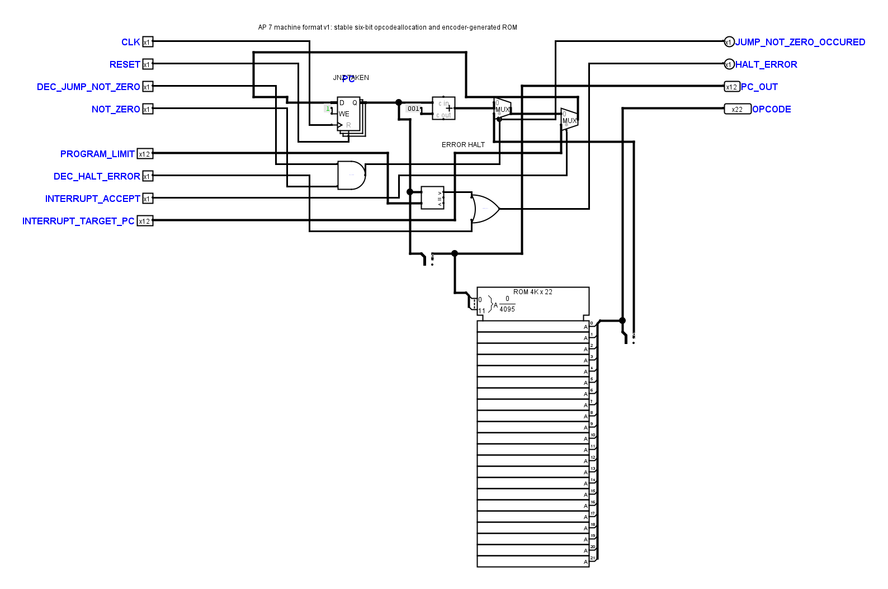
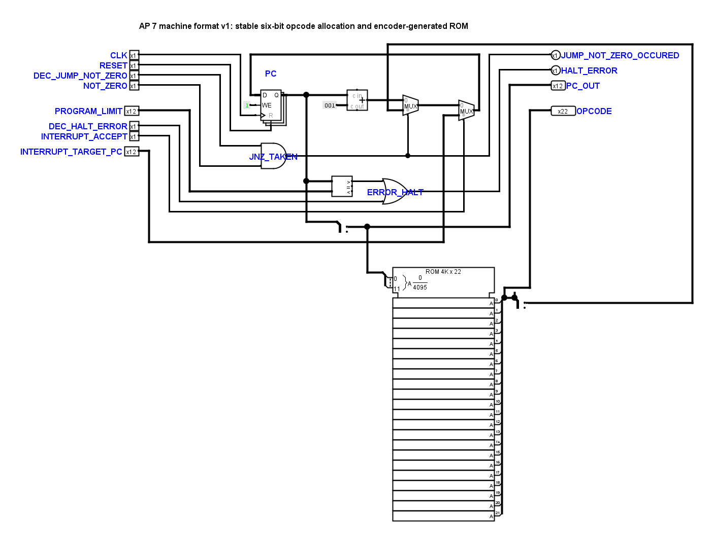

# Frühere Schaltplananordnung wiederhergestellt

Am 7. November 2026 hat der Benutzer die großflächige Layoutüberarbeitung
anhand zweier Ansichten von `FetchDecode` zurückgewiesen. Die Zeichnungen
sind deshalb möglichst an die vorherige Anordnung angeglichen. Die elektrische
Reparatur vom 6. November bleibt erhalten. Dies ist keine Behauptung einer
Benutzerabnahme der Lesbarkeit.

## Grundlage und Umfang

Vor dem Eingriff wurden alle eingehenden Dateien einschließlich der lokalen
`TinyCPU.circ` und der damals zusätzlich vorhandenen `TinyCPU2.circ` unter
`artifacts/layout-restoration-20261107/before/` gesichert. Als Layoutreferenz
dienen diese ältere `TinyCPU2.circ` und die Eingangssicherung des Reparaturpakets
vom 6. November für Diagnose, Peripherie und Operator. Die zusätzliche Datei
wird ausschließlich als gesicherte Layoutreferenz verwendet.

24 `.circ`-Dateien enthalten weiterhin 58 Definitionen. Bei 50 der 56
ungeschützten Definitionen wurde die frühere Zeichnung mit identischen nativen
Kontaktnetzen übernommen. Reine unverbundene Zeichenreste wurden entfernt;
vorhandene Abzweige sind im XML ausdrücklich geteilt, ohne ihre sichtbare
Leitungsführung zu verändern. Mehrbitanzeigen behalten Hexadezimaldarstellung.
Die beiden geschützten `FetchDecodeControls` sind gegenüber dem eingehenden
Stand bytegleich, einschließlich dessen Zeilenenden.

Sechs Definitionen benötigen eine gezielte Übertragung:

- Die integrierten und eigenständigen MUL-/DIV-Blätter behalten die korrigierte
  Rechenlogik und erhalten die vorherige kompakte Bauteilgruppierung.
  Die vollständige vorzeichenbehaftete MUL-Bereichsprüfung, DIV-Nullprüfung,
  Freigaben und Eingangsgültigkeit bleiben elektrisch identisch.
- Die FetchDecode-Diagnose erhält die frühere Kernanordnung mit getrenntem
  Interruptziel und PC-Netz. Der historische Kurzschluss wird nicht übernommen.
- Das Operator-Panel erhält seine frühere Anordnung und direkte sichtbare
  Ausgabeleitungen. Die drei expliziten Nullquellen bleiben erhalten; fünf
  skalare Ruhepegel werden weiterhin gemeinsam versorgt. Die zusätzlich
  eingeführten Beobachtungsbusse entfallen.

In `AddressAccess` wurde außerdem die beim eingehenden GUI-Speichern verlorene
interne Verifikatorbeschriftung `ACCESS_VALID` wieder eingesetzt. Ein offener
historischer Leitungsfortsatz im Interruptcontroller wurde gekürzt. Beides
ändert kein elektrisches Netz. Die Konstantenzahl bleibt 59.

## Nachweise

Die Gegenprüfung verwendet echte, von Logisim exportierte Kontaktpositionen
und Bitbreiten, keine angenäherten Symbolformen:

- 57 Definitionen einschließlich beider geschützten Decoder haben identische
  positionsunabhängige native Topologie-Fingerabdrücke.
- Beim Operator sind die nativen Kontaktnetze bitweise identisch, nachdem die
  rein verdrahteten Splitter aufgelöst sind. Auch die festen Werte werden
  verglichen; das Entfernen der zwölf Bus-Splitter ist keine Logikänderung.
- Logisims native Vorher-/Nachher-Simulation besteht für alle 58 Definitionen:
  64 Schritte je Definition, insgesamt 3712 vollständig definierte und gleiche
  Zustandsvergleiche.
- 255 Unit-Tests und die Offline-Verifikation bestehen. Eine zusätzliche
  Negativkontrolle stellt sicher, dass eine neue Leitung nicht durch die
  Ausnahme für wiederhergestellte Layouts akzeptiert wird.
- Der geometrische Kontaktaudit findet in den 56 bearbeiteten Definitionen
  keine ungeteilten T-Kontakte oder überlappenden Leitungen. Die 36 bestehenden
  Meldungen im geschützten Diagnose-Decoder bleiben unverändert und werden
  wegen seines Schutzes nicht automatisch bearbeitet.

Alle 15 elektrischen Prüfpakete bestehen: vollständige Kernmatrix mit 63
ISA-Fällen, Kern-/STORE-/PRINT-/Immediate-/Decoderprüfungen, Adressregister,
38 Adressgültigkeitsfälle, 83 Arithmetikfälle und je 36 MUL-/DIV-Blattvektoren,
Operations- und Effektivadressprüfung, sieben Peripheriefälle, Operator-Takt,
Operator-Kernvergleich für LOAD/PRINT/HALT und Countdown sowie INPUT-Baseline.
Die zugehörigen absichtlich fehlerhaften Varianten werden weiterhin abgelehnt.

Die vollständige elektrische Regression ist unter
`artifacts/layout-restoration-20261107/acceptance/` protokolliert; `results.json`
enthält alle 15 Exitcodes und Laufzeiten. `final-proof.json` bündelt die
abschließenden Belege einschließlich SHA256 aller ausgelieferten Schaltdateien.
Die Ausgangssicherung, native Kontaktlisten, Topologiebelege, bitweiser
Operatorvergleich, Simulationsvergleich und acht native Übersichtsseiten liegen
ebenfalls in `artifacts/layout-restoration-20261107/`.

## Darstellungsregeln

Die wiederhergestellten Zeichnungen behalten bewusst auch historische
Pinabstände und lokale Beschriftungen. Sie erfüllen damit nicht überall das
später eingeführte starre 20/40-Modulo-Raster. Dieses Raster darf die gewünschte
Rückkehr zur früheren Anordnung nicht erneut verhindern.

`hardware/logisim/layout-restoration-v1.json` hält genau die wiederhergestellten
Geometrien fest. Die Layoutprüfung akzeptiert diese Referenzen; veränderte
Geometrien fallen wieder unter die strenge Rasterprüfung. Elektrische,
Schnittstellen- und Tunnelprüfungen bleiben stets aktiv. Nach einem notwendigen
lokalen Eingriff ist die Referenz erst nach Verbindungsvergleich und nativer
Sichtkontrolle nachzuführen; eine Rastermeldung ist kein Auftrag, das gesamte
Blatt neu zu zeichnen. Die Referenz ist keine pauschale Ausnahme nach Namen.

## Beispiel FetchDecode

Eingehender Stand, vor dieser Wiederherstellung:

Wiederhergestellte Anordnung:

