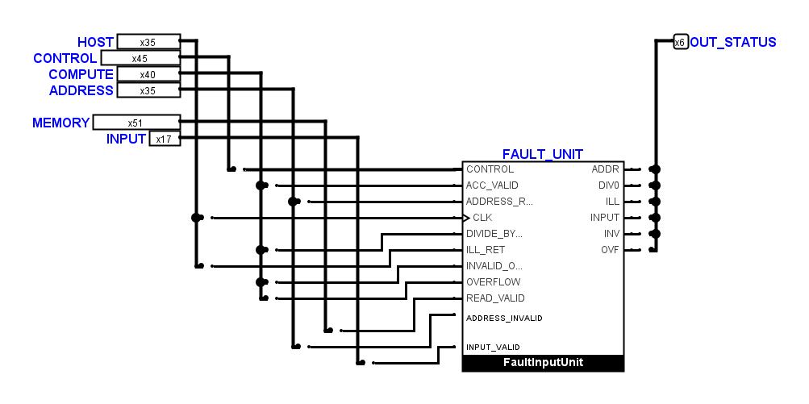
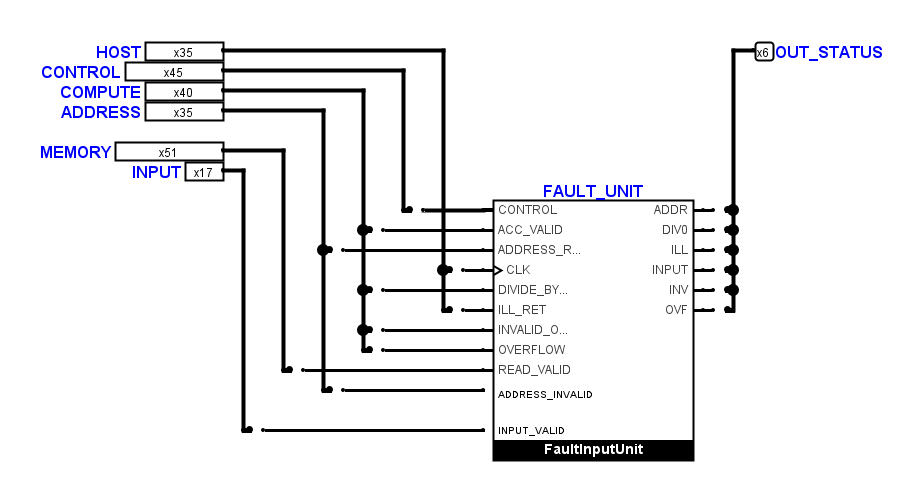
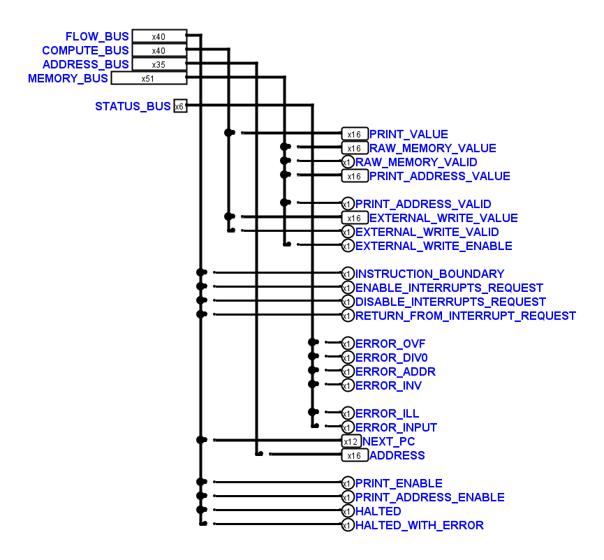
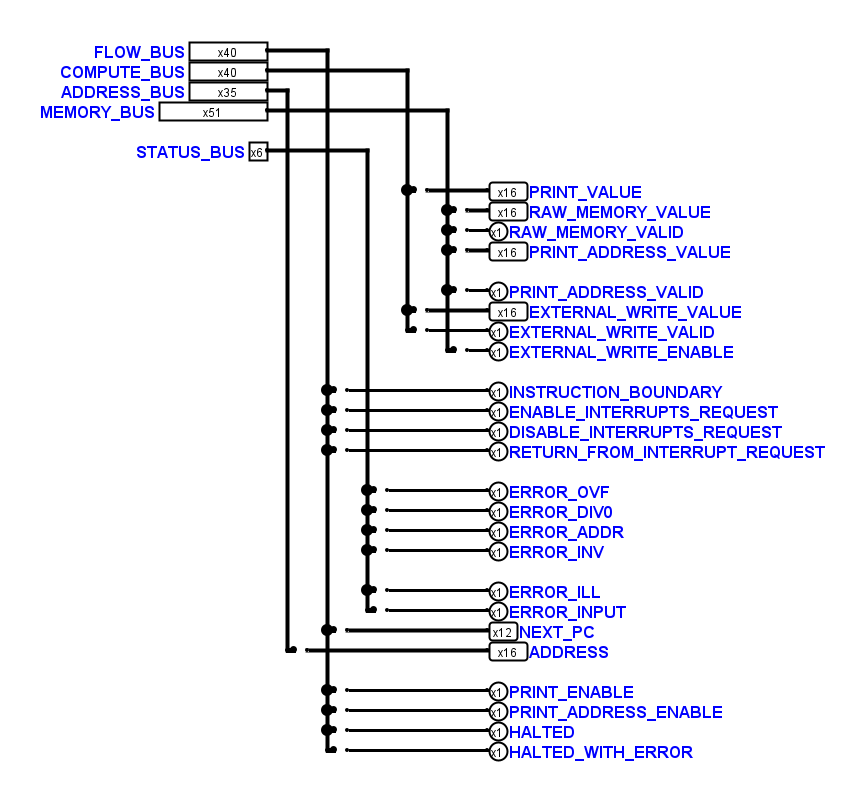
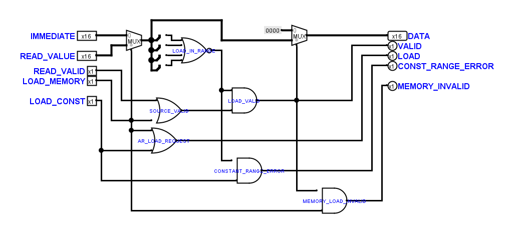

# Erneute Sichtprüfung der Kernblätter

Auf Wunsch des Benutzers wurden alle 52 ungeschützten Kernblätter erneut
anhand nativer Logisim-Ansichten geprüft. 17 Blätter erhalten lokale
Korrekturen; 35 bleiben gegenüber dem eingehenden Benutzerstand bytegleich.
Die beiden geschützten `FetchDecodeControls`-Definitionen und sämtliche
anderen `.circ`-Dateien bleiben ebenfalls bytegleich.

Die Sicherung enthält ausdrücklich auch die zu Beginn noch nicht
committeten Benutzeränderungen. Die bestehende Anordnung der Funktionsboxen,
öffentliche Schnittstellen, Steuerbitbelegungen und Konstanten bleiben erhalten.
Maßgeblich ist der [Benutzerstil](tiny_cpu_schematic_style.md).

## Sichtbare Änderungen

| Blätter | Korrektur |
| --- | --- |
| `CPUFetchUnitLink`, `CPUFaultUnitLink`, `CPUFaultInputUnitLink`, `CPUBranchUnitLink`, `CPUCoreDiagnosticsLink` | Bus-Abgriffe liegen direkt auf der Höhe ihrer Zielanschlüsse. Treppenförmige Zwischenwege entfallen, die Boxen rücken näher an die Abgriffe. Die Reihenfolge der Busstämme verringert Kreuzungen. |
| `CPUHostOutputs` | Die fünf Busstämme sind nach ihren tatsächlich benötigten Abgriffen angeordnet; die Reihenfolge und Vierergruppen der öffentlichen Pins bleiben erhalten. |
| `CPUMemoryUnitLink` | Der IMMEDIATE-Abgriff liegt direkt auf seiner Zielhöhe. Der vorherige senkrechte Abschnitt mit nur einer Rasterreihe Abstand zum HOST-Bus entfällt. |
| `AddressUnit` | Der IMMEDIATE-Knick vor `AddressRegisterLoad` erhält zwei statt einer Rasterreihe Abstand zur Box. |
| `AddArithmeticCircuit`, `JumpBox`, `AccumulatorUnit`, `AccumulatorInputUnit`, `MemoryUnit` | Einzelne senkrechte Ein- und Ausgangsabschnitte erhalten zwei Rasterreihen Abstand zum benachbarten Gatter. In `AccumulatorUnit` wird auch die benachbarte Datenspur mitgeführt, damit die Leitungslücke erhalten bleibt. |
| `FaultUnit`, `FaultInputUnit`, `AddressAccess` | Enge Gatterkorridore werden geöffnet. In `FaultUnit` verschiebt sich das DIV0-Gatter um eine Rasterspalte, damit die vorhandenen parallelen Eingangsleitungen ihre Abstände behalten. |
| `AddressRegisterLoad` | Die äußeren NOR-Eingänge werden von links statt über einen Knick innerhalb des Symbols angefahren. Der Ausgangskorridor und das nachfolgende Bereichsfehler-Gatter erhalten den nötigen Abstand. |

Die Änderungen verkürzen die Leitungen über die 52 Blätter insgesamt von
325.900 auf 322.250 Pixel. Die Zahl der geometrischen Kreuzungen ohne
Verbindung sinkt von 995 auf 900. Die kürzeren Bus-Verbindungsblätter tragen
den größten Teil dazu bei; einige Abstandskorrekturen benötigen lokal etwas
mehr Leitung. Eine reine Minimierung der Leitungslänge hat keinen Vorrang
vor lesbaren Anschlusskorridoren.

## Native Vorher-/Nachher-Ansichten

Fehler-Verbindungsblatt mit INPUT, vorher:

Nachher:

Ausgangsverteilung, vorher:

Nachher:

NOR-Anschlüsse in `AddressRegisterLoad`, nachher:

## Nachweise

Der positionsunabhängige Vergleich aller 80 Schaltungsdefinitionen bestätigt
dieselben nativen Anschlussnetze, Breiten, relativen Symbolanschlüsse und
elektrischen Bauteilparameter. Beide geschützten Decoderblöcke werden
zusätzlich byteweise verglichen. Der FBox-Abstandsaudit findet keine
unbeteiligten Leitungen im vorgeschriebenen Anschlussfreiraum. Die zusätzliche
Gatterkontrolle berücksichtigt die zurückgesetzten Anschlüsse negierter
Eingänge und findet keine verbliebenen engen vorbeiführenden Abschnitte.
Feste enge Anschlussreihen bleiben auf die lokale Auffächerung beschränkt.

Die Offline-Auswertung erkennt die `ACCESS_VALID`-Grenze nun unabhängig von
der sichtbaren Gatterbeschriftung anhand ihrer tatsächlichen Verbindung zum
öffentlichen Ausgang. Damit bleibt die aktuelle Benutzerbeschriftung
`ACCESS_VALID_OR` erhalten. Ein Regressionstest prüft verschiedene
Beschriftungen, den unveränderten Quelldatensatz und die Ablehnung einer
unterbrochenen Ausgangsverbindung. Die ursprüngliche Abweichung war bereits
im eingehenden Benutzerstand vorhanden; die CPU-Simulation bestand dabei.

Es bestehen 275 Unit-Tests, die vollständige CPU-Matrix mit 63 Fällen sowie
die INPUT-Prüfung mit zehn VM-Vergleichen, Reset-Wahrheitstabelle und drei
abgewiesenen elektrischen Negativkontrollen. Der native Vorher-/Nachher-Lauf
vergleicht 4.416 eingeschwungene Zustände über die 52 Kernblätter und 17
gleichnamige Diagnosefassungen ohne Abweichung.

Prüfprotokolle und gesicherte Zwischenstände liegen unter
`artifacts/layout-second-pass-20261109/`: `before/`, `candidate/`,
`before-native/`, `after-native/`, `native-proof.json`, `metrics.json`,
`gate-clearance.json`, `reference-updates.json` und `check-root/`.
Die Geometriereferenzen werden erst nach dem nativen Verbindungsvergleich
und dem Vergleich der Ansichten nachgeführt. Elektrische Verbindungen und
tatsächliche Leitungslücken bleiben von diesen Referenzen unabhängig geprüft.
