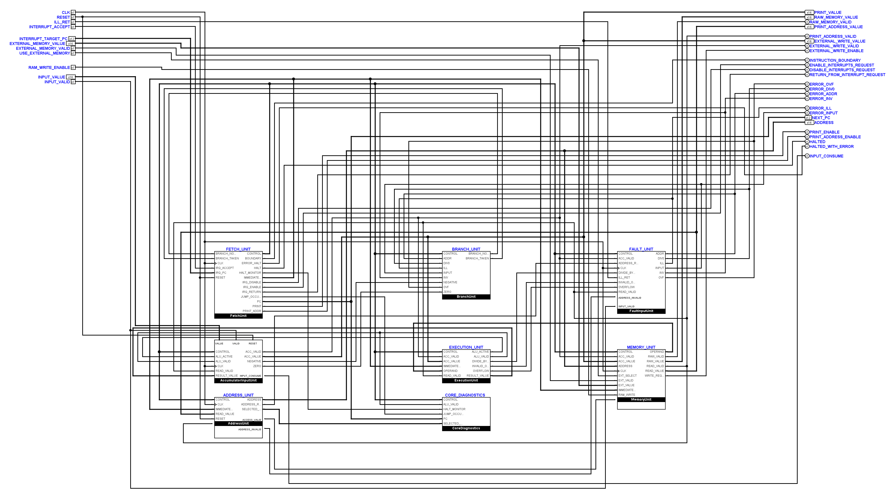
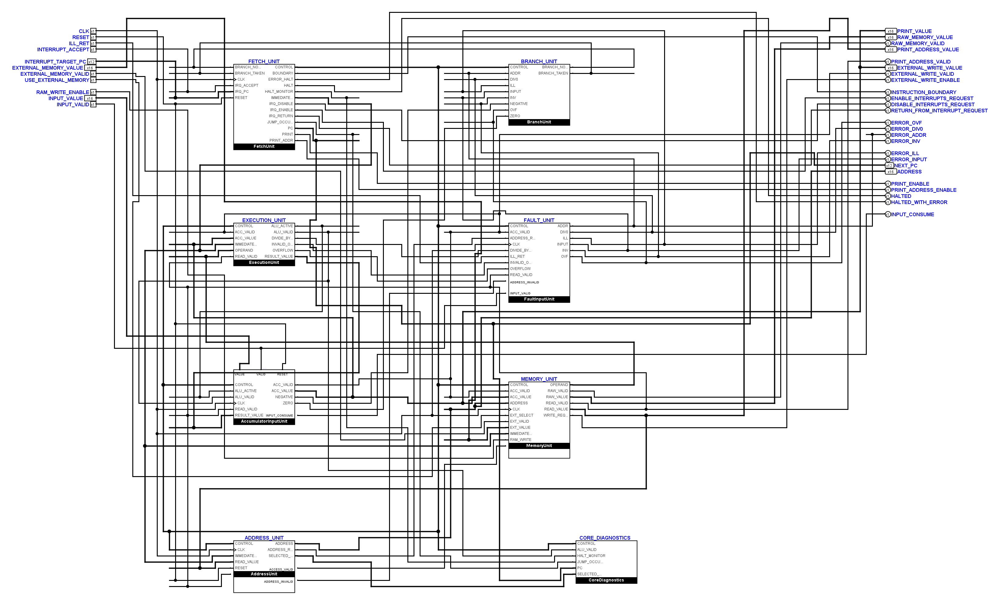
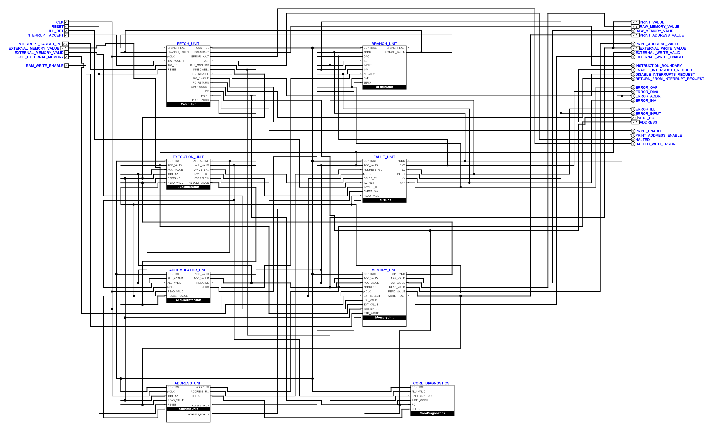

# Die beiden CPU-Übersichten überarbeitet

**Verworfener Zwischenstand:** Der Benutzer hat die nachfolgende Anordnung
wegen ihrer unruhigen Leitungsführung zurückgewiesen. Aktuell ist die
[Aufteilung in fachliche Teilschaltungen vom 8. November](tiny_cpu_main_modules_20261108.md).

Auf ausdrücklichen Wunsch vom 7. November 2026 wurden ausschließlich
`TinyCPUMain` und `TinyCPUInputMain` in
[TinyCPU.circ](../hardware/logisim/TinyCPU.circ) neu angeordnet und verdrahtet.
Die vorhandenen lokalen Benutzeränderungen sind die Eingangsbasis dieses
Durchgangs, nicht der letzte Git-Commit. Der vollständige eingehende Stand
liegt unter `artifacts/main-layout-20261107/before/TinyCPU.circ`.

Die acht Funktionsboxen stehen jetzt in vier fachlichen Reihen:

| Links | Rechts | Zusammenhang |
| --- | --- | --- |
| FetchUnit | BranchUnit | Befehl und nächster Programmschritt |
| ExecutionUnit | FaultUnit / FaultInputUnit | Ergebnis und Fehlerursachen |
| AccumulatorUnit / AccumulatorInputUnit | MemoryUnit | gespeicherte Werte und Speicherzugriff |
| AddressUnit | CoreDiagnostics | Adressbildung und Beobachtung |

Eingänge beginnen links oben, Ausgänge rechts oben. Die öffentlichen Pins
behalten ihre Reihenfolge, Namen, Breiten und Richtungen; Vierergruppen
erhalten eine freie Zwischenzeile. Die vorherige große Leitungsfläche oberhalb
der Funktionsboxen entfällt. Der gemeinsame Steuerbus und der Takt erhalten
früh festgelegte Verteilungswege; weitere Verbindungen nutzen die freien
Korridore zwischen den Reihen. Engere Auffächerungen bleiben unmittelbar an
den unveränderten Symbolanschlüssen. Die drei oberen Anschlüsse der
INPUT-Akkumulatorbox bleiben an ihren bisherigen Symbolpositionen.

Zusätzliche Teilkreise waren für diese Anordnung nicht erforderlich. Alle
32 anderen Definitionen sind gegenüber dem eingehenden Stand bytegleich,
einschließlich `FetchDecodeControls`. Keine Konstante, kein Tunnel, kein
Primitiv und keine neue Schnittstelle wurde hinzugefügt. Die Zeichnungen
bestehen die normale Rasterprüfung ohne neue Layoutausnahme.

Die von Logisim nativ gezeichneten Ansichten zeigen den tatsächlichen
verdrahteten Schaltplan. Die Bildmaße enthalten auch die Beschriftungen:

| Blatt | Vorher | Nachher | Leitungslänge vorher → nachher | Kreuzungen vorher → nachher |
| --- | --- | --- | --- | --- |
| TinyCPUMain | 3732 × 2021 | 3272 × 1981 | 155330 → 128540 | 1067 → 775 |
| TinyCPUInputMain | 3732 × 2081 | 3272 × 1981 | 168350 → 136290 | 1130 → 919 |

Die Längen sind Logisim-Koordinateneinheiten. Gezählt werden geometrische
Kreuzungen im Inneren zweier Leitungssegmente, keine elektrischen Abzweige.
Die Zahlen ergänzen die Sichtkontrolle; sie ersetzen sie nicht. Die Übersicht
enthält weiterhin viele Einzelverbindungen, insbesondere zu den öffentlichen
Statuspins. Die blauen Instanznamen und die bisherigen Symbolbeschriftungen
bleiben erhalten.

Vorher, INPUT-Übersicht:

Nachher:

Baseline-Übersicht:

Die beiden bearbeiteten Blätter besitzen identische positionsunabhängige
Topologie-Fingerabdrücke, ermittelt mit den von Logisim exportierten echten
Kontaktpositionen und Bitbreiten. Der Kontaktaudit findet keine überlappenden
Leitungen oder ungeteilten T-Kontakte. Die native Vorher-/Nachher-Simulation
vergleicht je Blatt 64 Zustände: alle 128 Zustände sind vollständig definiert
und gleich. Der vorhandene Vergleichshelfer kann dafür nun optional einzelne
Teilkreisnamen als zusätzliche Argumente auswählen.

Die neue INPUT-Grenze besteht zehn Kern-/VM-Programmfälle, sieben Reset-Zeilen
und drei abgelehnte elektrische Mutationen. Ebenfalls bestanden sind
Kernmutation, STORE, PRINT, Decoder, Adressregister, Effektivadresse,
Peripheriematrix, Operator-Takt und Operator-Kernvergleich.

Eine vollständige elektrische Gesamtfreigabe liegt **nicht** vor. Bereits der
eingehende Stand enthält ein `MulArithmeticCircuit` mit `appearance=custom`
ohne explizites `appear` sowie weitere nicht mehr zur Layoutreferenz passende
Blätter. Die Kernmatrix scheitert bei `mul-const` (ACC 3 statt 18), weitere
Prüfpakete bei ADD-/Operations-Fällen, einer Immediate-Negativkontrolle und der
alten INPUT-Baseline. Für vier betroffene Traces wurden die eingehenden
Übersichtszeichnungen in identische Testkopien eingesetzt: MUL, ADD-Grenzfall,
Adressgültigkeitsfall und Immediate-Negativkontrolle liefern jeweils
bytegleiche native Traces. Diese Probleme werden durch die Layoutänderung
nicht repariert und sind gesondert zu bearbeiten.

Ausgangssicherung, native Kontaktlisten, Topologie- und Geometriebeleg,
Simulatorvergleiche, Unit-Test-Vergleich und alle 16 elektrischen Prüfläufe
liegen unter `artifacts/main-layout-20261107/`. Die Prüfung der Übersicht
verwendet jetzt deren tatsächliches 20/40-Raster mit Ursprung null; die
historische hart codierte x-Verschiebung um 70 entfällt im Layouttest.
Der vollständige Durchlauf mit 264 Unit-Tests meldet vorher und nachher exakt
dieselben 17 fehlgeschlagenen Unterprüfungen und zwei Fehler; es kommt kein
neuer Befund hinzu. Die Unit-Tests sind damit ebenfalls keine vollständige
Gesamtfreigabe des eingehenden Projekts.
