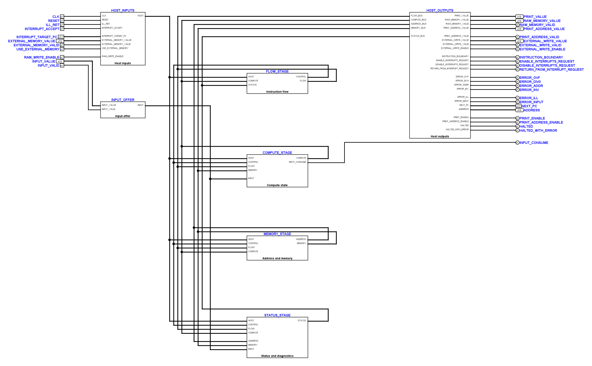
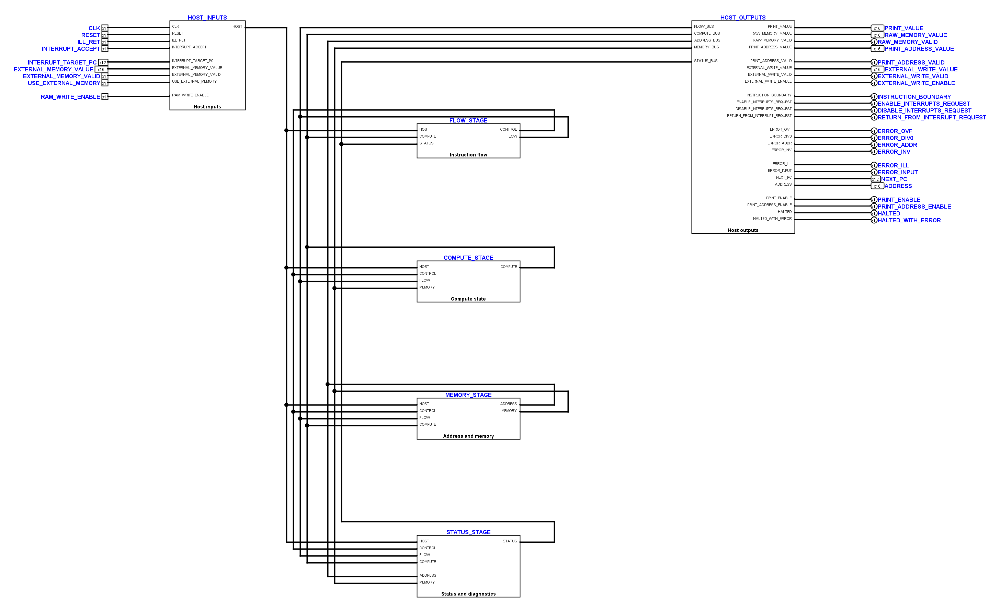
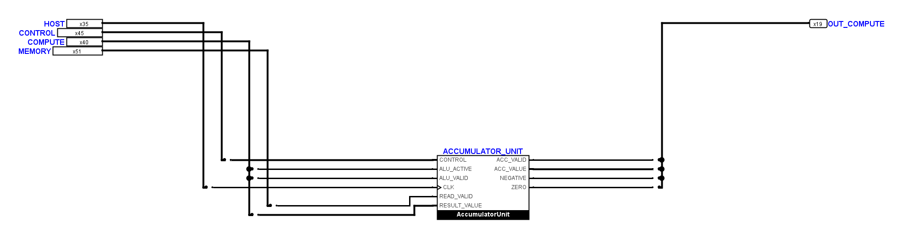
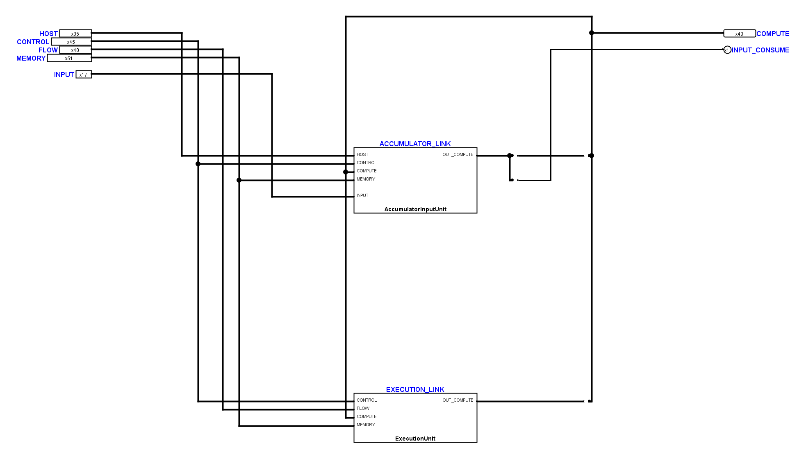

# CPU-Übersichten in Teilschaltungen aufgeteilt

Der Benutzer hat die Leitungsführung des
[Zwischenstands vom 7. November](tiny_cpu_main_layout_20261107.md) ausdrücklich
zurückgewiesen. Die neue Lösung wird deshalb in fachliche Teilschaltungen
zerlegt und erhält gerade Leitungsstrecken mit wenigen Knicken. Die alten
acht Funktionsschaltungen bleiben als Bausteine erhalten. Dies ist weiterhin
eine Überarbeitung derselben CPU, mit denselben öffentlichen Anschlüssen.

Die Hauptblätter enthalten jetzt vier Bereiche sowie die sichtbar verdrahteten
Anschlussboxen für die öffentlichen Ein- und Ausgänge:

| Bereich | Enthaltene Funktionsschaltungen |
| --- | --- |
| `CPUFlowStage` | `FetchUnit`, `BranchUnit` |
| `CPUComputeStage` | `AccumulatorUnit`, `ExecutionUnit` |
| `CPUMemoryStage` | `AddressUnit`, `MemoryUnit` |
| `CPUStatusStage` | `FaultUnit`, `CoreDiagnostics` |

`TinyCPUInputMain` verwendet die entsprechenden INPUT-Varianten für Compute
und Status und eine kleine Box für das Eingabeangebot. Die Signalverarbeitung
der acht bisherigen Boxen wird nicht umgebaut. Zehn Anschlussblätter mit
jeweils einer bisherigen Box zeigen, welche Felder der gemeinsamen Busse
deren einzelne Pins versorgen. Zusammen mit sechs Bereichsvarianten und
drei Anschlussboxen entstehen 19 zusätzliche Definitionen.

Die langen Leitungen liegen auf einem 20-Pixel-Raster mit mindestens 40 Pixel
Lücke nach höchstens vier Spuren. Die Verteilung erfolgt in einem eigenen
Buskorridor links der vier Bereiche. Die Rückführung jedes Bereichsausgangs
liegt direkt oberhalb seiner Box und hat drei Knicke. Die öffentlichen
Ausgänge sind ohne Knick mit ihrer Anschlussbox verbunden. Der einzelne
`INPUT_CONSUME`-Ausgang wird auf einer eigenen Spur geführt.

Auch innerhalb der neuen Blätter werden tatsächlich überlappende parallele
Leitungen mit mindestens 20 Pixel Abstand geführt: Eine Rasterzeile bleibt
frei. Eine neue Prüfung erfasst ausdrücklich auch die kurzen Auffächerungen.
An den unveränderten dicht belegten Symbolanschlüssen bleiben nur lokale
Anpassungen an deren feste Pinreihen; außerhalb dieses Anschlussbereichs
gelten die Vierergruppen. Die meisten einzelnen Signalverbindungen sind
gerade. Einzelne Höhenanpassungen erfolgen unmittelbar an der bisherigen Box.

Die Busse enthalten feste, dokumentierte Felder. Es sind elektrisch
verdrahtete Busse mit Splittern, keine Tunnel. Ihre vollständigen Bitbelegungen
stehen in [tinycpu-interconnect-v1.json](../hardware/logisim/tinycpu-interconnect-v1.json).
Keine Leitung überschreitet Logisims Grenze von 64 Bit.

| Bus | Breite | Quelle und Inhalt |
| --- | ---: | --- |
| HOST | 35 | öffentliche Takt-, Reset-, Interrupt- und Speicheranschlüsse |
| CONTROL | 45 | unveränderter Decoder-Steuerbus |
| FLOW | 40 | übrige Fetch-Ausgänge und lokale Sprungentscheidung |
| COMPUTE | 40 | Akkumulator- und ALU-Ausgänge |
| ADDRESS | 35 | Adressbildung, Auswahl und Zugriffsgültigkeit |
| MEMORY | 51 | Speicherwerte, Gültigkeit, Operand und Schreibanforderung |
| STATUS | 6 | gespeicherte Fehlerflags |
| INPUT | 17 | Eingabewert und Angebotsgültigkeit, nur in der INPUT-Variante |

Gegenüber dem eingehenden Stand bleiben alle 32 anderen bisherigen
Definitionen bytegleich, einschließlich des geschützten `FetchDecodeControls`.
Es kommen keine Konstanten oder Logikbauteile hinzu. Die beiden öffentlichen
Schnittstellen behalten Namen, Breiten, Richtungen und Symbolreihenfolge.

Der positionsunabhängige Vergleich löst die neue Verdrahtung bis auf die
bisherigen acht Boxen bitgenau auf. Dabei werden auch Logisims echte
Kontaktpositionen und Bitbreiten verwendet: Alle 252 beziehungsweise 270
Bitnetze stimmen mit dem gesicherten Stand überein. Auch der vollständige
Kern-Fingerabdruck entspricht weiterhin dem bisherigen Vertrag. Die native
Vorher-/Nachher-Simulation besteht mit 128 gleichen, vollständig definierten
Zuständen. Alle 21 neuen beziehungsweise geänderten Blätter bestehen
Rasterprüfung, Kontaktaudit und die Prüfung der parallelen Leitungsabstände.

Die Strukturprüfungen und die Trace-Auflösung berücksichtigen nun die
zusätzlichen Hierarchieebenen. Die vorhandenen fachlichen Messpfade bleiben
verwendbar; sie werden eindeutig durch die reinen Anschluss- und Bereichsboxen
aufgelöst. Gezielte Negativprüfungen verwerfen vertauschte Busbits, zusätzliche
Logik in einer Anschlussbox sowie zu enge Leitungsführung.

Die bekannten Gesamtfehler des eingehenden Stands bleiben gesondert offen:
unter anderem das fehlende eigene MUL-Symbol sowie fehlschlagende MUL-/ADD-
und weitere elektrische Fälle. Die 16 elektrischen Prüfpakete liefern dieselbe
Aufteilung wie zuvor: zehn bestanden, sechs nicht bestanden. Die neue
INPUT-Grenze besteht weiterhin zehn Kern-/VM-Programmfälle, sieben Reset-Zeilen
und drei abgelehnte elektrische Mutationen. Diese Layoutkorrektur ist keine
elektrische Gesamtfreigabe des übrigen Projekts.

Sicherung, Busvertrag, native Bilder und Kontaktlisten, bitgenauer Beleg und
Prüfprotokolle liegen in `artifacts/main-modules-20261108/`.

Der abschließende Durchlauf umfasst 267 Unit-Tests einschließlich der drei
neuen Negativ- und Abstandstests. Er meldet dieselben 17 fehlgeschlagenen
Unterprüfungen und zwei Fehler wie der Ausgangsstand. Die neuen Tests bestehen;
es kommt kein neuer Befund hinzu.
