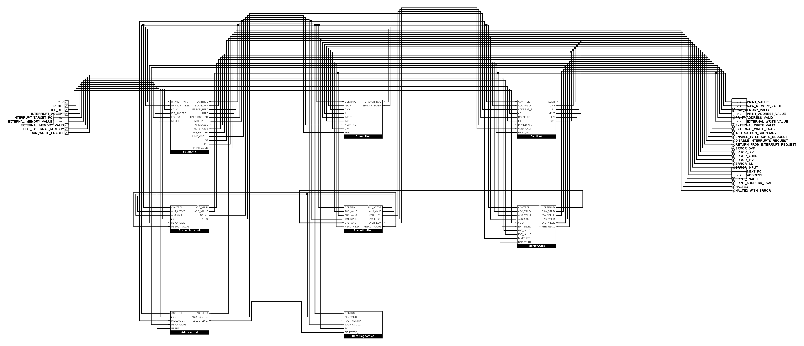

# AP 23: Funktionsboxen auf der obersten CPU-Ebene

Die anschließende topologische Reparatur des manuell neu gezeichneten Stands
ist in der [Verdrahtungsnachprüfung](tiny_cpu_wiring_review.md) dokumentiert.
Sie erhält die aktuelle Anordnung und berücksichtigt Logisims gespeicherte
Standardattribute im positionsunabhängigen Vergleich.

**Auftrag vom 31. Oktober 2026:** `TinyCPUMain` soll ausschließlich
Funktionsboxen wie Aufrufe fachlicher Teilprogramme zeigen. Anschlusspins und
Verbindungsleitungen bilden deren Schnittstelle. Einzelgatter, Auswahl- und
Aufteilungslogik, Konstanten und Diagnoseanzeigen werden darin gekapselt.

Die Vorgabe hat für diese Umstrukturierung Vorrang vor der historischen
Anordnungsregel der Top-Level-Referenz. Die Definition von
`FetchDecodeControls` bleibt unverändert geschützt. Die grüne Ausgangsbasis
ist Commit `df3de2bb1afaceabb6f47a67ef10cb474ed25f19` mit 61 Kernfixtures,
sieben Systemfixtures und den verpflichtenden Negativkontrollen.

## Fachliche Aufteilung

| Funktionsbox | Verantwortung |
|---|---|
| `FetchUnit` | Fetch, unveränderter Opcode-Decoder, Instruktionsfelder und Fetch-Konfiguration |
| `AccumulatorUnit` | Akkumulator und Auswahl seiner Ladegültigkeit |
| `AddressUnit` | Adressregister, Ladeauswahl, effektive Adresse und Bereichsprüfung |
| `MemoryUnit` | RAM, externe Speichergrenze, Lese- und Schreibauswahl |
| `ExecutionUnit` | Bestehende ALU und Operationsgültigkeit |
| `FaultUnit` | Fehlerursachen und bestehende Sticky-Register |
| `BranchUnit` | Bestehende Sprungentscheidung |
| `CoreDiagnostics` | Bisherige interne Beobachtungsanzeigen |

Der Decoder liefert einen benannten Steuerbus. Seine Bitzuordnung wird
maschinenlesbar festgelegt. Die Funktionsboxen zerlegen diesen Bus intern;
die Übersicht enthält dafür keine Splitter. Skalare öffentliche Kernpins
bleiben nach Namen, Richtung, Breite und Symbolreihenfolge kompatibel.

## Abnahme

- Die bestehende Logik wird strukturell extrahiert; die ISA wird nicht geändert.
- Die bisherigen Teilkreisdefinitionen, insbesondere Decoder, ALU, Register
  und RAM, bleiben unverändert. Neue Wrapper tragen die bisher verteilte Logik.
- Eine Offline-Regel lehnt primitive Bauteile auf `TinyCPUMain` ab.
- Hierarchische Verbindungen werden einschließlich Steuerbus und Tunnel
  innerhalb der neuen Funktionsboxen geprüft. Die bestehenden semantischen
  Verdrahtungsprüfungen bleiben wirksam.
- Alle 61 Kernfixtures, sieben Systemfixtures, Operator-Prüfung und
  Negativkontrollen werden auf dem umgebauten Projekt erneut ausgeführt.
- Die fertige Übersicht wird als Bild auf Lesbarkeit kontrolliert.

## Ergebnis und Bedienung

**Status:** umgesetzt. Die Übersicht zeigt acht Funktionsboxen und die
unveränderten neun Eingangs- sowie 24 Ausgangspins. Die Namen, Richtungen,
Breiten und Reihenfolge des öffentlich eingebetteten CPU-Symbols sind
erhalten. Die einzelnen Gatter, Multiplexer, Splitter, Konstanten und Probes
stehen vollständig innerhalb ihrer zuständigen Funktionsbox.



In Logisim `TinyCPUMain` öffnen und die gewünschte Funktionsbox betreten.
Die bisherigen Teilkreise sind darin weiterhin unter ihren bestehenden
Namen vorhanden. `FetchDecodeControls` bleibt also direkt in der
Teilkreisliste erreichbar und in seiner handgezeichneten Definition
unverändert. Die bisherigen Beobachtungsanzeigen liegen in `CoreDiagnostics`.
Ihre historischen Bezeichnungen werden durch diese Strukturänderung nicht
neu interpretiert.

Die Übersicht verwendet einen 45-Bit-Steuerbus. Seine Bitzuordnung,
Funktionsboxen und öffentlichen Pins stehen in
[`tinycpu-core-control-v1.json`](../hardware/logisim/tinycpu-core-control-v1.json).
Der Bus ist eine interne Verbindung und kein neues Maschinenwortformat.
Innerhalb der neuen Boxen verbinden lokal benannte Tunnel die extrahierten
Netze; solche Tunnel verbinden niemals verschiedene Boxen allein anhand
ihres Namens. Die Übersicht selbst enthält ausschließlich sichtbare Leitungen.

## Schutz vor Rückfällen

`src/tiny_cpu_hierarchy.py` prüft die echte hierarchische Bitverbindung über
Pins, scoped Tunnel und Splitter. Für die bisherigen semantischen
Bauteilprüfungen entsteht daraus eine reine Analyseansicht. Diese wird weder
in die produktive `.circ`-Datei zurückgeschrieben noch elektrisch ausgeführt.
Die bisherigen Mutationstests bleiben wirksam. Die elektrische Abnahme und
ihre Negativkontrollen verwenden immer das echte hierarchische Projekt.

Der positionsunabhängige Komponenten-/Port-/Netz-Fingerabdruck stimmt mit dem
grünen Ausgangsstand überein:
`13e0500f9f7cc7a9454dee69930fac267b685f60f5a4a3c1946618bac21905d2`.
Die Definitionen aller bisherigen Teilkreise sind unverändert. Ergänzende
Tests verwerfen primitive Top-Level-Bauteile, vertauschte Steuerbusbits,
geänderte öffentliche Pinreihenfolgen und einen unterbrochenen Steuerbus.
Ein Test schützt außerdem die tatsächliche Verankerung einer Box ohne
Ausgänge, damit die Diagnosebox auch nach Layoutänderungen angeschlossen bleibt.

## Nachweise

Ausgangs-Commit: `df3de2bb1afaceabb6f47a67ef10cb474ed25f19`.
Umgebung: Windows/PowerShell, Python 3.14.5, OpenJDK 27+35-2325 und
Logisim-evolution 4.1.0 aus der vorhandenen lokalen JAR. Der JAR-Digest ist
`fe6386a3217a591bcc311a4eda49e1f43a389b499dd3d0f6f40f344fc85f2577`.
Es wurde kein Simulator heruntergeladen. Gemeinsame Umgebung:

```powershell
$env:PYTHONPATH='src'
$env:JAVA='C:/Program Files/jdk-27/bin/java.exe'
$env:LOGISIM_JAR=(Resolve-Path .venv/Include/logisim-evolution-4.1.0-all.jar).Path
$env:TEMP=(Resolve-Path artifacts/review-tmp).Path
$env:TMP=$env:TEMP
```

Die endgültigen Nachweise liegen unter `artifacts/ap23-modularity/`:

| Prüfung | Befehl | Ergebnis und Artefakt |
|---|---|---|
| Offline-Verträge und Top-Level-Regel | `python src/tiny_cpu_verify.py` | Exit 0; `verify-final.txt`. |
| Elektrische Struktur | `python scripts/check-logisim-circuit.py` | Exit 0; `structure-final.txt`. |
| Windows-Unit-Suite | `python -m unittest discover -s tests -v` | Exit 0; 208 Tests ohne Skip, `unit-final.txt`. |
| Vollständige Kernmatrix | `python src/tiny_cpu_logisim.py --java $env:JAVA --jar $env:LOGISIM_JAR --trace-output artifacts/ap23-modularity/final/core.tsv --matrix-output artifacts/ap23-modularity/final/matrix` | Exit 0; beide Minimalkernläufe identisch, Countdown und alle 61 Fixtures, `core-final.txt`, `final/`. |
| STORE, PRINT, Immediate, Ergebnis-, Decoder- und Registerkontrollen | `python scripts/test-logisim-<name>.py --output artifacts/ap23-modularity/checks/<name>`; Namen und exakte Befehle in `checks.json` | Sämtliche Exitcodes 0; Rohdaten und `proof.json` je Kontrolle. Die Skriptnamen sind `store`, `print`, `immediate`, `core-mutation`, `decode`, `address-register`; der letzte Ausgabepfad heißt `checks/register`. |
| Systemmatrix | `python src/tiny_cpu_logisim.py --java $env:JAVA --jar $env:LOGISIM_JAR --profile tinycpu-16-12 --system tinycpu-peripherals-16-12-v1 --system-only --trace-output artifacts/ap23-modularity/system-unused.tsv --matrix-output artifacts/ap23-modularity/checks/system` | Exit 0; alle sieben Fixtures, `system.txt`, `checks/system/`. |
| Operator-Panel | `python scripts/test-logisim-operator.py` | Exit 0; `operator.txt`. |
| Tatsächliche Logisim-Anschlüsse | lesende API-Helfer `InspectCorePorts.java` und `InspectUnitPorts.java` | Alle Anschlüsse der Übersicht und der acht neuen Boxen stimmen mit dem Offline-Modell überein; `modular-ports.tsv`, `unit-ports.tsv`. |
| Sichtprüfung | `RenderCore.java` mit Logisims Zeichen-API | `overview.png`; die oben eingebundene Abbildung ist dieser Export. |

Die elektrische Prüfung benötigt wie zuvor Zugriff auf die lokalen
Java-Einstellungen. Die Bash-Gate-Komponenten wurden unter Windows einzeln
ausgeführt. Diese Abnahme ersetzt weder den ausstehenden manuellen
GUI-Funktionstest noch die offenen Qualitätsaufgaben aus AP 22, insbesondere
gültige externe Eingaben und arithmetische Grenzfälle. AP 23 ändert deren
Semantik nicht und erklärt sie nicht nachträglich für bestanden.
