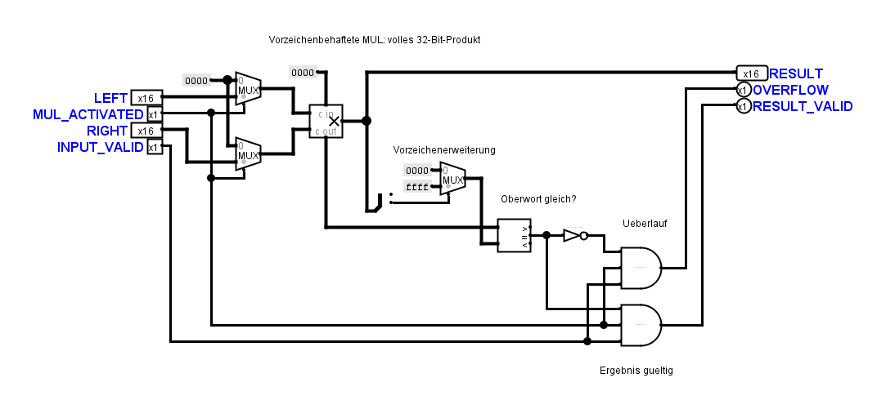
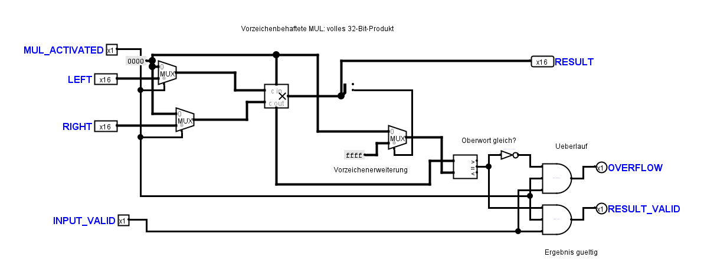

# MUL: freie Gatterkanten und INPUT_VALID-Verteilung

Die Korrektur betrifft ausschließlich `MulArithmeticCircuit` in
`TinyCPU.circ` und in `diagnostics/TinyCPU-MulArithmeticCircuit.circ`.
Die zuvor korrigierten `ErrorFlags` und alle übrigen Teilkreisblöcke bleiben
gegenüber dem Eingang dieses Durchgangs bytegleich.

Die senkrechte Freigabeleitung steht jetzt 20 Pixel vor den AND-Kanten.
`INPUT_VALID` erreicht die jeweils untersten Eingänge über einen gemeinsamen
Verteiler links der Gatter. Der Umweg durch beide Gatterkörper und auf deren
rechte Seite entfällt. Komparator, Inverter und Ausgangsleitungen haben
ebenfalls freie Korridore; Beschriftungen wurden aus den Leitungswegen gerückt.
Die elektrischen Eingangszuordnungen und Bauteilparameter bleiben unverändert.

## Native Ansichten

Kernfassung:

Diagnosefassung:

## Prüfung

Der Audit anhand nativer Symbolgrenzen bestätigt im Bereich der Komparatoren,
Inverter und AND-Glieder mindestens 20 Pixel Abstand für unbeteiligte
Leitungen. Alle zehn Textbeschriftungen sind frei von Leitungsüberschneidungen.
Die INPUT_VALID-Netze liegen vollständig links der Gatterkanten und erreichen
beide vorgesehenen Eingänge. Es gibt keine überlappenden Leitungen oder
ungeteilten T-Kontakte.

Alle 80 nativen Anschlussnetz- und Symbolvergleiche stimmen überein.
128 vollständig definierte native Vorher-/Nachher-Schritte und 72
mathematische MUL-Prüffälle bestehen. Letztere decken vorzeichenbehaftete
Grenzen, Überlauf und sämtliche Kombinationen von Aktivierung und
Eingangsgültigkeit ab. Vier gezielte bestehende Tests und die vollständige
Offline-Verifikation bestehen ebenfalls.

Sicherung und Nachweise liegen in `artifacts/mul-wiring-20261108/`, insbesondere
`native-proof.json`, `clearance-and-caption-proof.json`, `routing-proof.json`,
`equivalence.txt`, `vector-proof.json`, `targeted-tests.txt`, `offline.txt`
und `final-proof.json`. Die beiden exakten Layoutreferenzen wurden erst nach
nativer Sicht- und Anschlusskontrolle nachgeführt.
