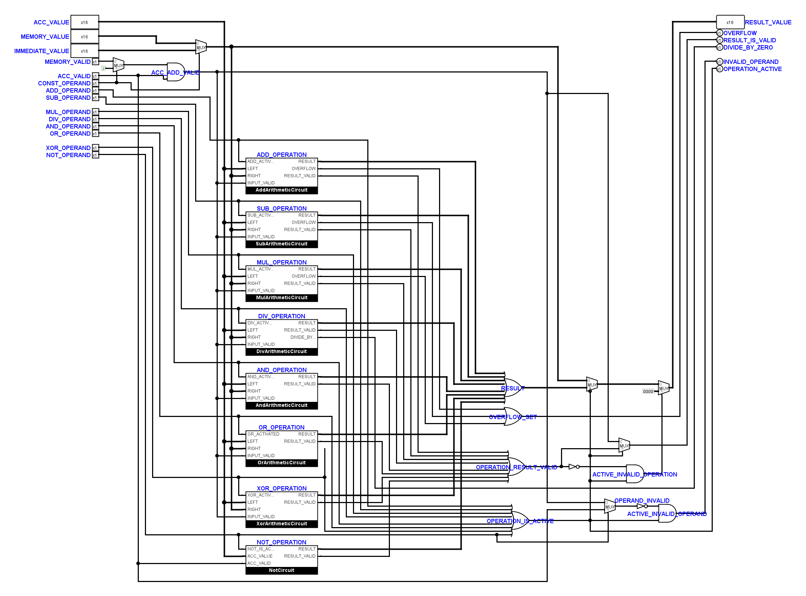

# Operations: gezielte Reparatur der Benutzerzeichnung

Der eingehende Stand wurde vollständig unter
`artifacts/operations-repair-20261101-141440/logisim/` gesichert.
Die Reparatur setzt die neue `Operations`-Zeichnung nicht auf eine frühere
Fassung zurück. Alle 45 Bauteile und Pins behalten ihre Positionen und
Eigenschaften; der Anschlussvergleich bestätigt ihre unveränderten XML-Einträge.

## Gefundene Fehler und Korrektur

1. In `ExecutionUnit` fehlte die Instanz `OPERATIONS_INSTANCE`. Ihre 87
   Leitungsstücke waren weiterhin vorhanden, endeten aber an keinem Bauteil.
   Schon der minimale CPU-Lauf lieferte deshalb nach der ersten Flanke nur
   undefinierte Akkumulatorbits. Die Instanz ist an diesen vorhandenen
   Anschlüssen wieder ergänzt; keine der 87 Leitungen wurde geändert.
2. Der Gültigkeits-Selektor vor `OPERAND_INVALID` hing an `XOR_OPERAND` statt
   an `NOT_OPERAND`. Die Auswahl muss für NOT nur die Akkumulatorgültigkeit
   verwenden; XOR benötigt dagegen beide gültigen Operanden. Eine lokale
   Abzweigung ist deshalb vom XOR-Netz auf das vorhandene NOT-Netz umgelegt.
   Alle anderen internen Anschlussgruppen bleiben unverändert.
3. Für `Operations` war `appearance=custom` gewählt, aber keine Symbolzeichnung
   gespeichert. Logisim verwendete damit einen anderen Anschlussabstand als
   die vorhandene Einbettung. Zusätzlich vertauschte die neue Blattanordnung
   die Symbolreihenfolge von `DIVIDE_BY_ZERO` und `INVALID_OPERAND`. Eine aus
   der aktuellen Zeichnung abgeleitete, explizite Symbolansicht bindet die
   Anschlüsse nun an ihre Namen und erhält die vorhandene Einbettung.
   Die Blattpins bleiben auf den Benutzerpositionen.

## Nachweise

- 63 elektrische Kernfälle, die minimalen CPU-Traces und Countdown: bestanden.
- Sieben elektrische Systemfälle: bestanden.
- Zwei isolierte NOT-/XOR-Fälle: bestanden. Bei gültigem Akkumulator und
  ungültigem Speicher meldete NOT vorher fälschlich `INVALID_OPERAND=1`;
  nachher ist es `0`. XOR meldet für den ungültigen Speicher nun korrekt `1`.
- Drei neue Regressionstests sichern die fehlende Instanz, den NOT-Selektor
  und die Ablehnung eines unvollständigen benutzerdefinierten Symbols.
  Die ersten beiden Tests erkennen auch den gesicherten fehlerhaften Eingang.
- 231 native Kontakte von `Operations` und `ExecutionUnit` stimmen mit dem
  Offline-Modell in Position und Breite überein. Kontakt- und projektweite
  statische Verdrahtungsprüfung bestehen.
- Alle übrigen 27 Kern-Teilkreise und sämtliche anderen 23 `.circ`-Dateien
  sind gegenüber dem eingehenden Benutzerstand bytegleich. Der geschützte
  Decoder bleibt unverändert.
- Der bisher akzeptierte Kern-Topologie-Fingerabdruck passt wieder.
  Der Erwartungswert wurde für diese Reparatur nicht verändert.

Die Rohdaten, Vorher-/Nachher-Ansichten und der Vergleich `proof.py` liegen
unter `artifacts/operations-repair-20261101-141440/`.

## Bereits vorhandene Prüfprobleme

Die vollständige Python-Suite umfasst jetzt 232 Tests. Es bleiben die bekannten
absoluten Rasterbefunde in `FetchUnit` und `AccumulatorUnit` sowie der
Decoder-Mutationstest, der entfernte Konstanten erwartet.

Die ergänzende Prüfung `scripts/test-logisim-operations.py` meldet außerdem
einen MUL-Überlaufbefund für `0x4000 × 2`: `OVERFLOW` bleibt `0`. Derselbe
Befund wurde zur Abgrenzung auch mit dem älteren Operations-Stand vor der
Benutzerumzeichnung reproduziert. Er wurde in diesem Durchgang nicht durch
Änderungen an den unveränderten Multiplikations-Teilkreisen bearbeitet.
Die 63 bestandenen Kernfälle belegen daher nicht die vollständige Abdeckung
jedes arithmetischen Grenzfalls.
