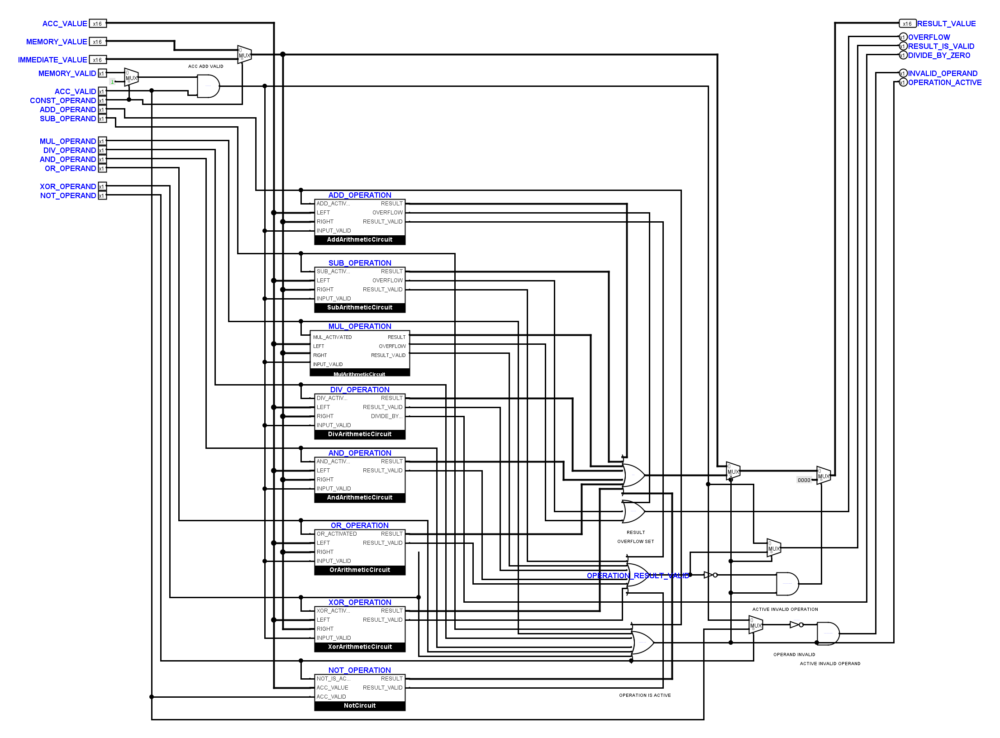

# Operations: MUL-Schnittstelle wieder angeschlossen

Der gemeldete Fehler ließ sich vor der Korrektur mit dem vorhandenen
Operations-Test reproduzieren: `multiply-positive-overflow` lieferte falsche
Werte für `RESULT_VALUE`, `OVERFLOW` und `RESULT_IS_VALID`.

In der Kernfassung war `MulArithmeticCircuit` auf `custom` eingestellt,
enthielt aber keine explizite Symbolzeichnung. Logisim verwendete dadurch
eine Ersatzdarstellung mit anderer Pinanordnung und anderem Anschlussabstand.
Die Leitungen in `Operations` erreichten damit falsche Anschlüsse und
Bitbreiten. Außerdem endeten der rechte Operand und die Ergebnisgültigkeit
auf falschen Höhen.

## Korrektur

Beide MUL-Fassungen besitzen jetzt eine explizite Symbolzeichnung mit an die
vorhandenen Blattpins gebundenen Anschlüssen. Links liegen Aktivierung,
`LEFT`, `RIGHT` und `INPUT_VALID`; rechts `RESULT`, `OVERFLOW` und
`RESULT_VALID`. Die Datenanschlüsse sind 16 Bit breit, die Steuersignale
ein Bit. Der vertikale Anschlussabstand beträgt 20 Pixel.

In `Operations` wurden ausschließlich die beiden betroffenen Leitungszweige
an `RIGHT` und `RESULT_VALID` angeschlossen. Die interne MUL-Zeichnung mit
dem linken Gültigkeitsverteiler bleibt erhalten.

## Nachweise

- Die acht vorhandenen nativen Operations-Prüffälle bestehen, einschließlich
  Multiplikationsüberlauf, vorzeichenbehafteter Division und Division durch null.
- Die vollständige CPU-Befehlsmatrix mit 63 Fällen besteht.
- Die Arithmetikprüfung besteht mit 83 vollständigen Vergleichen gegen die VM
  und je 36 MUL- und DIV-Vektoren in beiden Fassungen. Die gezielten
  Negativkontrollen werden abgewiesen.
- Der Vergleich nativer Logisim-Kontakte bestätigt unveränderte Netze in den
  übrigen 79 Schaltungen und alle sieben korrekt angeschlossenen MUL-Ports
  in `Operations`, einschließlich Bitbreiten und benannter Quellen/Ziele.
- Zwei neue Regressionstests sichern die explizite MUL-Schnittstelle und
  ihre Einbindung in Operations. Beide weisen den gesicherten Fehlerstand ab.
- Die statische Leitungsprüfung berücksichtigt jetzt auch die tatsächlichen,
  vom Anker versetzten Splitterkontakte. Ein Positiv- und ein Negativtest
  unterscheiden korrekt angeschlossene von zu kurz gezeichneten Leitungen.
- Alle 271 Unit-Tests, die Offline-Verifikation und die statische
  Leitungsprüfung bestehen.

Die beiden geschützten `FetchDecodeControls`-Zeichnungen sind gegenüber dem
Eingang dieses Durchgangs bytegleich. Die bereits eingegangenen Zeichnungen
von `AndArithmeticCircuit` und `JumpBox` wurden ebenfalls unverändert erhalten;
ihre veralteten exakten Geometriereferenzen wurden nach nativem Netzvergleich
und Sichtkontrolle nachgeführt. Das ist keine neue allgemeine Layoutabnahme.

Sicherung, native Ansichten und Prüfprotokolle liegen unter
`artifacts/operations-repair-20261108/`, insbesondere `operations-before.txt`,
`operations-final.txt`, `native-proof.json`, `change-scope.json`,
`preserved-user-layouts.json`, `regression-before.txt`, `core-matrix.txt`,
`arithmetic.txt`, `static-after.txt`, `offline.txt` und `unit-final.txt`.
