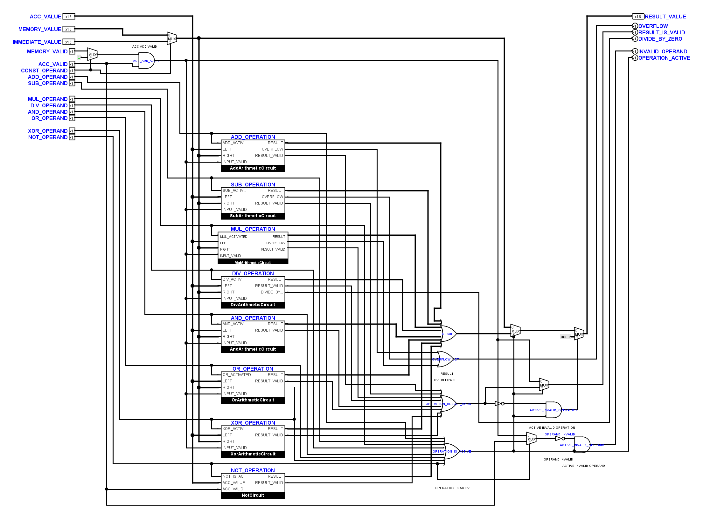

# ODER-Eingänge von links anschließen

Die Korrektur beseitigt 20 Anschlussstellen: 19 Leitungen liefen von rechts
an beziehungsweise hinter einen ODER-Eingang, ein weiterer Eingang wurde
direkt senkrecht angefahren. Darunter waren auch durchgehende Leitungen mit
einem Abzweig unmittelbar am Eingangspin.

Betroffen sind `Operations`, `JumpBox`, `AddressUnit` und `MemoryUnit` im
Kernprojekt, `InterruptController` im Peripherieprojekt sowie die beiden
Diagnoseblätter `AddressRangeFBox` und `EffectiveAddress`.

Die Eingangsleitungen enden jetzt waagrecht von links am Pin. Abzweige wurden
vor die Eingänge verlegt. Die benachbarten Auffächerungen wurden passend
gestaffelt, um Kreuzungen und lange enge Parallelführungen zu vermeiden.
Die festen 10-Pixel-Anschlussabstände großer ODER-Gatter werden nur lokal
aufgefächert. Die beiden Diagnose-ODER-Gatter in `EffectiveAddress` stehen
20 Pixel weiter rechts; das Ergebnisgatter in `Operations` 10 Pixel weiter
rechts. Alle Schnittstellen und elektrischen Netze bleiben erhalten.

Alle vier ODER-Beschriftungen in `Operations` sind explizit auf 10 Punkt
gesetzt. Ein Audit der tatsächlich von Logisim geladenen 1178
Bauteil-Schriftgrößen findet projektweit keine Beschriftung mit Größe 1.
Die bereits gespeicherten Vergrößerungen des vorherigen Durchgangs sind
erhalten; die zusätzliche explizite Angabe betrifft zuvor implizite
Schriftgrößen. Eine ältere geöffnete Projektfassung muss neu geladen werden.

## Prüfung

Der native Vergleich bestätigt in allen 80 Teilkreisdefinitionen identische
elektrische Anschlussnetze, relative Pinpositionen, Bitbreiten und
Bauteilparameter. Beide geschützten `FetchDecodeControls`-Zeichnungen sind
bytegleich erhalten. Alle acht Operations-Prüffälle und die vollständige
CPU-Befehlsmatrix mit 63 Fällen bestehen.
Alle 274 Unit-Tests sowie die Offline- und statischen Leitungsprüfungen bestehen.

Die Layoutprüfung kontrolliert jetzt zusätzlich die Anfahrrichtung der
ODER-Eingänge, auch bei gedrehten Gattern und Pins inmitten durchgehender
Leitungen. Eine exakte Geometriereferenz setzt diese Prüfung nicht außer Kraft.
Drei Regressionstests prüfen die relevanten Fehlformen und gültige Zuführungen.
Der gesicherte Eingang wird an 20 Stellen abgewiesen, der korrigierte Stand
an keiner Stelle.

Die bereits eingegangenen Zeichnungen von `EffectiveAddress`, `AddressPath`,
`Memory` und `FetchDecode` im Kernprojekt wurden unverändert erhalten. Ihre
veralteten Geometriereferenzen wurden nach nativem Netzvergleich und
Sichtkontrolle nachgeführt; hierfür wurden keine Leitungen umgezeichnet.

Sicherung, native Ansichten und Nachweise stehen in
`artifacts/or-inputs-20261108/`: insbesondere `native-proof.json`,
`direction-proof.json`, `native-fonts.tsv`, `font-proof.json`,
`preserved-user-layouts.json`, `operations.txt`, `core-matrix.txt` und
`unit-final.txt`.
