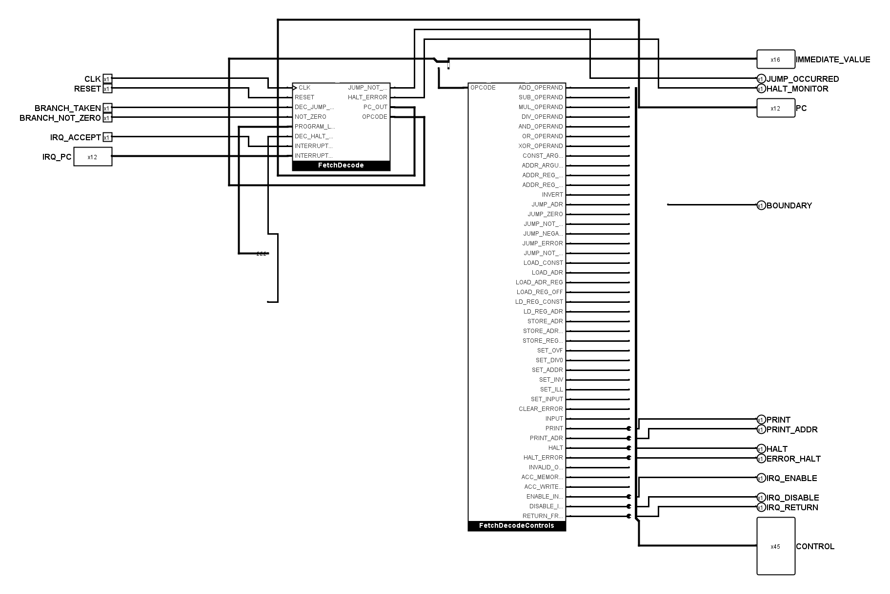
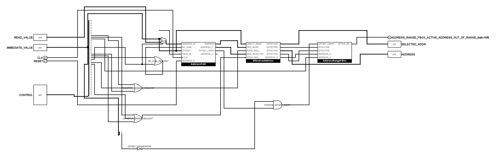

# Kompaktere Verdrahtung mit freien Rasterzeilen

Die acht internen Funktionsboxen wurden am 1. November 2026 nach dem
Tunnelabbau erneut angeordnet. Eingänge, Vorlogik, Funktionsboxen und
Ausgänge stehen jetzt näher zusammen; lange Leerflächen zwischen
Anschlüssen und Logik entfallen. Der Adresspfad zeigt seine drei FBoxen
nebeneinander in Signalflussrichtung. Der handgezeichnete Inhalt von
`FetchDecodeControls` und sämtliche übrigen Teilkreisdefinitionen bleiben
unverändert. Im gesamten Projekt gibt es weiterhin keine Tunnel.

## Leitungsabstände

- Zwischen parallelen langen Leitungen bleibt eine Rasterzeile frei:
  20 Pixel Spurabstand bei 10 Pixel Rasterweite.
- Nach höchstens vier Spuren bleiben drei Rasterzeilen frei:
  40 Pixel Abstand bis zur nächsten Gruppe.
- FBoxen werden nur so weit auseinandergerückt, wie ihre Anschlüsse und
  die benötigten Leitungsspuren es erfordern.

Die langen horizontalen und vertikalen Spuren liegen auf den Koordinaten
20, 40, 60 und 80 modulo 100. Direkt an festen Pins sind kurze
Anschlussauffächerungen nötig. Insbesondere werden die 45 Decoderausgänge
auf kurzem Weg zum benachbarten Steuerbus-Splitter geführt; seine feste
Anschlussreihe lässt sich ohne Änderung des geschützten Decoders nicht in
Vierergruppen auseinanderziehen. Diese lokalen Anschlussstücke dürfen
vom Spurraster abweichen. Die freien Zwischenräume gelten für die längeren
Leitungswege außerhalb dieser Bereiche.

`tiny_cpu_verify.py` prüft das Spurraster in allen acht Funktionsboxen.
Zusammenhängende gerade Läufe über 160 Pixel werden auch dann erkannt,
wenn sie durch Abzweige in mehrere XML-Leitungsstücke zerlegt sind.
Regressionsprüfungen decken gültige Vierergruppen, belegte Gruppenzwischenräume,
kurze Anschlussstücke und unterteilte lange Leitungen ab. Die verbindlichen
Gestaltungsregeln stehen in `hardware/logisim/AGENTS.md`.

## Ansichten aus Logisim

Die Fetch-Ansicht ist etwa 1.220 statt 3.000 Pixel hoch. Die Adressansicht
benötigt etwa 930 statt 2.940 Pixel Höhe; ihre FBoxen stehen nebeneinander.
Die Bilder stammen aus Logisims eigener Zeichenfunktion.

## Ausrichtung und Blattpins

Die 45 Anschlüsse der Steuerbus-Zusammenführung in `FetchUnit` zeigen nach
Westen zum Decoder (`facing=west`, `appear=right`). Die Bitfolge bleibt dabei
von oben nach unten unverändert; es findet keine Bitumkehr statt.

Die Blattpins der acht Funktionsboxen sind nach der Höhe ihrer Signalquelle
beziehungsweise Zieleingänge angeordnet. Alle 97 verdrahteten Blattpins
beginnen und enden mit einer waagrechten Leitung. Kurze notwendige
Höhenversätze liegen möglichst nahe an der Logik. Überflüssige freie
Leitungsenden an Abzweigen sind entfernt.
Die einzelnen Steuer-Ausgänge verlassen die Zusammenführung über kurze
Abzweige. Der Instruktions-Splitter liegt über dem Decoder, sodass auch
`IMMEDIATE_VALUE` ohne Umweg um dessen gesamte Höhe zum Seitenpin gelangt.

Explizite Symbolansichten aus Logisim erhalten die bisherigen Anschlüsse
der Funktionsboxen unabhängig von dieser neuen Blattanordnung. Die
Koordinatenbindungen der `circ-port`-Elemente wurden mit den Blattpins
verschoben. Die CPU-Übersicht benötigt deshalb keine neue Verdrahtung.
Der Anschlussvergleich aller acht Symbole ist unverändert; 714 mit Logisim
ausgelesene native Kontakte stimmen mit dem Offline-Modell überein.

## Prüfung

Der positionsunabhängige elektrische Topologie-Fingerabdruck stimmt
weiterhin mit dem bisherigen Steuerbusvertrag überein:

`0d7893c6fbc0869006a4bd8ffa96313c405fac87719787ca1e71a3348159f980`

Öffentliche Namen, Richtungen, Bitbreiten und Symbol-Pinreihenfolgen bleiben
erhalten. Die acht neuen Zeichnungen enthalten keine impliziten T-Kontakte
oder kollinearen Überlappungen. Der Offline-Verifikator und der statische
Schaltungsprüfer bestehen. Die vollständige elektrische Prüfung umfasst
61 Kernfälle, sieben Systemfälle und Kern-Traces einschließlich Countdown;
alle bestehen auf dem endgültigen Stand. Auch die ergänzenden Prüfungen
für Kernmutation, PRINT, unmittelbare Operanden, Adressregister und
Operator-Panel bestehen einschließlich ihrer Negativkontrollen. Die
74 Verifikator-Tests einschließlich des neuen Raster-Mutationstests bestehen.
Die gesamte Python-Suite besteht mit 226 von 227 Tests; der einzige Fehler
ist weiterhin der bereits vorher bekannte Decoder-Mutationstest.

Der bereits vor dem Tunnelabbau fehlerhafte Decoder-Mutationstest erwartet
weiterhin entfernte Konstanten. Dasselbe gilt für die STORE- und
Decoder-Negativkontrollen; die Decoderzeichnung wurde dafür nicht verändert.
Alle Protokolle und der gesicherte eingehende Stand liegen unter
`artifacts/readable-wiring/`; die anschließende Ausrichtungs- und Pinprüfung
liegt unter `artifacts/horizontal-pins/`. Der Operator-Test für diesen
Stand läuft auf einer bytegleichen Projektkopie ohne Autosave-Datei:
Die Autosave-Datei der geöffneten Logisim-Sitzung löst beim direkten Test
einen Wiederherstellungsdialog aus und wird unverändert belassen.
