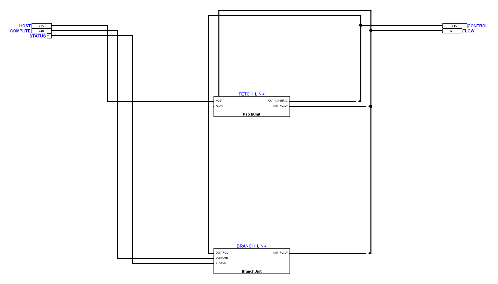
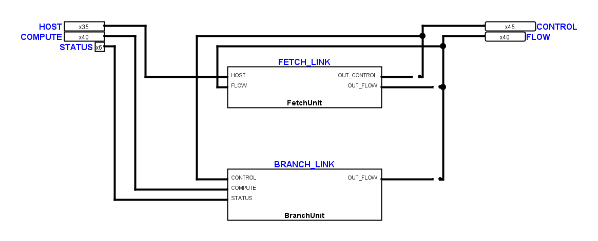
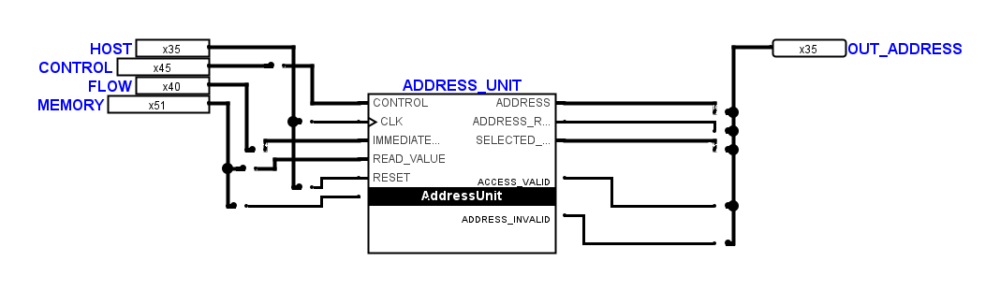

# Übrige Schaltpläne an TinyCPUMain angeglichen

Der Auftrag vom 8. November 2026 wurde in den bestehenden Logisim-Dateien
umgesetzt. 76 bearbeitbare Teilkreisdefinitionen wurden durchgesehen, davon
73 geometrisch geändert. `TinyCPUMain`, `TinyCPUInputMain` und beide
geschützten `FetchDecodeControls`-Zeichnungen sind bytegleich erhalten.
Auch die bereits einfachen Blätter `IntegrationReset`, `CoreDiagnostics`
und `CPUAccumulatorInputUnitLink` behalten ihre Geometrie.

Funktionsgruppen und Symbolschnittstellen bleiben erhalten. Freie Korridore
wurden verkürzt, Leitungszüge lokal versetzt und Umwege entfernt. Neben den
FBoxen bleiben mindestens zwei Punktreihen (20 Pixel) frei; Anschlussleitungen
führen gerade bis zu ihren Pins. Zwei enge Anschlussbereiche erhielten dafür
zusätzlichen Platz. 129 übergroße Gatterbeschriftungen wurden als kleine,
freistehende Beschriftungen gesetzt; ihre internen Bezeichner bleiben erhalten.
Es wurden keine Konstanten, Gatter oder sonstige elektrische Bauteile ergänzt
oder entfernt. Tunnel bleiben verboten.

Die geometrische Gegenüberstellung der 76 bearbeitbaren Definitionen ergibt:

| Messgröße | Eingang | Ergebnis |
| --- | ---: | ---: |
| Rechtwinklige Leitungskreuzungen | 1355 | 1091 |
| Gesamtlänge der Leitungen, Pixel | 606330 | 521480 |
| Verletzungen des FBox-Freiraums | vorhanden | keine |

Damit sinken die Kreuzungen um 19,5 Prozent und die Leitungslänge um
14,0 Prozent. Die Zahlen bewerten lokale Verbesserungen; sie behaupten kein
mathematisch optimales Layout. Dichte Blätter wie `Operations` und das
Peripherie-Hauptblatt behalten fachlich notwendige Kreuzungen und Rückführungen.

## Native Ansichten

`CPUFlowStage` vorher:

`CPUFlowStage` nachher:

Der zusätzlich freigestellte Anschlussbereich der Adresseinheit:

## Nachweise und verbleibende Befunde

Der Eingangszustand aller Dateien einschließlich der Layoutreferenz liegt unter
`artifacts/remaining-layout-20261108/before/logisim/`. Die Vorher-/Nachher-Bilder
sind echte native Logisim-Zeichnungen. Die elektrische Prüfung verwendet die
von Logisim exportierten Kontaktpositionen und Bitbreiten.

- Alle 80 Definitionen haben identische Anschlussnetze, native relative
  Symbolanschlüsse und elektrische Bauteilparameter. Die zusätzlichen
  Textobjekte und die Gatter-Schriftgröße sind reine Darstellungsänderungen.
- Der native Simulationsvergleich besteht für alle 80 Definitionen mit
  jeweils 64 Schritten, insgesamt 5120 Zustandsvergleichen.
- Der separate Abstandsaudit findet in den 76 bearbeitbaren Definitionen
  keine Verletzung des 20-Pixel-Freiraums einer FBox. Gerade Anschlussstücke
  zu eigenen Pins sind ausdrücklich berücksichtigt.
- Alle bearbeiteten Blätter sind frei von ungeteilten T-Kontakten und
  überlappenden Leitungen. Die geschützten Decoder werden nicht repariert.
- Der Vergleich der 267 Unit-Tests findet keine neuen Fehlerfälle. Im
  Eingangslauf bestehen 27 fehlgeschlagene Prüfungen und zwei Testfehler;
  der abschließende vollständige Lauf enthält fünf fehlgeschlagene Prüfungen
  und dieselben zwei Testfehler. Die verbleibenden Rastermeldungen betreffen
  bereits zuvor auffällige Transport-/Übersichtsblätter. Der statische
  Verifikator scheitert außerdem weiterhin an einer bereits eingehend
  fehlenden expliziten Symbolansicht. Die Suite ist deshalb nicht vollständig grün.
- Bereits eingehende elektrische Fehlerwerte, insbesondere in `Operations`,
  werden im Differenzvergleich ausdrücklich als solche mitverglichen. Gleiche
  Fehlerwerte vor und nach dem Layout belegen Verhaltenserhalt, keine
  elektrische Fehlerfreiheit der CPU.

`native-proof.json`, `final-metrics.json`, `final-metrics-detail.json`,
`equivalence.txt` und `test-comparison.json` im genannten Artefaktverzeichnis
enthalten die einzelnen Nachweise. Die Layoutreferenz
`hardware/logisim/layout-restoration-v1.json` ist auf die nativ geprüften und
visuell durchgesehenen exakten Geometrien nachgeführt. Eine Änderung an einer
Leitung oder einem Bauteil hebt diese Ausnahme weiterhin auf; elektrische
Prüfungen und Schnittstellenverträge bleiben uneingeschränkt aktiv.
