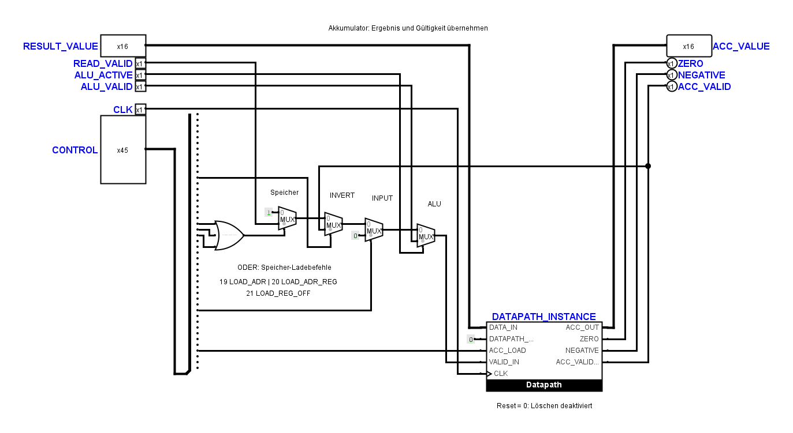

# Akkumulator: Benutzeranordnung, Notizen und Prüfung

Stand: 1. November 2026. Der Benutzer hat `AccumulatorUnit` nach dem ersten
Referenzentwurf erneut angepasst. Dieser Stand wurde vor der Bearbeitung unter
`artifacts/schematic-followup-20261101-123906/logisim/` gesichert.

## Flussrichtung und Beschriftungen

Der [Zeichenstil](tiny_cpu_schematic_style.md) und die Logisim-Anweisungen
enthalten jetzt ausdrücklich den gewünschten Fluss von oben nach unten und
von links nach rechts. Rechts dürfen die Ausgangsleitungen wieder zu den
oberen Pins hochgeführt werden. `TinyCPUMain` und kurze Anpassungen an feste
Bauteilanschlüsse, etwa Multiplexer, sind die genannten Ausnahmen.

Alle Bauteile und Pins der neuen Akkumulator-Zeichnung behalten ihre
Benutzerpositionen. Ergänzt sind die Überschrift, die vier Auswahlstufen,
die drei Speicher-Ladebefehle und der Hinweis zum deaktivierten Register-Reset.
Der verbliebene Text `STATUS[3:0]` ist durch die passende Überschrift ersetzt:
Der lokale Statusbus des früheren Entwurfs ist in dieser Zeichnung nicht mehr
vorhanden; die Signale sind direkt verdrahtet.

## Gefundener Anschlussfehler

Das ODER-Gatter `ACC_MEMORY_REQUEST_SELECT` erhielt im eingehenden Stand
die Steuerbits 19, 21 und 23. Benötigt werden 19 `LOAD_ADR`, 20 `LOAD_ADR_REG`
und 21 `LOAD_REG_OFF`. Zwei Eingangsverbindungen sind mit kurzen lokalen
Anschlussstücken korrigiert; die übrige Verdrahtung bleibt unverändert.

Die bisherigen 61 elektrischen Fälle bestanden auch mit dieser Abweichung,
weil der betroffene Register-Ladefall eine gültige Speicherzelle benutzte.
Ein zusätzlicher Lauf mit einer noch ungültigen Speicherzelle zeigte an
Flanke 2 nach dem Laden `ACC_VALID=1` statt des erwarteten Werts `0`.
Nach der Korrektur besteht dieser Lauf. Zwei Varianten für ungültiges Lesen
über Register beziehungsweise Register plus Offset sind dauerhaft in der
elektrischen Matrix ergänzt. Ein positionsunabhängiger Strukturtest sichert
zusätzlich die drei Steuerquellen des ODER-Gatters.

## Warum liegt DATAPATH_STARTUP_RESET auf null?

Der Anschluss führt innerhalb von `Datapath` zu den Löscheingängen der Register
`ACC` und `ACC_VALID`. Eine `1` löscht also sowohl den gespeicherten Wert als
auch dessen Gültigkeitsbit. Die feste `0` verhindert diese Löschung und hält
den vorhandenen Steuereingang definiert inaktiv.

Die Reset-Funktion wird in der aktuellen `AccumulatorUnit` tatsächlich nicht
ausgelöst. Der öffentliche CPU-Reset setzt nach dem bestehenden Vertrag den
Befehlsablauf zurück und ist kein allgemeines Löschen von Akkumulator, RAM und
Fehlerflags. Der Name `STARTUP_RESET` erzeugt für sich allein keinen Startimpuls.

Eine Bereinigung könnte diese Reset-Schnittstelle grundsätzlich entfernen.
Dafür müssten der Datapath-Anschluss, seine interne Registerbeschaltung und
die betroffenen Instanzen gemeinsam angepasst werden. Die externe Null allein
wegzulassen entfernt diese Funktion nicht sauber. In diesem Durchgang bleiben
Reset-Verhalten und Schnittstellen unverändert.

Ein separater Logisim-Test mit acht aufeinanderfolgenden Vektoren bestätigt:
Bei Reset `0` wird ein geladener Wert gehalten, bei Reset `1` werden beide
Register ohne weitere Taktflanke gelöscht; anschließend ist erneutes Laden
möglich.

## Kurze Begleitbeschreibungen

Neben jeder der 24 `.circ`-Dateien liegt jetzt eine gleichnamige `.md`-Datei.
Alle 56 Teilkreisdefinitionen sind darin kurz nach ihrer Grundfunktion erklärt,
einschließlich Diagnose- und Smoke-Schaltungen:

- [CPU-Kern mit 29 Teilkreisen](../hardware/logisim/TinyCPU.md)
- [Peripherie mit fünf Teilkreisen](../hardware/logisim/TinyCPU_Peripherals.md)
- [Operator-Panel](../hardware/logisim/TinyCPU_Operator.md)
- Diagnose- und Smoke-Beschreibungen jeweils direkt neben ihrer Schaltungsdatei.

Die Diagnosefassungen werden als eigene Fassungen beschrieben. Sie werden
nicht allein aufgrund desselben Teilkreisnamens als identisch mit dem
eingebetteten CPU-Blatt ausgegeben.

## Prüfstand

- 63 elektrische Kernfälle, die beiden minimalen CPU-Traces und Countdown: bestanden.
- Sieben Systemfälle, Kern-Negativkontrolle und Operator-Panel: bestanden.
- Acht Datapath-Resetvektoren: bestanden.
- Projektweite statische Verdrahtungsprüfung und Kontaktprüfung der
  bearbeiteten `AccumulatorUnit`: bestanden.
- 761 native Kontakte der acht Funktionsboxen stimmen in Position und Breite
  mit dem Offline-Modell überein.
- Der positionsunabhängige Anschlussvergleich bestätigt: Nur die zwei
  korrigierten Gattereingänge ändern ihre Quelle. Alle Bauteilpositionen,
  Symbolanschlüsse und die übrigen 28 Kern-Teilkreise bleiben unverändert.
  Insbesondere sind beide geschützten Decoder-Schaltungsdateien unverändert.

Die vollständige Python-Suite und der Offline-Verifier sind weiterhin nicht
vollständig grün. Die Suite umfasst jetzt 229 Tests: Der Decoder-Mutationstest erwartet entfernte Konstanten;
die alten absoluten Rasterprüfungen beanstanden `FetchUnit` und die neue
Benutzeranordnung von `AccumulatorUnit`. Diese Rasterbefunde sind keine
elektrischen Fehler und werden durch die bestandenen elektrischen Tests
auch nicht als visuell abgenommen ausgegeben. Eine Umzeichnung zum bloßen
Erfüllen des alten absoluten Rasters erfolgte nicht.

Die lokalen Rohprotokolle und Vektoren liegen unter
`artifacts/schematic-followup-20261101-123906/`. Nach der unabhängigen
Fehlerprüfung und den elektrischen Nachweisen ist der strukturelle
Topologie-Erwartungswert aktualisiert; die vom Benutzer entfernten lokalen
Bus-Splitter verändern ihn ebenfalls:

`9074ea5b742fc54e1e031f9c1c0aa88fa992ccfe7a20675cfca1a1f27f3c19b3`
