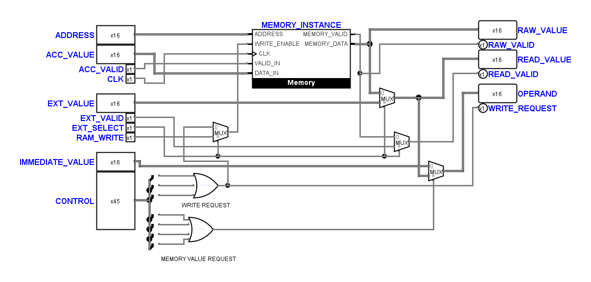
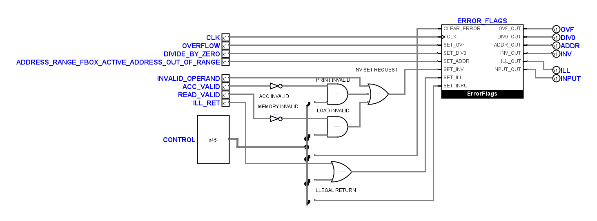

# Nachprüfung der erneut angepassten Schaltpläne

Prüfung vom 2. November 2026 nach der erneuten Benutzerbearbeitung. Die sechs
angepassten Teilkreise sind AddressUnit, MemoryUnit, ExecutionUnit, FaultUnit,
BranchUnit und CoreDiagnostics. Der eingehende Stand einschließlich aller
anderen `.circ`-Dateien und der lokalen Git-Änderungen ist unter
`artifacts/schematic-recheck-20261102/` gesichert.

## Gefundener Fehler und lokale Korrektur

Der Eingang 0 des Multiplexers für `Memory.WRITE_ENABLE` war mit dem
Steuerbit `STORE_ADR_REG` verbunden. Er muss die zusammengefasste Anforderung
`MEMORY_WRITE_REQUEST` erhalten, damit auch direktes Schreiben und Schreiben
mit Registeroffset funktionieren. Eingang 1 bleibt `RAM_WRITE`; `EXT_SELECT`
wählt weiterhin zwischen internem und externem Schreibpfad.

Der Countdown belegt den eingehenden Fehler: An Flanke 2 vor der aktiven
Flanke fehlt `MEM_WRITE` (Soll 1, Ist 0). Der neue positionsunabhängige
Regressionstest schlägt an diesem Eingang fehl und besteht nach der Korrektur.

Nur dieser Leitungszweig wurde vom Steuerbit auf den vorhandenen OR-Ausgang
umgelegt. Sämtliche Bauteile, Beschriftungen, Pins, Positionen und
Symbolzeichnungen sind gegenüber dem eingehenden Benutzerstand unverändert.
Die übrigen 28 Kern-Teilkreise und alle anderen 23 `.circ`-Dateien sind bytegleich.
Das schließt die geschützten Decoderzeichnungen ein.

## Bestätigte Benutzeränderungen

Die anderen fünf angepassten Teilkreise entsprechen funktional dem zuletzt
elektrisch geprüften Stand. Der Vergleich löst die Steuerbusse bitweise auf,
berücksichtigt Logisims geänderte XML-Reihenfolge und erlaubt das Vertauschen
gleichwertiger OR-/AND-Eingänge.

In FaultUnit wurden die beiden Null-Konstanten an `ILLEGAL_RETURN_OR` entfernt
und das Gatter von vier auf zwei Eingänge reduziert. Die beiden entfernten
Quellen versorgten ausschließlich neutrale OR-Eingänge; die verbleibenden
Eingänge bleiben `ILL_RET` und `SET_ILL`. Die Änderung ist elektrisch
gleichwertig. Der Kern enthält nun 27 statt 29 Konstanten.

Der vom Benutzer gekürzte FaultUnit-Pinname
`ADDRESS_RANGE_FBOX_ACTIVE_ADDRESS_OUT_OF_RANGE` bleibt erhalten. Sein
Symbolkontakt sowie die übrigen Symbolkontakte stimmen in Position und Breite
mit der vorherigen Einbettung überein. Es sind keine Tunnel vorhanden.

## Reparatur des Strukturprüfers

Der bisherige AP-18-Prüfer suchte die aktiven OR-Eingänge stets 10 Pixel ober-
und unterhalb des Gattermittelpunkts. Das passte zu den mittleren Anschlüssen
der Vier-Eingangs-Ausführung. Die Zwei-Eingangs-Ausführung besitzt dagegen
native Kontakte bei ±20 Pixel. Dadurch meldete der Prüfer fälschlich eine
fehlende Interrupt-Rückführung und verdeckte zahlreiche weitere Tests.

Der Prüfer und der zugehörige Logisim-Test bestimmen die tatsächlichen
Gatterkontakte jetzt anhand der Bauteileigenschaften. Eine zusätzliche
Regression prüft beide Ausführungen mit echten Verbindungen sowie die
Ablehnung jedes einzeln abgetrennten aktiven Eingangs. Die positive
Zwei-Eingangs-Prüfung scheiterte am bisherigen Prüfer; die neue Prüfung
akzeptiert beide gültigen Ausführungen und erkennt alle vier Trennungen.

## Nachweise

- 63 elektrische Kernfälle, zwei minimale CPU-Läufe und Countdown: bestanden.
- Alle sieben elektrischen Systemfälle: bestanden.
- Bitweiser Vergleich der funktionalen Netze aller sechs angepassten
  Teilkreise gegen den zuletzt elektrisch geprüften Stand: bestanden,
  einschließlich des unabhängigen Nachweises der neutralen OR-Eingänge.
- Alle 329 nativen Bauteilkontakte und 359 geladenen Leitungsstücke der sechs
  Teilkreise stimmen mit dem Verbindungsmodell und der gespeicherten Zeichnung
  überein. Der Kontaktvergleich verwendet den eingehenden Komponentenstand;
  dessen XML ist gegenüber der Reparatur unverändert.
- Keine impliziten Leitungskontakte oder überlappenden Segmente in diesen
  Teilkreisen; die projektweite statische Treiberprüfung besteht.
- Sämtliche Blattpins sind angeschlossen und haben waagrechte Leitungseintritte.
- Die nativen Vorher-/Nachher-Ansichten wurden geprüft; die kompakte
  Benutzeranordnung wurde beibehalten.

Sicherung, Simulatorlogs, native Ansichten und ausführbare Vergleiche liegen
unter `artifacts/schematic-recheck-20261102/`. Wesentliche Dateien sind
`proof.py`, `proof.json`, `compare.py`, `electrical-before.txt`,
`electrical-after.txt`, `system.txt`, `regression-before.txt`,
`regression-after.txt`, `validator-regressions.txt` und `python-tests-final.txt`.

## Noch offene Prüfbefunde

Die vollständige Python-Suite umfasst jetzt 240 Tests und meldet neun
Fehlschläge sowie einen Fehler. Fünf Rasterbefunde betreffen FetchUnit,
AccumulatorUnit, AddressUnit, MemoryUnit und FaultUnit. Vier Tests vergleichen
gegen den alten Struktur-Fingerabdruck; ein Decoder-Mutationstest erwartet
weiterhin bereits entfernte Konstanten. Die Erwartungswerte wurden nicht
auf die neue Zeichnung umgeschrieben. Die zuletzt vereinfachte FaultUnit
ändert durch ihre entfernten Konstanten und OR-Eingänge zusätzlich den
Bauteilgraphen.

Bei den sechs diesmal betrachteten Teilkreisen beanstandet die absolute
Rasterprüfung 17 lange Läufe in AddressUnit, acht in MemoryUnit und neun in
FaultUnit. ExecutionUnit, BranchUnit und CoreDiagnostics bestehen diese
Prüfung. Die Anschlusskorrektur verändert diese Befunde nicht. Das starre
20/40/60/80-Koordinatenraster ist strenger als eine reine Abstandsbewertung;
es wurde nicht durch eine erneute automatische Anordnung der Benutzerzeichnung
erzwungen. Knapp aneinanderliegende Busanzeigen und einzelne enge lokale
Leitungsspuren bleiben Gegenstand einer gesonderten visuellen Stilabnahme.
Eine vollständige projektweite Stilabnahme wird hier nicht erklärt.

Die bereits dokumentierte [Adressregister-Gültigkeitslücke](tiny_cpu_address_review.md)
und der [MUL-Grenzfall](tiny_cpu_operations_repair.md) sind weiterhin offen.
Die Übereinstimmung mit dem vorherigen Netz und die bestandenen Referenzfälle
belegen keine vollständige funktionale Freigabe aller möglichen Programme.
