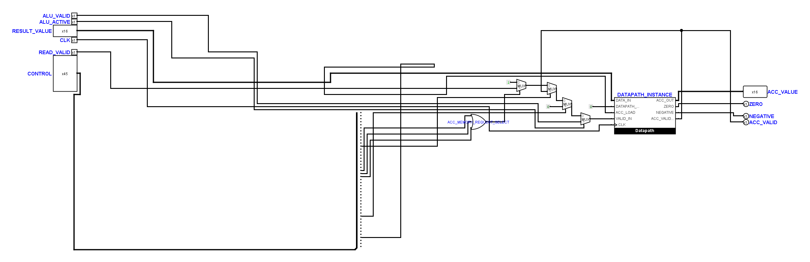
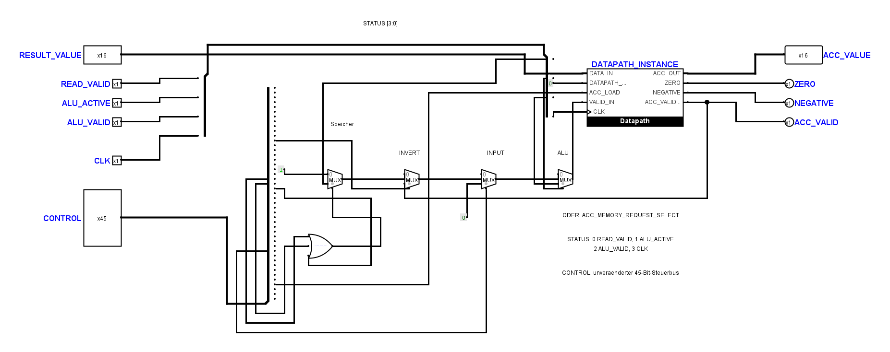
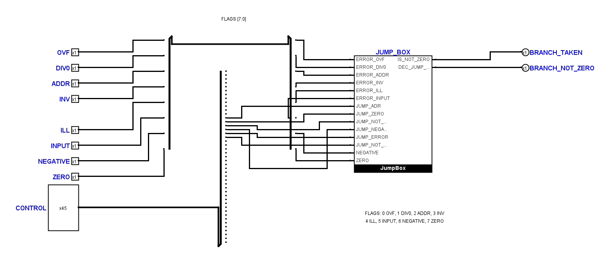
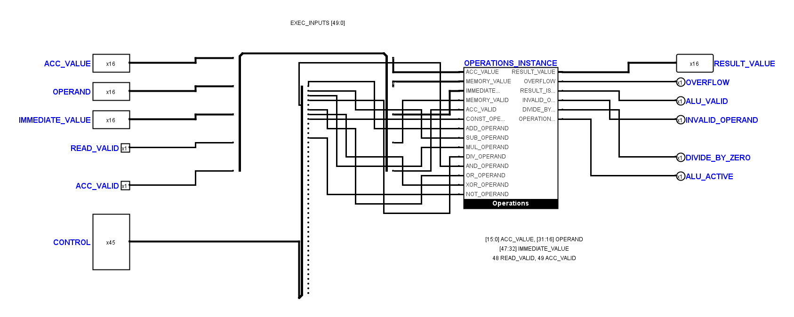

# Erste Schaltplan-Referenzen mit sichtbaren Bussen

**Historischer Teilstand:** Die nachfolgend gezeigte Akkumulator-Zeichnung wurde
inzwischen vom Benutzer weiter angepasst. Der aktuelle Stand mit ergänzten
Notizen und Prüfungen steht im [Nachtrag](tiny_cpu_schematic_followup.md).
Insbesondere enthält die aktuelle `AccumulatorUnit` keinen lokalen `STATUS`-Bus
mehr; die folgenden Angaben zu diesem Bus beschreiben den früheren Entwurf.

Stand: 1. November 2026. Dieser Durchgang überarbeitet drei Teilkreise in
`hardware/logisim/TinyCPU.circ`: `AccumulatorUnit`, `BranchUnit` und
`ExecutionUnit`. Die eingehenden lokalen Änderungen wurden vorab gesichert.
Die anderen 26 Teilkreise dieses Kernprojekts bleiben unverändert,
einschließlich des geschützten `FetchDecodeControls`. Auch alle anderen
`.circ`-Dateien bleiben unverändert.

Die Präzisierung des Benutzerstils ist übernommen: Bei unvollständigen Bündeln
werden die tatsächlich vorhandenen Leitungen von oben beziehungsweise von
links gezählt. Zusammengehörige Signale sollen, wo es übersichtlicher wird,
über physisch verdrahtete Busse laufen. Das bisherige absolute Spurraster
bleibt eine technische Teilprüfung und ersetzt diese visuelle Beurteilung nicht.

## Akkumulator

Die vier Auswahlstufen stehen in einer Reihe und sind nach ihrer Funktion
beschriftet: Speicher, `INVERT`, `INPUT`, ALU. Der Ergebnisbus führt oben zum
Datapath; die Rückführung von `ACC_VALID` bleibt unterhalb des Datapaths und
der Auswahlstufen. Links und rechts beginnen die Pins auf derselben Höhe.
Nach den ersten vier Eingangspins folgt ein zusätzlicher Abstand.

Vier Eingangssignale laufen über den gemeinsamen Bus `STATUS[3:0]` zur
Verarbeitung. Die Zusammenführung steht nahe an den Blattpins, die Aufteilung
nahe an den Verbrauchern. Die Busbelegung steht zusätzlich im Schaltplan.
Der vollständige technische Name des ODER-Gatters bleibt erhalten; seine
lesbare Beschriftung steht separat im freien Legendenbereich, damit Logisims
zentrierte Gatterbeschriftung das Symbol nicht überdeckt.

Die native Logisim-Ansicht benötigt 1853 × 734 statt 2653 × 861 Pixel,
also rund 40 Prozent weniger Bildfläche einschließlich der Legende.
Das ist ein erster verbesserter Referenzplan; insbesondere die Auffächerung
des bestehenden 45-Bit-Steuerbusses bietet noch Raum für weitere Vereinfachung.

Vorher:

Nachher:

## Sprunglogik und Ausführung

`BranchUnit` fasst die Fehler- und Ergebnisflags zu einem acht Bit breiten Bus
zusammen. Die Eingänge bilden zwei Vierergruppen; der Steuerbus folgt mit
zusätzlichem Abstand. Die Aufteilung erfolgt unmittelbar vor der `JumpBox`.

`ExecutionUnit` führt die drei 16-Bit-Operanden und ihre zwei Gültigkeitssignale
über `EXEC_INPUTS[49:0]` zur Verarbeitung. Die Ausgangspins folgen der
Reihenfolge der tatsächlichen Operations-Ausgänge und bilden Vierergruppen.
Der zusätzliche Bus erfordert lokale Splitter und einige zusätzliche kurze
Leitungsstücke; die Zahl der XML-Leitungsstücke allein ist deshalb kein
geeignetes Maß für die Vereinfachung.

## Busbelegung und Konstanten

| Teilkreis | Lokaler Bus | Belegung, niederwertige Bits zuerst |
| --- | --- | --- |
| `AccumulatorUnit` | `STATUS[3:0]` | 0 `READ_VALID`, 1 `ALU_ACTIVE`, 2 `ALU_VALID`, 3 `CLK` |
| `BranchUnit` | `FLAGS[7:0]` | 0 `OVF`, 1 `DIV0`, 2 `ADDR`, 3 `INV`, 4 `ILL`, 5 `INPUT`, 6 `NEGATIVE`, 7 `ZERO` |
| `ExecutionUnit` | `EXEC_INPUTS[49:0]` | 15:0 `ACC_VALUE`, 31:16 `OPERAND`, 47:32 `IMMEDIATE_VALUE`, 48 `READ_VALID`, 49 `ACC_VALID` |

Die öffentlichen Pins, ihre Namen, Richtungen, Breiten und Symbolpositionen
bleiben kompatibel. Die `circ-port`-Referenzen sind an die verschobenen Blattpins
angepasst. Der bestehende 45-Bit-Steuerbus und seine Bitbelegung bleiben erhalten.
Es entstehen keine Tunnel.

Die Konstantenzahl bleibt unverändert: 29 im Kernprojekt, 64 im Gesamtbestand.
Die drei Akkumulator-Konstanten definieren den festen Gültigkeitswert für den
ersten Multiplexer, die ungültige `INPUT`-Auswahl und den inaktiven
Datapath-Reset. Die beiden Nullquellen bleiben lokal, weil ihre Zusammenlegung
eine zusätzliche Verbindung zwischen der Auswahlstufe und dem Datapath
erfordern würde. Konstanten wurden weder ergänzt noch in Hilfsboxen versteckt.

## Nachweise und offene Punkte

Die Ansichten stammen aus der Zeichenfunktion von Logisim-evolution 4.1.0.
Der gesicherte Eingang, die Entwürfe, das Vergleichsskript `proof.py`,
der Routingentwurf und die Rohprotokolle liegen lokal unter
`artifacts/schematic-polish/`.

- Für jeden bearbeiteten Teilkreis stimmen die vollständigen Verbindungsgruppen
  aller funktionalen Anschlussbits mit dem Eingang überein. Die Splitter werden
  dabei als Bitverbindungen aufgelöst. Namen und elektrische Bauteilparameter
  sind ebenfalls verglichen.
- Vertauschte Bits an jeweils einem Busende werden als Negativkontrolle erkannt.
  Alle 771 nativen Anschlusspunkte der acht Funktionsboxen stimmen in Position
  und Bitbreite mit dem Offline-Modell überein.
- Alle drei bearbeiteten Blätter bestehen Spurraster- und Kontaktprüfung;
  es gibt dort keine überlappenden Leitungsstücke oder impliziten T-Kontakte.
  Die projektweite statische Schaltungsprüfung besteht.
- Die 61 elektrischen Kernfälle sowie die beiden minimalen CPU-Traces und der
  Countdown-Trace bestehen. Auch die sieben Systemfälle, die Kern-Negativkontrolle
  und das Operator-Panel bestehen.
- Die Python-Suite läuft mit 228 Tests. Ein Fehler betrifft weiterhin den
  Decoder-Mutationstest, der entfernte Konstanten erwartet. Ein fehlgeschlagener
  Test betrifft das bereits im Eingang abweichende absolute Spurraster der
  unveränderten `FetchUnit`. Beide Befunde sind mit dem Eingang verglichen.
  Der frühere Rasterbefund in `AccumulatorUnit` ist durch die Umzeichnung behoben.
  Der vollständige Offline-Verifier stoppt weiterhin am `FetchUnit`-Rasterbefund.

Zusätzliche Splitter verändern den strukturellen Topologie-Fingerabdruck, obwohl
die funktionalen Anschlussbits dieselben Netze bilden. Nach dem unabhängigen
Bitvergleich, den Negativkontrollen und den elektrischen Nachweisen wurde der
Erwartungswert in `tinycpu-core-control-v1.json` aktualisiert:

`233cd2df9f38d5a852be046fa7396aa250fc9dca804a44fc79b54b026167faf1`

Die übrigen 53 Teilkreisdefinitionen im Gesamtbestand sind in diesem Durchgang
nicht neu gezeichnet oder visuell abgenommen. Die engen Anschlussreihen der
vorhandenen Splitter und Funktionssymbole bleiben als lokale Auffächerungen
erhalten; sie rechtfertigen keine engen langen Leitungsbündel. Eine vollständige
projektweite Abnahme nach allen Zeichenregeln bleibt offen.
