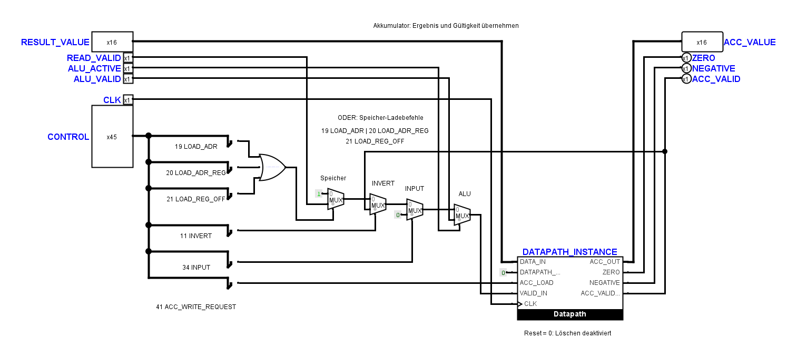

# Prüfung weiterer Benutzeränderungen

Der eingehende Stand wurde unter
`artifacts/schematic-review-20261101-190929/logisim/` gesichert.
Verglichen wurden die Änderungen seit der vorherigen Operations-Reparatur.

## Ergebnis der Prüfung

| Teilkreis | Ergebnis |
| --- | --- |
| `ErrorFlags` | Neue Anordnung, gleiche native Anschlussstruktur und Bauteilparameter. Unverändert übernommen. |
| `FetchDecode` | Neue Anordnung, gleiche Anschlussstruktur; ROM-Inhalt unverändert. Der gesetzte Anfangswert `PROGRAM_LIMIT=0xfff` bleibt erhalten. |
| `DivArithmeticCircuit` | Neue Anordnung, gleiche native Anschlussstruktur und Bauteilparameter. Unverändert übernommen. |
| `Operations` | Die angepassten Leitungsstücke bilden weiterhin dieselben Netze. Unverändert übernommen. |
| `ExecutionUnit` | Verschobene Ausgangspins und Leitungswege bleiben erhalten; die Symbolanschlüsse und Kern-Verbindungen sind kompatibel. |
| `AccumulatorUnit` | Funktionaler Fehler in der Auswahl aus dem Steuerbus gefunden und lokal korrigiert. |

Der Anschlussvergleich der vier internen Teilkreise nutzt die tatsächlich von
Logisim gelesenen Kontakte. Positionen, Beschriftungsdarstellung, der für die
Referenzprüfung eingesetzte ROM-Inhalt und Anfangswerte von Eingabepins sind
keine Bestandteile dieses Netzvergleichs. Der wirkliche ROM-Inhalt wurde
gesondert verglichen; die extern angesteuerten Eingänge werden zusätzlich in
den elektrischen Kern- und Systemfällen geprüft.

## Korrektur im Akkumulator

Der 45-Bit-Bus `CONTROL` enthält gleichzeitig gesetzte einzelne Steuersignale.
Ein Gleichheitsvergleich des gesamten Busses mit `0x12`, `0x13` oder ähnlichen
Zahlen wählt deshalb nicht das betreffende Signal aus. Im eingehenden Stand
speicherte bereits `LOAD_CONST(3)` nach der ersten Flanke `0` statt `3`, weil
die Akkumulator-Schreibfreigabe nicht entstand.

An den sechs bisherigen Auswahlstellen liegen jetzt kleine, lokal verdrahtete
Splitter mit jeweils einem verwendeten Ausgang. Sie entnehmen die Bits:

| Bit, ab null gezählt | Signal |
| --- | --- |
| 19 | `LOAD_ADR` |
| 20 | `LOAD_ADR_REG` |
| 21 | `LOAD_REG_OFF` |
| 11 | `INVERT` |
| 34 | `INPUT` |
| 41 | `ACC_WRITE_REQUEST` |

Die Vergleichsbauteile und ihre sechs Zahlenkonstanten sind dadurch entfallen.
Die anderen Bauteile, Blattpins, Auswahlstufen und der Datapath bleiben an
den Benutzerpositionen. Der interne Name `ACC_MEMORY_REQUEST_SELECT` des
ODER-Gatters ist für Diagnose und Prüfung wieder ergänzt; die separate
Beschriftung bleibt sichtbar. Alle Verbindungen bleiben physisch verdrahtet.

Der Offline-Verbindungsvergleich unterstützt sowohl den vollständigen
Steuerbus-Aufteiler als auch diese sechs lokalen Abgriffe. Er prüft weiterhin
die 45-Bit-Breite, die unveränderten Signalnummern, die richtigen sechs Bits
und die echte Verbindung zum CONTROL-Pin. Unbenutzte Splitterbits mit Logisims
Kennzeichnung `none` werden bitgenau berücksichtigt.

## Prüfungen

- 63 elektrische Kernfälle sowie minimale CPU-Traces und Countdown: bestanden.
- Sieben elektrische Systemfälle: bestanden.
- Projektweite statische Verdrahtungsprüfung: bestanden.
- Kontaktprüfung aller sechs genannten Teilkreise: bestanden.
- Der bisher akzeptierte Kern-Topologie-Fingerabdruck bleibt unverändert;
  sein Erwartungswert wurde nicht angepasst.
- Neue Regressionen prüfen unbelegte Splitterbits, einen falsch ausgewählten
  Nachbarbit und einen vom Steuerbus getrennten Abgriff.

Die Python-Suite umfasst jetzt 235 Tests. Es bleiben die bereits bekannten
Rasterbefunde in `FetchUnit` und `AccumulatorUnit` sowie der Decoder-Test,
der entfernte Konstanten erwartet. Der vollständige Offline-Verifier stoppt
weiterhin am alten absoluten Rastercheck. Diese Befunde wurden nicht durch
eine Umzeichnung der Benutzerpläne oder abgeschwächte Erwartungen beseitigt.
Der frühere, separat dokumentierte MUL-Überlaufbefund ist von diesen
Benutzeränderungen unberührt.

Rohdaten, native Vorher-/Nachher-Ansichten und Vergleichsprotokolle liegen unter
`artifacts/schematic-review-20261101-190929/`. Die geschützten
`FetchDecodeControls`-Zeichnungen bleiben unverändert.
