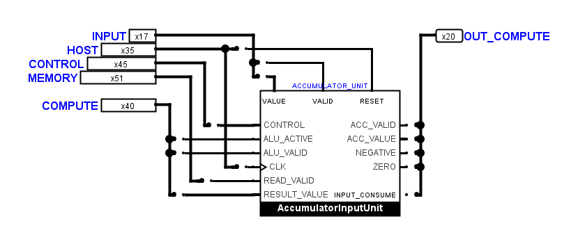
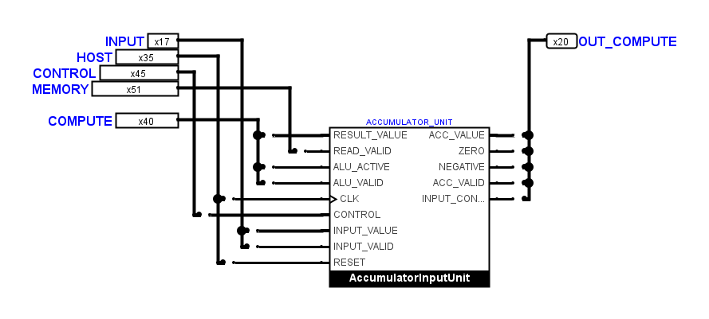
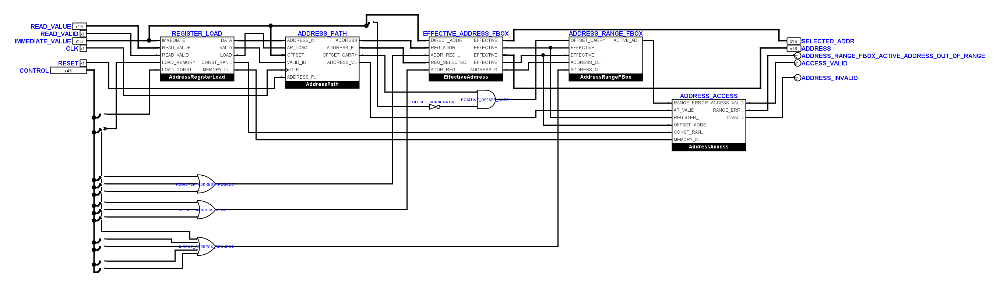
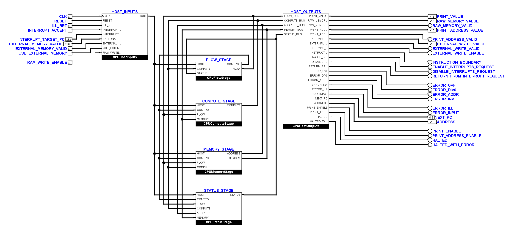

# Einheitliche Logisim-Funktionsboxen

Ausgangspunkt ist der erneut vom Benutzer gespeicherte Stand vom
9. November 2026, einschließlich aller noch nicht committeten Änderungen.
Die vollständige Sicherung liegt unter
`artifacts/standard-fboxes-20261109/before/`.

Alle 34 eigenen Symboldefinitionen wurden durch die von Logisim erzeugte
Darstellung `logisim_evolution` ersetzt: 33 im Kernprojekt und eine in der
MUL-Diagnose. Alle 80 Schaltungsdefinitionen verwenden damit die eingebaute
Darstellung. Es gibt keine eigenen `appear`-Zeichnungen mehr. Die Höhe der
Standardboxen ergibt sich weiterhin aus ihrer Anschlusszahl; lange Namen
kürzt Logisim in seiner festen Standardbreite selbst ab.

Die beiden geschützten `FetchDecodeControls`-Zeichnungen bleiben gegenüber
dem eingehenden Stand bytegleich. Sie verwendeten bereits die Standardform.
Ihre internen Bauteile, Pins und Leitungen wurden nicht bearbeitet.

## Anschlüsse und Leitungsführung

Die Standardform leitet die Anschlussreihenfolge aus den Blattpins ab.
Deshalb reicht das Umstellen des Darstellungsattributs allein nicht aus:
Bei 38 Instanzen ändern sich Anschlusspositionen. Jede Verbindung wurde
nach ihrem Signalnamen und ihrer Breite zugeordnet. Insbesondere bleiben
MUL-Aktivierung und LEFT sowie die Ergebnis- und Gültigkeitssignale getrennt.
Die MUL-Diagnose und das Kernblatt behalten ihre jeweilige gezeichnete
Eingangsreihenfolge; beide Symbole werden von Logisim erzeugt.

Die zehn Verbindungsblätter besitzen direkte Abgriffe auf der jeweiligen
Anschlusszeile. Leere Zwischenräume wurden anschließend verkürzt, ohne
Netze zusammenzulegen oder die Busbitbelegung zu ändern. Die sechs
Stufenblätter und beide Hauptübersichten sind an die Standardanschlüsse
angepasst. In `AddressUnit` und `ExecutionUnit` wurden die veränderten
Ein- und Ausgangsreihen ebenfalls nach Signalnamen aufgefächert.

Der Benutzer hat die Vierergruppen der äußeren Blattpins ausdrücklich
bestätigt und den dafür größeren Platzbedarf akzeptiert. Die dichten
Standardanschlüsse werden deshalb zu den vorhandenen Gruppen aufgefächert.
Vor allem die beiden Hauptübersichten benötigen rechts mehr Breite.
Über die 52 ungeschützten Kernblätter steigt die Leitungslänge dadurch von
311.690 auf 342.560 Pixel; die Zahl der geometrischen Kreuzungen ohne
Verbindung beträgt 926 statt 905. Die einheitliche Standardform und die
beibehaltenen Vierergruppen bestimmen diese Abwägung.

Die Sichtprüfung korrigiert außerdem drei enge Gatterkorridore in `JumpBox`,
`AddressAccess` und `FaultInputUnit`. Überflüssige rückwärts gerichtete
Ausgangsstummel in `CPUFlowStage` entfallen beim Neuanschließen.
Elf Schriftangaben in `OutputMemoryPath` und `InterruptController` wurden
von 9 auf die vorgeschriebenen 10 Punkt angehoben.

## Native Ansichten

Vorher: eigene Symbolform mit Anschlüssen an mehreren Seiten.

Nachher: Logisims eingebaute Standardform und direkte Busabgriffe.

Die Adresslogik verwendet ebenfalls ausschließlich Standardboxen:

Hauptübersicht mit erhaltenen Vierergruppen und breiterer Auffächerung:

## Elektrische Nachweise

Der native Vergleich aller 80 Schaltungsdefinitionen bestätigt dieselben
benannten Anschlussnetze, Signalbreiten und Richtungen. Die relativen
Anschlusspositionen und elektrischen Parameter aller primitiven Bauteile
bleiben erhalten. Für FBoxen werden die tatsächlichen nativen Anschlüsse
mit ihren Signalnamen verglichen; deren neue Geometrie ist Teil des Auftrags.
Beide Decoderblöcke werden zusätzlich byteweise verglichen.

Die vorhandenen Geometrieausnahmen wurden nach nativem Anschlussvergleich
und Sichtprüfung nachgeführt. Sie ändern weder elektrische Prüfungen noch
die Prüfung der tatsächlichen Leitungslücken. Der FBox-Korridoraudit und
die ergänzende Gatterkontrolle finden in den geprüften Kernblättern keine
verbliebenen engen vorbeiführenden Abschnitte.

Der bestehende Topologie-Fingerabdruck berücksichtigt bei Registern auch
die Beschriftungsschrift. Für die beiden Peripherieblätter mit der Änderung
von 9 auf 10 Punkt wurden deshalb ausschließlich die beiden erwarteten
Fingerabdrücke nachgeführt. Grundlage sind der unabhängige native
Netzvergleich und der native Vorher-/Nachher-Verhaltensvergleich.
Die elektrischen Prüfbedingungen bleiben erhalten.

Es bestehen 276 Unit-Tests, die vollständige CPU-Befehlsmatrix mit 63 Fällen
und die INPUT-Prüfung mit zehn VM-Vergleichen, Reset-Wahrheitstabelle und
drei abgewiesenen elektrischen Negativkontrollen. Der native Verhaltensvergleich
liefert 4.544 identische eingeschwungene Zustände über 71 Kern- und
Diagnosefassungen einschließlich der beiden Peripherieblätter mit neuer
Schriftgröße.
Auch die statische Leitungsprüfung und die Offline-Prüfung aller 24 Dateien
mit 80 Schaltungsdefinitionen bestehen.

Protokolle stehen unter `artifacts/standard-fboxes-20261109/`, insbesondere
`converted.json`, `native-proof.json`, `font-fingerprint-updates.json`,
`metrics.json`, `gate-clearance.json`, `reference-updates.json`,
`unit.txt`, `native.txt`, `core.txt`, `input.txt` und `check-root/`.
