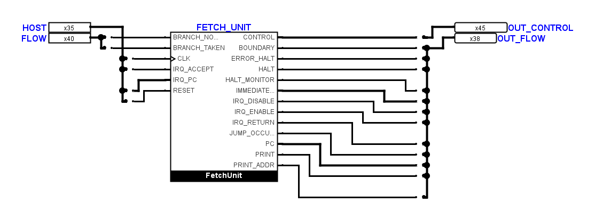
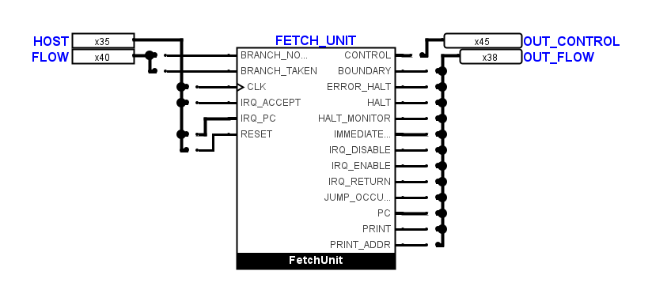
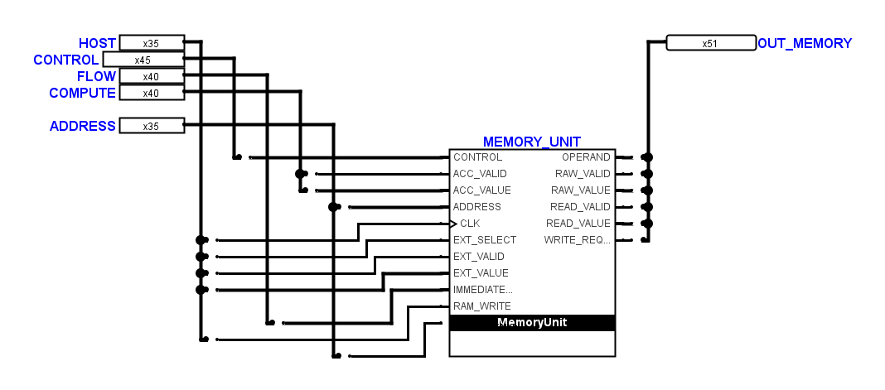
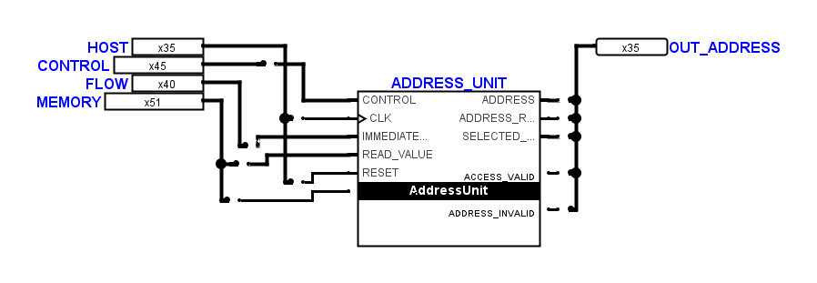

# Strengere Verdichtung nach dem zweiten Bildschirmfoto

Die zweite Ansicht von `CPUAddressUnitLink` ist die maßgebliche kompakte
Referenz. Ihre neuere Autosicherung wurde vor dem Eingriff gesichert, ihre
elektrische Topologie mit der gespeicherten Fassung verglichen und ihre
Zeichnung unverändert übernommen. Die übrigen Änderungen dieses Durchgangs
verdichten 71 weitere Teilkreiszeichnungen. Beide CPU-Hauptübersichten und
beide geschützten `FetchDecodeControls` bleiben bytegleich zum Eingang.

Ausgangsbusse stehen näher an den Boxen; geeignete Einzelabgriffe liegen direkt
auf den Anschlusszeilen. Dadurch entfallen beispielsweise beim Fetch-Blatt
sämtliche gestaffelten Ausgangsumwege. Dessen Leitungslänge sinkt von 4690
auf 1270 Pixel. Dasselbe Prinzip wurde auf Speicher-, Ausführungs-, Fehler-
und Sprungverbindungen angewandt.

Die übrige Verdichtung entfernt freie Streifen im 10-Pixel-Raster bis zu den
tatsächlich benötigten Leitungsabständen. Es gibt keine pauschalen Restbreiten
von 80 oder 100 Pixeln mehr. Kein bearbeitetes Blatt erhält dadurch längere
Leitungen oder mehr Kreuzungen. Native Bauteilgrößen, Symbolanschlüsse und
Bitzuordnungen bleiben erhalten. Ein mathematisch global optimales Layout
ist damit nicht behauptet; fachlich erforderliche Rückführungen bleiben sichtbar.

## Sichtbarer Unterschied

Fetch-Verbindung vor diesem strengeren Durchgang:

Fetch-Verbindung mit direkt angeordneten Busabgriffen:

Speicher-Verbindung nach demselben Prinzip:

Erhaltene Benutzerreferenz:

## Prüfung

Der native geometrische Audit der 76 ungeschützten Blätter einschließlich der
Benutzerreferenz ergibt 520590 Pixel vor und 455000 Pixel nach diesem
Durchgang: nochmals 12,6 Prozent weniger Leitungslänge. Die Zahl der Kreuzungen
bleibt bei 1091. Der 20-Pixel-Freiraum um FBoxen bleibt vollständig eingehalten;
gerade Anschlussstücke dürfen bis zu ihren eigenen Pins führen.

Alle 80 Teilkreisdefinitionen haben identische native Anschlussnetze,
Bitbreiten, relativen Symbolanschlüsse und elektrischen Bauteilparameter.
Der native Simulationsvergleich besteht für 64 Schritte je Definition,
insgesamt 5120 Vergleiche. Bereits eingehende Fehlerwerte werden dabei gleich
mitverglichen; Verhaltenserhalt bedeutet keine elektrische Fehlerfreiheit.
Alle Transportblätter bestehen die Prüfung auf mindestens eine freie
Rasterzeile selbst in kurzen Auffächerungen. Die bearbeiteten Zeichnungen
enthalten keine überlappenden Leitungen oder ungeteilten T-Kontakte.

Die Layoutreferenz enthält nur die exakt nativ geprüften und visuell
durchgesehenen Geometrien. Der Transporttest verwendet nun dieselbe
`inspect_schematic_layout`-Regel wie die Produktionsprüfung: eine exakt
geprüfte Zeichnung wird akzeptiert, bei jeder Geometrieänderung greift wieder
die Rasterprüfung. Die wirklichen Parallelabstände werden weiterhin separat
und ohne Ausnahme geprüft. Damit erzwingt ein absolutes Modulo-Raster keine
künstliche Verlängerung der vom Benutzer gewünschten kompakten Zeichnungen.

Ausgangssicherung, Autosicherung, native Ansichten, Anschlussnachweise,
Abstandsaudit und Simulationsprotokoll liegen unter
`artifacts/strict-layout-20261108/`. `unit-before.txt` und `unit-after.txt`
halten die vollständigen Testläufe fest: 265 der 267 Tests bestehen; dieselben
zwei eingehenden Testfehler bleiben. Es gibt keine neuen Fehlerfälle.
Die vollständige Offline-Verifikation besteht für alle 24 Dateien und
80 Definitionen einschließlich der Struktur- und Vertragsprüfungen.
Zwei bereits eingehende
Verifikatorprobleme mit der fehlenden expliziten Symbolansicht beziehungsweise
der Komponentenerkennung werden durch diese Layoutänderung nicht repariert.
