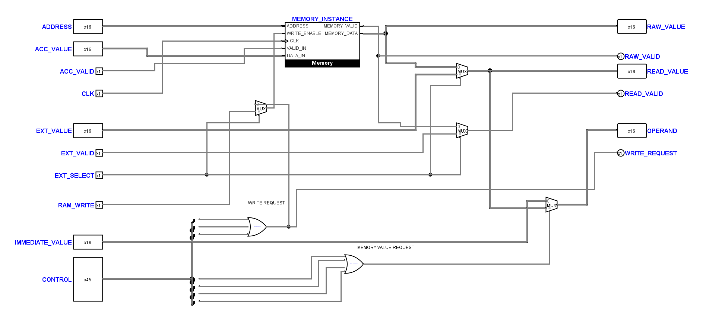
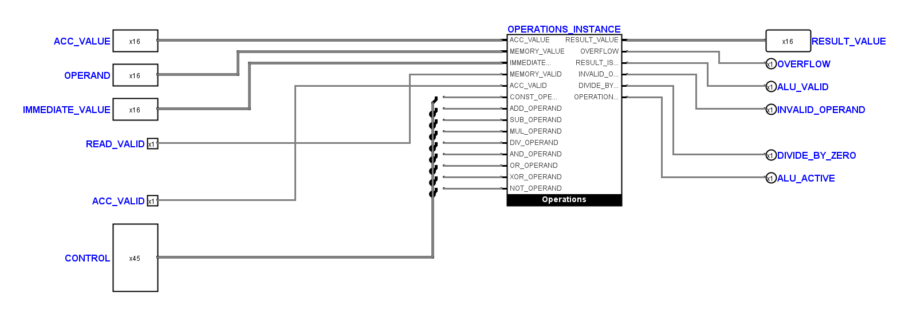
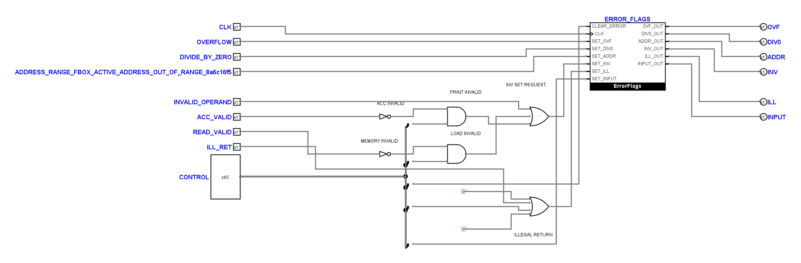
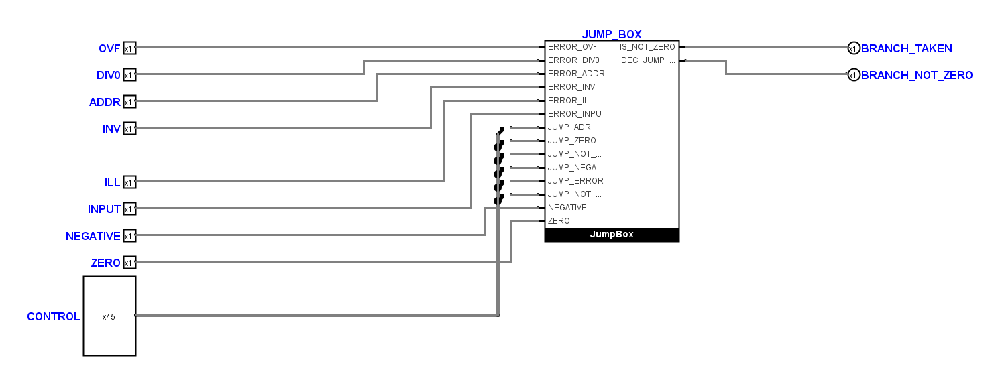
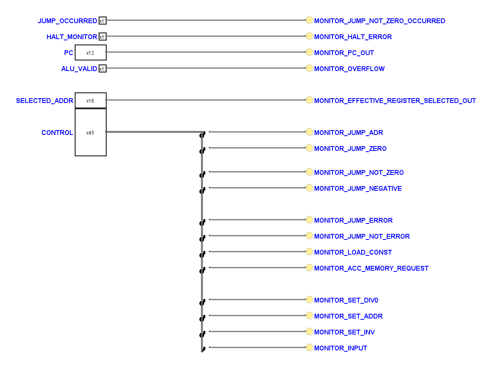

# Layout von MemoryUnit bis CoreDiagnostics

Nach der erneuten Benutzerbearbeitung wurde dieser Stand durch die
[Nachprüfung und lokale Anschlusskorrektur](tiny_cpu_schematic_recheck.md)
ergänzt. Die folgenden Bilder dokumentieren die frühere Layoutüberarbeitung.

Überarbeitung vom 2. November 2026 nach der vom Benutzer bestätigten
`AddressUnit`-Referenz. Geändert wurden ausschließlich die fünf genannten
Teilkreiszeichnungen in `hardware/logisim/TinyCPU.circ` und die Prüfung ihrer
lokalen Steuerbus-Abgriffe. Der vollständige eingehende Stand einschließlich
lokaler Benutzeränderungen liegt unter `artifacts/unit-layout-20261102/logisim/`;
die damaligen Änderungen gegenüber Git zusätzlich in `local-changes.patch`.

| Teilkreis | Anordnung | Leitungsstücke vorher → nachher |
| --- | --- | ---: |
| MemoryUnit | RAM oben; externe Auswahl rechts daneben; Schreibfreigabe und Operandenauswahl in eigenen Stufen | 114 → 94 |
| ExecutionUnit | Dateneingänge direkt zur Operations-Box; benötigte Steuerbits unmittelbar daneben | 91 → 48 |
| FaultUnit | Direkte Fehler oben; Gültigkeitsprüfung darunter; Rückführung links vor der ErrorFlags-Box | 98 → 79 |
| BranchUnit | Flags direkt zur JumpBox; Sprungsteuerung über kurze lokale Abgriffe | 74 → 39 |
| CoreDiagnostics | Direkte Anzeigen oben; Steuerbus-Anzeigen darunter in Vierergruppen | 72 → 30 |

Die fünf langen vollständigen 45-fach-Aufteiler wurden durch einzelne,
physisch angeschlossene Bit-Abgriffe ersetzt. In ExecutionUnit und BranchUnit
entfallen außerdem die zusätzlichen Sammel-/Aufteilpaare für Eingänge,
die nun direkt zur jeweiligen Funktionsbox führen. Der Steuerbus bleibt
45 Bit breit. Alle Leitungen sind sichtbar; Tunnel wurden nicht eingefügt.
Pins beginnen links beziehungsweise rechts oben, mit waagrechten Anschlüssen.
Die größeren Lücken zwischen Pingruppen und die freien Leitungsspuren bleiben
auch bei den aufgeteilten Leitungsstücken erhalten. Enge Auffächerungen sind
auf die festen Anschlüsse der Bauteile begrenzt.

## Native Ansichten

Die Bilder stammen aus den tatsächlichen Schaltungen mit Logisims eigenem
Renderer. Vorheransichten und Renderprogramm liegen im Sicherungsordner.

### MemoryUnit

### ExecutionUnit

### FaultUnit

### BranchUnit

### CoreDiagnostics

## Funktions- und Schnittstellennachweise

- Der positionsunabhängige Vergleich aller funktionalen Anschlüsse ergibt
  in jedem der fünf Teilkreise dieselbe bitweise Netzpartition wie vor der
  Umzeichnung. Auch sämtliche funktionalen Bauteile und deren elektrische
  Eigenschaften sind erhalten. Gezielt vertauschte Steuerbits werden erkannt.
- Alle fünf eingebetteten Symbolansichten besitzen dieselben Anschlüsse,
  Namen, Richtungen und Breiten. Die `circ-port`-Referenzen wurden mit den
  Blattpins verschoben; bestehende Instanzen brauchen keine neue Verdrahtung.
- Alle 258 nativen Logisim-Kontakte und alle 290 geladenen Leitungsstücke
  stimmen mit der gespeicherten Zeichnung und dem Verbindungsmodell überein.
  Kontaktprüfung, Rasterprüfung für alle fünf Teilkreise und die statische
  projektweite Treiberprüfung bestehen.
- 63 elektrische Kernfälle, die beiden minimalen CPU-Traces und der Countdown
  bestehen. Auch die sieben elektrischen Systemfälle bestehen.
- Die ergänzte Regression prüft bei allen fünf Teilkreisen sowohl einen
  falschen Steuerbit-Abgriff als auch die Trennung vom Steuerbus.
- Die übrigen 24 Kern-Teilkreise und alle anderen 23 `.circ`-Dateien sind
  bytegleich zum eingehenden Stand. Das gilt insbesondere für AddressUnit,
  AccumulatorUnit, FetchUnit und beide geschützten Decoderzeichnungen.

Die 29 Konstanten im Kernprojekt sind unverändert. In den fünf bearbeiteten
Teilkreisen bleiben lediglich die zwei lokalen Nullpegel an getrennten
Eingängen von `ILLEGAL_RETURN_OR`. Eine gemeinsame senkrechte Versorgung an
dieser Stelle würde die beiden dazwischenliegenden Steuersignale zusätzlich
kreuzen; die kurzen getrennten Quellen bleiben deshalb erhalten.

Die exakten Steuerbitlisten, der ausführbare Vergleich und die Simulatorlogs
stehen unter `artifacts/unit-layout-20261102/`, insbesondere in `proof.py`,
`proof.json`, `electrical.txt`, `system.txt` und `tests-after.txt`.

## Abgrenzung bestehender Befunde

Die vollständige Python-Suite läuft nachher mit 238 statt 237 Tests und meldet
dieselben sieben Fehlschläge und denselben Fehler wie vorher: Rasterbefunde
in FetchUnit, AccumulatorUnit und AddressUnit, vier Vergleiche gegen den alten
Topologie-Fingerabdruck und der Decoder-Mutationstest mit seiner alten
Konstantenerwartung. Erwartungswerte wurden nicht passend gemacht.

Der Fingerabdruck unterscheidet sich bereits im Eingang vom hinterlegten
Sollwert. Durch das Entfernen der vier passiven Eingangs-Splitter ändert sich
nun außerdem sein Bauteilgraph. Die bitweise Netzgleichheit und die elektrischen
Prüfungen sind die unabhängigen Nachweise für diese Änderung; die unterschiedlichen
Fingerabdrücke sind in `proof.json` ausdrücklich aufgeführt.

Historische Diagnosebezeichnungen und deren tatsächliche Signalzuordnungen
bleiben erhalten. Beispielsweise beobachtet `MONITOR_OVERFLOW` weiterhin
`ALU_VALID`; diese Benennungen wurden nicht als Teil einer Layoutänderung
funktional umgedeutet. Auch die bereits dokumentierte offene
[Adressregister-Gültigkeitslücke](tiny_cpu_address_review.md) und der
[MUL-Grenzfall](tiny_cpu_operations_repair.md) werden durch diese Umzeichnung
nicht behoben. Die bestandenen Fälle sind keine vollständige funktionale
Freigabe aller möglichen Programme.
