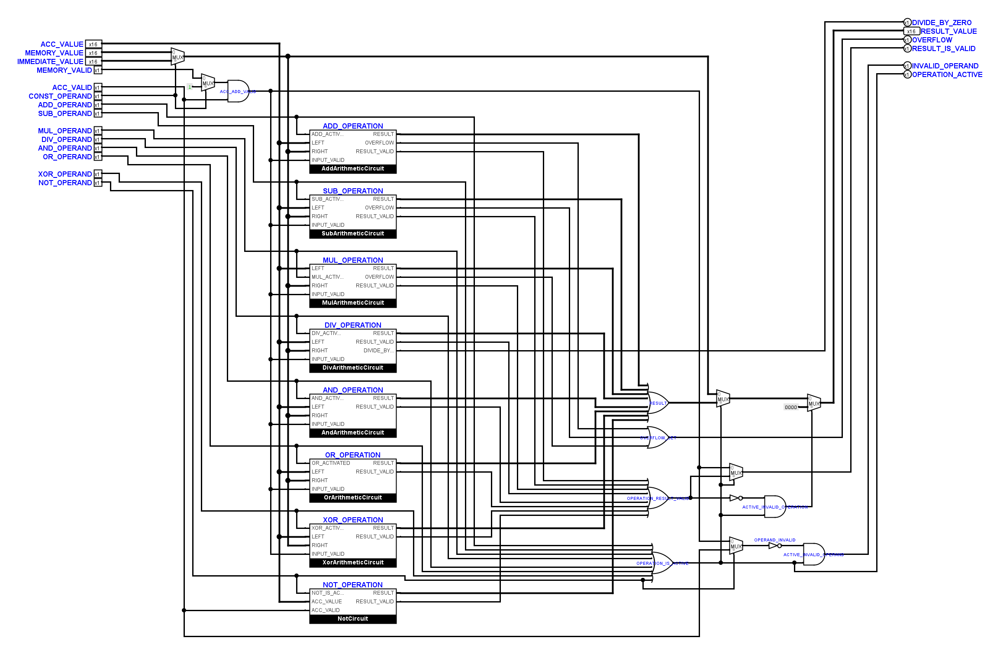
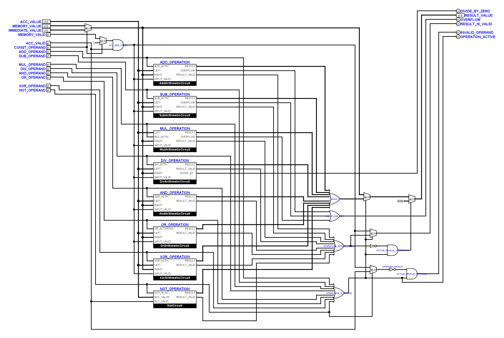
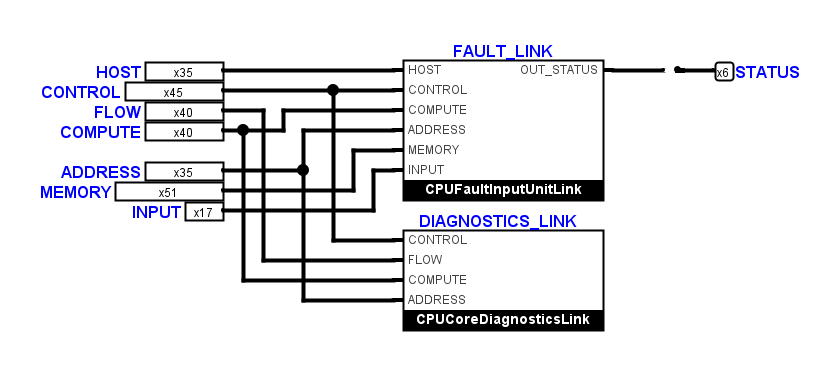

# Leitungskontrolle vom 10. November 2026

Die nach der Symbolumstellung von Hand bearbeiteten Blätter wurden als neue
Eingangsbasis gesichert. Ihre elektrischen Netze stimmen in allen 80
Schaltungsdefinitionen mit dem zuletzt geprüften Stand überein. Die Kontrolle
hat vier Kernblätter und sieben weitere Diagnose-/Peripherieblätter lokal
korrigiert. Logisims Standardformen und die öffentlichen Signalverträge bleiben
erhalten; beide `FetchDecodeControls`-Zeichnungen sind bytegleich zur Eingangsbasis.

## Korrigierte Stellen

| Blatt | Änderung |
| --- | --- |
| `CPUFlowStage` | Linken Leitungsknick vor der unteren FBox von 10 auf 20 Pixel Abstand versetzt. |
| `CPUComputeStageInput` | Rückführung links der FBox um eine Rasterreihe verschoben; benachbarte Spuren behalten 20 Pixel Abstand. |
| `CPUStatusStageInput` | INPUT-Zuleitung und benachbarte Spuren auf mindestens zwei Rasterreihen Abstand zur FBox gebracht. |
| `Operations` | Lange Gültigkeits-/Aktivitätsbündel auf 20 Pixel Spurabstand mit größerer Lücke nach jeweils vier Leitungen aufgefächert. Die dichten nativen ODER-Anschlüsse werden erst lokal angefahren. |
| Diagnose `AddArithmeticCircuit`, `SubArithmeticCircuit` | Oberen XOR-Eingang von links angefahren; Abzweig vor dem Gatter angeordnet. |
| Diagnose `DivArithmeticCircuit` | Zuleitung zum oberen Eingang von `DIVIDE_BY_ZERO_ACTIVE` vor dem Gatter geführt; den bisherigen Umweg über die rechte Ausgangsseite entfernt. |
| Diagnose `NotCircuit` | Aktivitätsabzweig vor den AND-Eingang und unter die Beschriftung gelegt. |
| Diagnose `XorArithmeticCircuit` | Zwei über die XOR-Eingänge hinausstehende, unbenutzte Leitungsstücke entfernt. |
| `OutputMemoryPath` | Oberen Eingang von `OUTPUT_WRITE_GATE` von links angefahren. |
| `InterruptController` | Sechs rückwärts angefahrene Eingänge an AND-Gliedern lokal korrigiert. |

Die drei FBox-Korrekturen verschieben nur Leitungen. In `Operations` erhalten
die rechten Auswertungen 40 Pixel zusätzlichen Platz; zwei ODER-Glieder wurden
lokal versetzt. Die übrigen manuellen Anordnungen bleiben erhalten. Die sieben
zusätzlichen Blätter ändern ausschließlich Leitungen, keine Bauteilparameter.

In den 52 ungeschützten Kernblättern sinkt die gezählte Zahl gewöhnlicher
Leitungskreuzungen von 914 auf 910. Die Gesamtlänge steigt durch die nötigen
Abstände von 337.100 auf 340.050 Rasterpixel. Zwölf lange, nur 10 Pixel
auseinanderliegende Leitungspaare in `Operations` entfallen. Unveränderliche
10-Pixel-Pinreihen an primitiven Bauteilen behalten kurze lokale Auffächerungen.

## Nachweise

- 24 Dateien / 80 Definitionen: positionsunabhängiger Vergleich der tatsächlich
  von Logisim erzeugten, benannten Anschlüsse. Alle Netze, Bitbreiten,
  Splitterbelegungen und primitiven Anschlussgeometrien bleiben identisch.
- 1.220 native FBox-/Gatteranschlüsse außerhalb der geschützten Decoder auf
  ihre Anschlussseite geprüft: keine Rückwärtsanschlüsse verblieben.
- Alle ungeschützten Definitionen auf zusammenhängende parallele Läufe mit
  mehr als 160 Pixel Überlappung geprüft: kein 10-Pixel-Bündel verblieben.
- Native FBox- und Gatterkorridore der ungeschützten Kernblätter geprüft;
  keine Befunde. Native Ansichten der geänderten Blätter und der eingegangenen
  manuellen Anpassungen gesichtet.
- Offline-Verifikation und statische Schaltungsprüfung bestanden.
- 278 Unit-Tests bestanden.
- 63 elektrische CPU-Fälle und vollständiger CPU-Trace bestanden.
- INPUT-Grenze: zehn Kern-/VM-Vergleiche, Reset-Wahrheitstabelle und drei
  erfolgreich zurückgewiesene elektrische Mutationen bestanden.
- Sieben elektrische Systemfälle für Ausgabespeicher, Maskierung,
  Interrupt-Annahme, Rückkehr, Reset und ungültigen Vektor bestanden.
- Native Vorher-/Nachher-Simulation: 71 Definitionen mit 4.544 gleichen,
  eingeschwungenen Stichproben. Dies ist ein Differenzvergleich einschließlich
  vorhandener Fehlerwerte, kein Ersatz für die gesonderten Funktionstests.

Die Layoutreferenz wurde nach Anschlussvergleich und Sichtkontrolle für
26 Zeichnungen nachgeführt: die 18 manuellen Anpassungen sowie die zusätzlich
berührten Blätter, mit Überschneidungen. Sie nimmt weiterhin nur das frühere
Modulo-Raster aus. Der Prüfer kontrolliert lange enge Parallelführungen nun
auch bei exakt eingetragenen Geometrien und fasst dazu an Abzweigen geteilte
gerade Abschnitte zusammen. Zwei Regressionstests sichern dies ab.

Die Kontrolle ist keine neue automatische Gesamtanordnung. Die native
Anschlussseitenprüfung und die Prüfung langer Bündel erfassen alle
ungeschützten Definitionen; die detaillierte Korridorprüfung erfasst die
Kernblätter. Daraus wird keine vollständige visuelle Abnahme jeder vorhandenen
Beschriftung und jeder kurzen primitiven Anschlussstelle abgeleitet.

Prüfkopie, native Ansichten, Netznachweise und Protokolle liegen unter
`artifacts/wire-review-20261109/`; der Durchgang wurde am 9. November begonnen
und am 10. November abgeschlossen. Die Arbeiten wurden nicht automatisch
committet oder gepusht.
